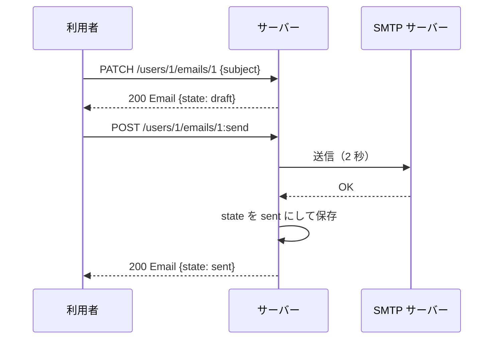

## 本記事の内容
- 『APIデザイン・パターン』(JJ Geewax 著、マイナビ出版) の第 9 章「カスタムメソッド」を、Go で書き直しながら読んだメモです
- パターンを使わない実装と使う実装を同じ手順で動かして、何が変わるかを出力で確かめます
- コードは Go 1.22 以降の `net/http` と標準ライブラリだけで動きます
- シリーズの目次は「[Go]APIデザインパターン 00: 目次と、パターンを使わないとどうなるか」にあります

## 1. 結論
作成・取得・一覧・更新・削除の標準メソッドに収まらない操作は、`POST /users/1/emails/1:send` のように、リソースのパスの後ろにコロンと動詞を付けたカスタムメソッドにします。
メールを送る、状態を draft から sent に進める、といった副作用のある処理はカスタムメソッドの中にだけ置きます。
標準の update メソッドは、保存されているデータを書き換えるだけに戻します。

読んでいて一番残ったのは、update で「できる」ことと update で「やるべき」ことは別だ、という話でした。

## 2. 困る場面
メールを扱う API を考えます。
Email リソースには `state` があり、作った直後は draft、送ると sent になります。

最初に私が思いついたのは、`PATCH /users/1/emails/1` に `{"state":"sent"}` を送ったら、サーバーが SMTP で送信して `state` を sent に変える、という形でした。
これでも動きますが、書籍を読むと問題が 3 つ見えてきます。

- 件名を直す PATCH と、メールを送る PATCH が同じメソッドなので、利用者から見ると「データの更新」と「送信」の区別がつきません
- 送信は SMTP サーバーとの通信を伴うので、同じ PATCH でも数秒かかったり、SMTP 側の都合で失敗したりします
- `state` は本来サーバーが管理する値なのに、利用者が好きな値を書き込めます

4-2 で、この 3 つが実際にどう見えるかを出力で確かめます。

## 3. 足すもの
増えるのは、カスタムメソッド用のルートと、update のリクエストから `state` を外すことです。

カスタムメソッドの URL は `POST /users/{uid}/emails/{id}:send` の形です。
HTTP メソッドはほとんどの場合 POST で、リソースのパスの直後にコロンで動詞をつなぎます。
`/emails/1/send` のようにスラッシュで区切らないのは、`send` という id を持つサブリソースと見分けがつかなくなるからです。
RPC としての名前は `SendEmail` のように動詞 + 名詞にそろえ、`CreateEmailForUser` のような前置詞付きの名前は避けます。

カスタムメソッドが何を対象にするかは、場面で変わります。

| 対象 | URL の例 | 場面 |
|---|---|---|
| 1 つのリソース | `POST /users/1/emails/2:send` | そのリソースだけを変える |
| コレクション | `POST /users/1/emails:export` | 同じコレクションの複数のリソースを扱う |
| 親リソース | `POST /users/1:export` | 親が持つ情報を丸ごと扱う |
| 親をまたぐ | `POST /users/-/emails:archive` | 親の id をハイフンにして、本文で対象を指定する |
| 無し | `POST /emailAddress:validate` | 何も保存しない計算（ステートレス） |

Go の型にするとこうなります。

```go
type Email struct {
	ID      string `json:"id"`
	To      string `json:"to"`
	Subject string `json:"subject"`
	Content string `json:"content"`
	State   string `json:"state"` // ①
}

type UpdateEmailRequest struct { // ②
	Subject *string `json:"subject"`
	Content *string `json:"content"`
}

type ValidateEmailAddressRequest struct {
	Address string `json:"address"`
}

type ValidateEmailAddressResponse struct {
	Valid  bool   `json:"valid"`
	Reason string `json:"reason,omitempty"`
}
```

- ① draft か sent が入ります。レスポンスには出しますが、変えるのはサーバーだけです
- ② update のリクエストには `state` がありません。ポインタにしているのは、「指定しなかった」と「空文字にしたい」を区別するためです

:::message
Go 1.22 の `http.ServeMux` は、`/emails/{id}:send` のようにワイルドカードとコロンを 1 つのセグメントに混ぜたパターンを登録できません。
そこで `POST /users/{uid}/emails/{idAction}` で受けて、ハンドラの中で `strings.Cut` を使って `1` と `send` に分けています。
:::

## 4. 前後比較
### 4-1. 使わない場合
PATCH に全部を押し込んだ形です。
`state` が sent に変わったら、その場で SMTP に送ります。
作成用の `POST /users/{uid}/emails` と `store` は省いています。

```go
type UpdateEmailRequest struct {
	Subject *string `json:"subject"`
	Content *string `json:"content"`
	State   *string `json:"state"` // ①
}

func sendViaSMTP(e Email) {
	time.Sleep(2 * time.Second)
	log.Printf("SMTP: sent %q to %s", e.Subject, e.To)
}

func main() {
	s := &store{emails: map[string]Email{}}
	mux := http.NewServeMux()

	mux.HandleFunc("PATCH /users/{uid}/emails/{id}", func(w http.ResponseWriter, req *http.Request) {
		e, ok := s.get(req.PathValue("id"))
		if !ok {
			http.Error(w, "email not found", http.StatusNotFound)
			return
		}
		var in UpdateEmailRequest
		if err := json.NewDecoder(req.Body).Decode(&in); err != nil {
			http.Error(w, "invalid json: "+err.Error(), http.StatusBadRequest)
			return
		}
		if in.Subject != nil {
			e.Subject = *in.Subject
		}
		if in.Content != nil {
			e.Content = *in.Content
		}
		if in.State != nil {
			e.State = *in.State
			if e.State == "sent" { // ②
				sendViaSMTP(e)
			}
		}
		s.save(e)
		writeJSON(w, http.StatusOK, e)
	})

	log.Fatal(http.ListenAndServe(":8009", mux))
}
```

- ① 利用者が `state` を送れます
- ② 更新の途中で SMTP に送ります。`sendViaSMTP` は 2 秒かかる送信の代わりです

### 4-2. 動かすと件名の修正と送信が同じ PATCH になる
下書きを 1 通作ってから、件名の修正、送信、もう一度送信、知らない状態の順に PATCH を送ります。

```
$ curl -s -i -X POST localhost:8009/users/1/emails \
    -d '{"resource":{"to":"bob@example.com","subject":"hello","content":"hi"}}'
HTTP/1.1 200 OK
Content-Type: application/json

{"id":"1","to":"bob@example.com","subject":"hello","content":"hi","state":"draft"}

$ curl -s -i -w 'time_total: %{time_total}s\n' -X PATCH \
    localhost:8009/users/1/emails/1 -d '{"subject":"hello (fixed)"}'
HTTP/1.1 200 OK
Content-Type: application/json

{"id":"1","to":"bob@example.com","subject":"hello (fixed)","content":"hi","state":"draft"}
time_total: 0.000404s

$ curl -s -i -w 'time_total: %{time_total}s\n' -X PATCH \
    localhost:8009/users/1/emails/1 -d '{"state":"sent"}'
HTTP/1.1 200 OK
Content-Type: application/json

{"id":"1","to":"bob@example.com","subject":"hello (fixed)","content":"hi","state":"sent"}
time_total: 2.003151s

$ curl -s -i -w 'time_total: %{time_total}s\n' -X PATCH \
    localhost:8009/users/1/emails/1 -d '{"state":"sent"}'
HTTP/1.1 200 OK
Content-Type: application/json

{"id":"1","to":"bob@example.com","subject":"hello (fixed)","content":"hi","state":"sent"}
time_total: 2.002085s

$ curl -s -i -X PATCH localhost:8009/users/1/emails/1 -d '{"state":"delivered"}'
HTTP/1.1 200 OK
Content-Type: application/json

{"id":"1","to":"bob@example.com","subject":"hello (fixed)","content":"hi","state":"delivered"}
```

件名を直す PATCH は 0.4 ミリ秒で返り、`state` を sent にする PATCH は 2 秒かかりました。
同じメソッドなのに、送る前には何が起きるのか分かりません。
sent をもう一度送ると SMTP がもう一度動き、同じメールが 2 通届きます。
最後の `delivered` は、サーバーが知らない状態なのにそのまま保存されました。

サーバーのログにも SMTP の行が 2 つあります。

```
2026/10/28 16:12:32 SMTP: sent "hello (fixed)" to bob@example.com
2026/10/28 16:12:34 SMTP: sent "hello (fixed)" to bob@example.com
```

### 4-3. 使う場合（差分）
PATCH から `state` を外し、送信は `:send` に移します。
何も保存しない `:validate` も足してみます。

```diff go
 	mux.HandleFunc("PATCH /users/{uid}/emails/{id}", func(w http.ResponseWriter, req *http.Request) {
 		e, ok := s.get(req.PathValue("id"))
 		if !ok {
 			http.Error(w, "email not found", http.StatusNotFound)
 			return
 		}
+		dec := json.NewDecoder(req.Body)
+		dec.DisallowUnknownFields() // ①
 		var in UpdateEmailRequest
-		if err := json.NewDecoder(req.Body).Decode(&in); err != nil {
+		if err := dec.Decode(&in); err != nil {
 			http.Error(w, "invalid json: "+err.Error(), http.StatusBadRequest)
 			return
 		}
 		if in.Subject != nil {
 			e.Subject = *in.Subject
 		}
 		if in.Content != nil {
 			e.Content = *in.Content
 		}
-		if in.State != nil {
-			e.State = *in.State
-			if e.State == "sent" {
-				sendViaSMTP(e)
-			}
-		}
 		s.save(e)
 		writeJSON(w, http.StatusOK, e)
 	})
+
+	mux.HandleFunc("POST /users/{uid}/emails/{idAction}", func(w http.ResponseWriter, req *http.Request) {
+		id, action := splitCustom(req.PathValue("idAction")) // ②
+		e, ok := s.get(id)
+		if !ok {
+			http.Error(w, "email not found", http.StatusNotFound)
+			return
+		}
+		switch action {
+		case "send": // ③
+			if e.State != "draft" {
+				http.Error(w, "email is not a draft: state="+e.State, http.StatusConflict)
+				return
+			}
+			sendViaSMTP(e)
+			e.State = "sent"
+			s.save(e)
+			writeJSON(w, http.StatusOK, e)
+		default:
+			http.Error(w, "unknown custom method: "+action, http.StatusNotFound)
+		}
+	})
+
+	mux.HandleFunc("POST /emailAddress:validate", func(w http.ResponseWriter, req *http.Request) { // ④
+		var in ValidateEmailAddressRequest
+		if err := json.NewDecoder(req.Body).Decode(&in); err != nil {
+			http.Error(w, "invalid json: "+err.Error(), http.StatusBadRequest)
+			return
+		}
+		if _, err := mail.ParseAddress(in.Address); err != nil {
+			writeJSON(w, http.StatusOK, ValidateEmailAddressResponse{Valid: false, Reason: err.Error()})
+			return
+		}
+		writeJSON(w, http.StatusOK, ValidateEmailAddressResponse{Valid: true})
+	})
```

- ① 知らないフィールドを 400 で断るので、`state` を PATCH で送れなくなります
- ② パスの最後の `1:send` を id と動詞に分けます
- ③ 副作用はここだけです。draft 以外のメールは 409 Conflict で断り、二重送信を防ぎます
- ④ どのリソースにも属さないステートレスなカスタムメソッドです

:::message
`json.Decoder` は、struct に無いフィールドが JSON にあっても既定では黙って捨てます。
`DisallowUnknownFields()` を呼んでおくと、その場合に `json: unknown field "state"` というエラーになります。
:::

全文は畳んでおきます。

:::details after/main.go の全文
```go
package main

import (
	"encoding/json"
	"log"
	"net/http"
	"net/mail"
	"strconv"
	"strings"
	"sync"
	"time"
)

type Email struct {
	ID      string `json:"id"`
	To      string `json:"to"`
	Subject string `json:"subject"`
	Content string `json:"content"`
	State   string `json:"state"`
}

type CreateEmailRequest struct {
	Resource Email `json:"resource"`
}

type UpdateEmailRequest struct {
	Subject *string `json:"subject"`
	Content *string `json:"content"`
}

type ValidateEmailAddressRequest struct {
	Address string `json:"address"`
}

type ValidateEmailAddressResponse struct {
	Valid  bool   `json:"valid"`
	Reason string `json:"reason,omitempty"`
}

type store struct {
	mu     sync.Mutex
	seq    int
	emails map[string]Email
}

func (s *store) create(e Email) Email {
	s.mu.Lock()
	defer s.mu.Unlock()
	s.seq++
	e.ID = strconv.Itoa(s.seq)
	e.State = "draft"
	s.emails[e.ID] = e
	return e
}

func (s *store) get(id string) (Email, bool) {
	s.mu.Lock()
	defer s.mu.Unlock()
	e, ok := s.emails[id]
	return e, ok
}

func (s *store) save(e Email) {
	s.mu.Lock()
	defer s.mu.Unlock()
	s.emails[e.ID] = e
}

func sendViaSMTP(e Email) {
	time.Sleep(2 * time.Second)
	log.Printf("SMTP: sent %q to %s", e.Subject, e.To)
}

func writeJSON(w http.ResponseWriter, status int, v any) {
	w.Header().Set("Content-Type", "application/json")
	w.WriteHeader(status)
	json.NewEncoder(w).Encode(v)
}

func splitCustom(seg string) (id, action string) {
	id, action, _ = strings.Cut(seg, ":")
	return id, action
}

func main() {
	s := &store{emails: map[string]Email{}}
	mux := http.NewServeMux()

	mux.HandleFunc("POST /users/{uid}/emails", func(w http.ResponseWriter, req *http.Request) {
		var in CreateEmailRequest
		if err := json.NewDecoder(req.Body).Decode(&in); err != nil {
			http.Error(w, "invalid json: "+err.Error(), http.StatusBadRequest)
			return
		}
		writeJSON(w, http.StatusOK, s.create(in.Resource))
	})

	mux.HandleFunc("PATCH /users/{uid}/emails/{id}", func(w http.ResponseWriter, req *http.Request) {
		e, ok := s.get(req.PathValue("id"))
		if !ok {
			http.Error(w, "email not found", http.StatusNotFound)
			return
		}
		dec := json.NewDecoder(req.Body)
		dec.DisallowUnknownFields()
		var in UpdateEmailRequest
		if err := dec.Decode(&in); err != nil {
			http.Error(w, "invalid json: "+err.Error(), http.StatusBadRequest)
			return
		}
		if in.Subject != nil {
			e.Subject = *in.Subject
		}
		if in.Content != nil {
			e.Content = *in.Content
		}
		s.save(e)
		writeJSON(w, http.StatusOK, e)
	})

	mux.HandleFunc("POST /users/{uid}/emails/{idAction}", func(w http.ResponseWriter, req *http.Request) {
		id, action := splitCustom(req.PathValue("idAction"))
		e, ok := s.get(id)
		if !ok {
			http.Error(w, "email not found", http.StatusNotFound)
			return
		}
		switch action {
		case "send":
			if e.State != "draft" {
				http.Error(w, "email is not a draft: state="+e.State, http.StatusConflict)
				return
			}
			sendViaSMTP(e)
			e.State = "sent"
			s.save(e)
			writeJSON(w, http.StatusOK, e)
		default:
			http.Error(w, "unknown custom method: "+action, http.StatusNotFound)
		}
	})

	mux.HandleFunc("POST /emailAddress:validate", func(w http.ResponseWriter, req *http.Request) {
		var in ValidateEmailAddressRequest
		if err := json.NewDecoder(req.Body).Decode(&in); err != nil {
			http.Error(w, "invalid json: "+err.Error(), http.StatusBadRequest)
			return
		}
		if _, err := mail.ParseAddress(in.Address); err != nil {
			writeJSON(w, http.StatusOK, ValidateEmailAddressResponse{Valid: false, Reason: err.Error()})
			return
		}
		writeJSON(w, http.StatusOK, ValidateEmailAddressResponse{Valid: true})
	})

	log.Fatal(http.ListenAndServe(":8109", mux))
}
```
:::

### 4-4. 同じ手順で動かすと送信は `:send` でしか起きない
4-2 と同じく下書きを作ってから、件名の修正、`state` の PATCH、`:send` を 2 回、最後に `:validate` を送ります。
下書きを作る出力は 4-2 と同じなので省きます。

```
$ curl -s -i -w 'time_total: %{time_total}s\n' -X PATCH \
    localhost:8109/users/1/emails/1 -d '{"subject":"hello (fixed)"}'
HTTP/1.1 200 OK
Content-Type: application/json

{"id":"1","to":"bob@example.com","subject":"hello (fixed)","content":"hi","state":"draft"}
time_total: 0.000367s

$ curl -s -i -X PATCH localhost:8109/users/1/emails/1 -d '{"state":"sent"}'
HTTP/1.1 400 Bad Request
Content-Type: text/plain; charset=utf-8

invalid json: json: unknown field "state"

$ curl -s -i -w 'time_total: %{time_total}s\n' -X POST \
    localhost:8109/users/1/emails/1:send
HTTP/1.1 200 OK
Content-Type: application/json

{"id":"1","to":"bob@example.com","subject":"hello (fixed)","content":"hi","state":"sent"}
time_total: 2.002178s

$ curl -s -i -X POST localhost:8109/users/1/emails/1:send
HTTP/1.1 409 Conflict
Content-Type: text/plain; charset=utf-8

email is not a draft: state=sent

$ curl -s -i -X POST localhost:8109/emailAddress:validate -d '{"address":"bob"}'
HTTP/1.1 200 OK
Content-Type: application/json

{"valid":false,"reason":"mail: missing '@' or angle-addr"}
```

`state` を PATCH で送ると 400 Bad Request になりました。
送信は `:send` だけが行い、2 回目は 409 Conflict で止まっています。
サーバーのログに残った SMTP の行も 1 つだけです。

```
2026/10/28 16:12:37 SMTP: sent "hello (fixed)" to bob@example.com
```

## 5. 1 リクエストの流れ
`POST /users/1/emails/1:send` がサーバーの中をどう通るかを順に追います。
送る側を利用者、受ける側をサーバーと呼びます。

1. 利用者が `POST /users/1/emails/1:send` を本文無しで送る
2. `http.ServeMux` が `POST /users/{uid}/emails/{idAction}` に当て、`idAction` に `1:send` を入れる
3. ハンドラが `1` と `send` に分け、Email 1 を読む。無ければ 404
4. `state` が draft でなければ 409 Conflict を返す
5. SMTP に送る。ここだけが副作用で、2 秒かかる
6. `state` を sent にして保存し、200 で Email を返す

利用者が受け取るのは `state` が sent になった Email で、サーバーに残るのは `state` の変更と SMTP の送信ログです。
件名を直す PATCH は、Email を読んで保存して返すだけなので、SMTP には触りません。



## 6. 疑問と答え
読みながら引っかかったところです。

**標準の update で状態を変えても動くのに、なぜ分けるのか**
動くことと、利用者が予想できることは別です。
update は「保存されたデータを書き換える」メソッドだと利用者は思っているので、そこで SMTP が動くと、速さも失敗の仕方も予想から外れます。
副作用のある操作を別の名前にしておけば、update は今までどおり軽い操作のままでいられます。

**リソースの方を変えれば標準メソッドだけで済むのでは**
書籍も、EmailDraft と Email の 2 つのリソースに分けて、Email の作成が送信を兼ねる案を挙げています。
ただ、それは標準メソッドを守るためにリソースをねじ曲げる形で、やりすぎだと書かれています。
標準メソッドは目的ではなく道具なので、合わない時はカスタムメソッドを足す方が自然です。

**なぜスラッシュではなくコロンなのか**
`/emails/1/send` はパスとして有効なので、`send` という id のサブリソースと区別がつきません。
コロンなら「ここでリソースが終わり、ここから動詞」と機械的に読めます。

**GET のカスタムメソッドはあるのか**
べき等で安全なら GET にしてもよい、と書籍は書いています。
ただし、読み取り用の値を返したいだけなら、第 12 章のシングルトンサブリソースの方が向いています。

**ステートレスなカスタムメソッドはどこに置くのか**
何も保存しない `:validate` のような操作は、どのリソースにも属さない `POST /emailAddress:validate` の形にできます。
実際には課金や権限の単位になる親（プロジェクトなど）に付けることが多く、翻訳 API なら後からモデルをリソースにして `POST /translationModels/1/text:translate` に移す、という流れが書籍 9.3.3 の例です。

**カスタムメソッドを増やしすぎるとどうなるか**
何でもカスタムメソッドで済ませる API は、リソースの切り方が間違っているサインだと書籍は警告しています。
標準メソッドで済む操作にカスタムメソッドを使っていないか、増やすたびに見直すのがよさそうです。

ここまでを自分の言葉でまとめると、標準メソッドは保存データの読み書きに限定し、送信のように副作用や状態遷移を伴う操作は `リソース:動詞` のカスタムメソッドに出す、です。

## 7. トレードオフ
得られるのは、標準メソッドが予想どおりの軽い操作のまま残り、副作用のある操作が名前で見分けられることです。
引き換えに、カスタムメソッドには標準メソッドのような共通ルールが無いので、URL の形やエラーの返し方を API の中でそろえる決め事を自分で持つ必要があります。

書籍は、リソースの設計が正しければ標準メソッドだけでも同じことができる、という立場です。
新しいカスタムメソッドを足したくなった時は、リソースの切り方の間違いをごまかしていないかを先に疑う、という進め方を勧めています。

## 8. 参考
- 『APIデザイン・パターン』JJ Geewax 著、マイナビ出版、第 9 章
- https://google.aip.dev/136
- AWS EC2 では、インスタンスの起動は属性を書き換える操作ではなく、`StartInstances` / `StopInstances` という別のアクションです。状態の遷移を update から切り離す考え方は同じです: https://docs.aws.amazon.com/AWSEC2/latest/APIReference/API_StartInstances.html
