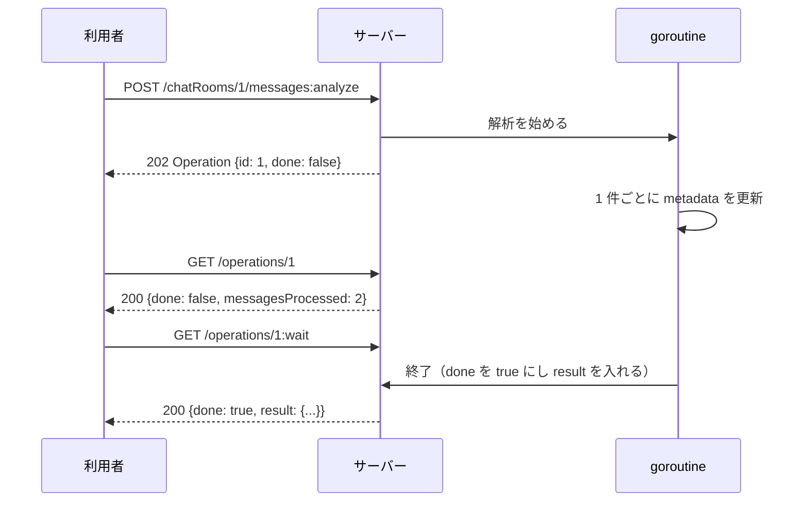

## 本記事の内容
- 『APIデザイン・パターン』(JJ Geewax 著、マイナビ出版) の第 10 章「ロングランオペレーション」を、Go で書き直しながら読んだメモです
- パターンを使わない実装と使う実装を同じ手順で動かして、何が変わるかを出力で確かめます
- コードは Go 1.22 以降の `net/http` と標準ライブラリだけで動きます
- シリーズの目次は「[Go]APIデザインパターン 00: 目次と、パターンを使わないとどうなるか」にあります

## 1. 結論
時間のかかる処理は、終わるまで接続を握ったまま待たせるのではなく、`Operation` リソースをすぐに返します。
`Operation` には `id`、終わったかどうかの `done`、終わった後に入る `result`、進捗を入れる `metadata` があります。
利用者は `GET /operations/{id}` で状態を見るか、`GET /operations/{id}:wait` で完了まで待ち、要らなくなったら `POST /operations/{id}:cancel` で止めます。

このパターンを書籍はロングランオペレーション（LRO）と呼んでいて、以降の章でも何度も出てきます。

## 2. 困る場面
チャットルームのメッセージを解析する `POST /chatRooms/1/messages:analyze` を考えます。
メッセージが増えるほど時間がかかり、数秒から数分になります。

同期のまま作ると、利用者は結果が返るまで待つしかありません。
読んでいて身に覚えがあったのは、「レスポンスが来ないのでコードがおかしいと思って止めて、print 文を足してもう一度実行する」という書籍のくだりです。
困ることを並べるとこうなります。

- どれだけ待てば十分なのか、利用者には分かりません
- 途中でどこまで進んだのかを知る手段がありません
- 接続が切れると結果を受け取れず、サーバー側の処理は続いているのに同じ処理をもう一度頼むことになります
- 要らなくなった処理をサーバーに止めてもらう方法がありません

4-2 で、タイムアウトした後もサーバーが最後まで働き続けるところを見ます。

## 3. 足すもの
増えるのは `Operation` リソースと、それを扱うメソッドです。

| フィールド | 型 | 意味 |
|---|---|---|
| `id` | string | Operation の識別子 |
| `done` | bool | 終わったかどうか。成功したかどうかではない |
| `result` | 結果の型 か `OperationError` | `done` が true になってから入る |
| `metadata` | 処理ごとの型 | 進捗など、処理そのものについての情報 |
| `expireTime` | 時刻 | この時刻を過ぎると Operation が消える |

| メソッド | HTTP | 役割 |
|---|---|---|
| AnalyzeMessages | `POST /chatRooms/{id}/messages:analyze` | すぐに Operation を返す（202 Accepted） |
| GetOperation | `GET /operations/{id}` | 今の状態を見る |
| ListOperations | `GET /operations?filter=done=false` | id を失った時に探す |
| WaitOperation | `GET /operations/{id}:wait` | `done` になるまでレスポンスを返さない |
| CancelOperation | `POST /operations/{id}:cancel` | 止める。止まってから返す |
| PauseOperation / ResumeOperation | `POST /operations/{id}:pause` / `:resume` | `metadata.paused` を切り替える |

どの処理の Operation も、親の下ではなく `/operations` の下にまとめて置きます。

Go の型にするとこうなります。

```go
type OperationError struct {
	Code    string `json:"code"`
	Message string `json:"message"`
	Details any    `json:"details,omitempty"`
}

type Operation struct {
	ID         string                  `json:"id"`
	Done       bool                    `json:"done"`
	ExpireTime *time.Time              `json:"expireTime,omitempty"`
	Result     any                     `json:"result,omitempty"` // ①
	Metadata   AnalyzeMessagesMetadata `json:"metadata"`       // ②
}

type AnalyzeMessagesMetadata struct {
	ChatRoom          string `json:"chatRoom"`
	Paused            bool   `json:"paused"`
	MessagesProcessed int    `json:"messagesProcessed"`
	MessagesCounted   int    `json:"messagesCounted"`
}
```

- ① 書籍の `result?: ResultT | OperationError` に当たります。Go には「どちらかの型」が無いので `any` にして、`MessageAnalysis` か `OperationError` のどちらかを入れます
- ② 書籍では `Operation<ResultT, MetadataT>` と型引数になっています。この記事では解析専用に決め打ちしています

:::message
`ExpireTime` と `Result` に `omitempty` を付けているのは、`done` が false の間はこの 2 つを JSON に出さないためです。
ポインタや `any` が nil なら、そのフィールドは省略されます。
:::

## 4. 前後比較
### 4-1. 使わない場合
処理が終わってからレスポンスを返す形です。
1 メッセージの処理に 500 ミリ秒かかることにしています。

```go
func analyze(id string, msgs []message) MessageAnalysis {
	users := map[string]int{}
	grades := map[string]float64{}
	for i, m := range msgs {
		time.Sleep(500 * time.Millisecond) // ①
		users[m.user]++
		grades[m.user] += float64(len([]rune(m.text))) / 10
		log.Printf("chatRooms/%s: processed %d/%d", id, i+1, len(msgs))
	}
	for u := range grades {
		grades[u] /= float64(users[u])
	}
	return MessageAnalysis{
		ChatRoom:         "chatRooms/" + id,
		MessageCount:     len(msgs),
		ParticipantCount: len(users),
		UserGradeLevels:  grades,
	}
}

func main() {
	mux := http.NewServeMux()

	mux.HandleFunc("POST /chatRooms/{id}/messages:analyze", func(w http.ResponseWriter, req *http.Request) {
		id := req.PathValue("id")
		msgs, ok := rooms[id]
		if !ok {
			http.Error(w, "chat room not found", http.StatusNotFound)
			return
		}
		log.Printf("chatRooms/%s: analyze start", id)
		result := analyze(id, msgs) // ②
		log.Printf("chatRooms/%s: analyze done", id)
		writeJSON(w, http.StatusOK, result)
	})

	log.Fatal(http.ListenAndServe(":8010", mux))
}
```

- ① 時間のかかる処理の代わりです
- ② ここで 3 秒止まります。その間、利用者には何も返りません

### 4-2. 動かすとタイムアウトしてもサーバーは最後まで働く
利用者は 1 秒で諦めることにして、`--max-time 1` を付けて送ります。

```
$ curl -sS -i --max-time 1 -X POST localhost:8010/chatRooms/1/messages:analyze
curl: (28) Operation timed out after 1002 milliseconds with 0 bytes received
```

サーバーのログを見ると、利用者がいなくなった後も 6 件を最後まで処理しています。

```
2026/10/28 16:13:09 chatRooms/1: analyze start
2026/10/28 16:13:09 chatRooms/1: processed 1/6
2026/10/28 16:13:10 chatRooms/1: processed 2/6
2026/10/28 16:13:10 chatRooms/1: processed 3/6
2026/10/28 16:13:11 chatRooms/1: processed 4/6
2026/10/28 16:13:11 chatRooms/1: processed 5/6
2026/10/28 16:13:12 chatRooms/1: processed 6/6
2026/10/28 16:13:12 chatRooms/1: analyze done
```

この結果を利用者が受け取る方法はありません。
もう一度頼むと、同じ 3 秒をもう一度待つことになります。

```
$ curl -s -i -w 'time_total: %{time_total}s\n' -X POST \
    localhost:8010/chatRooms/1/messages:analyze
HTTP/1.1 200 OK
Content-Type: application/json

{"chatRoom":"chatRooms/1","messageCount":6,"participantCount":3,"userGradeLevels":{"alice":1.05,"bob":1.5,"carol":1.45}}
time_total: 3.007259s
```

待っている 3 秒の間、進み具合を知る手段も、止める手段もありません。

### 4-3. 使う場合（差分）
解析は goroutine に移し、ハンドラは Operation を作ってすぐ返します。
`analyze` の差分はこうなります。

```diff go
-func analyze(id string, msgs []message) MessageAnalysis {
+func analyze(ctx context.Context, ops *opStore, id, chatRoom string, msgs []message) {
 	users := map[string]int{}
 	grades := map[string]float64{}
 	for i, m := range msgs {
-		time.Sleep(500 * time.Millisecond)
+		for {
+			select {
+			case <-ctx.Done(): // ①
+				ops.finish(id, OperationError{Code: "CANCELLED", Message: "cancelled by the caller"})
+				return
+			case <-time.After(500 * time.Millisecond):
+			}
+			if o, _ := ops.snapshot(id); !o.Metadata.Paused { // ②
+				break
+			}
+		}
 		users[m.user]++
 		grades[m.user] += float64(len([]rune(m.text))) / 10
-		log.Printf("chatRooms/%s: processed %d/%d", id, i+1, len(msgs))
+		ops.update(id, func(o *Operation) { o.Metadata.MessagesProcessed = i + 1 }) // ③
 	}
 	for u := range grades {
 		grades[u] /= float64(users[u])
 	}
-	return MessageAnalysis{
-		ChatRoom:         "chatRooms/" + id,
+	ops.finish(id, MessageAnalysis{ // ④
+		ChatRoom:         "chatRooms/" + chatRoom,
 		MessageCount:     len(msgs),
 		ParticipantCount: len(users),
 		UserGradeLevels:  grades,
-	}
+	})
 }
```

- ① cancel されたら `result` に `OperationError` を入れて抜けます
- ② `paused` の間は次のメッセージに進みません
- ③ 1 件ごとに進捗を `metadata` に書きます
- ④ 終わったら `done` を true にし、`result` と `expireTime` を入れます

ハンドラ側は、解析を始めるルートが 202 を返すように変わり、Operation を扱うルートが 2 本増えます。

```diff go
 	mux.HandleFunc("POST /chatRooms/{id}/messages:analyze", func(w http.ResponseWriter, req *http.Request) {
-		id := req.PathValue("id")
-		msgs, ok := rooms[id]
+		room := req.PathValue("id")
+		msgs, ok := rooms[room]
 		if !ok {
 			http.Error(w, "chat room not found", http.StatusNotFound)
 			return
 		}
-		log.Printf("chatRooms/%s: analyze start", id)
-		result := analyze(id, msgs)
-		log.Printf("chatRooms/%s: analyze done", id)
-		writeJSON(w, http.StatusOK, result)
+		id, ctx := ops.create("chatRooms/"+room, len(msgs))
+		go analyze(ctx, ops, id, room, msgs) // ⑤
+		snap, _ := ops.snapshot(id)
+		writeJSON(w, http.StatusAccepted, snap)
 	})
+
+	mux.HandleFunc("GET /operations/{idAction}", func(w http.ResponseWriter, req *http.Request) {
+		id, action := splitCustom(req.PathValue("idAction"))
+		op, ok := ops.get(id)
+		if !ok {
+			http.Error(w, "operation not found", http.StatusNotFound)
+			return
+		}
+		switch action {
+		case "":
+		case "wait": // ⑥
+			select {
+			case <-op.done:
+			case <-req.Context().Done():
+				return
+			}
+		default:
+			http.Error(w, "unknown custom method: "+action, http.StatusNotFound)
+			return
+		}
+		snap, _ := ops.snapshot(id)
+		writeJSON(w, http.StatusOK, snap)
+	})
+
+	mux.HandleFunc("POST /operations/{idAction}", func(w http.ResponseWriter, req *http.Request) {
+		id, action := splitCustom(req.PathValue("idAction"))
+		op, ok := ops.get(id)
+		if !ok {
+			http.Error(w, "operation not found", http.StatusNotFound)
+			return
+		}
+		switch action {
+		case "cancel": // ⑦
+			op.cancel()
+			<-op.done
+		case "pause":
+			ops.update(id, func(o *Operation) { o.Metadata.Paused = true })
+		case "resume":
+			ops.update(id, func(o *Operation) { o.Metadata.Paused = false })
+		default:
+			http.Error(w, "unknown custom method: "+action, http.StatusNotFound)
+			return
+		}
+		snap, _ := ops.snapshot(id)
+		writeJSON(w, http.StatusOK, snap)
+	})
```

- ⑤ 解析は goroutine で続け、ハンドラは待たずに 202 Accepted を返します
- ⑥ `:wait` は Operation の `done` チャネルが閉じるまでレスポンスを返しません
- ⑦ `cancel()` を呼んだ後、goroutine が本当に止まるまで待ってから返します

:::message
`context.WithCancel` で作った `ctx` を goroutine に渡しておくと、`cancel()` を呼んだ時に `ctx.Done()` のチャネルが閉じます。
goroutine 側は `select` でそれを見て抜けるので、外から処理を止められます。
:::

:::message
`close(op.done)` で閉じたチャネルは、受信するとすぐに返ります。
`:wait` はこれを待っていて、`req.Context().Done()` も一緒に待つのは、利用者が接続を切った時にハンドラを抜けるためです。
:::

Operation の保存場所（`opStore`）と一覧を含めた全文は畳んでおきます。

:::details after/main.go の全文
```go
package main

import (
	"context"
	"encoding/json"
	"log"
	"net/http"
	"strconv"
	"strings"
	"sync"
	"time"
)

type MessageAnalysis struct {
	ChatRoom         string             `json:"chatRoom"`
	MessageCount     int                `json:"messageCount"`
	ParticipantCount int                `json:"participantCount"`
	UserGradeLevels  map[string]float64 `json:"userGradeLevels"`
}

type AnalyzeMessagesMetadata struct {
	ChatRoom          string `json:"chatRoom"`
	Paused            bool   `json:"paused"`
	MessagesProcessed int    `json:"messagesProcessed"`
	MessagesCounted   int    `json:"messagesCounted"`
}

type OperationError struct {
	Code    string `json:"code"`
	Message string `json:"message"`
	Details any    `json:"details,omitempty"`
}

type Operation struct {
	ID         string                  `json:"id"`
	Done       bool                    `json:"done"`
	ExpireTime *time.Time              `json:"expireTime,omitempty"`
	Result     any                     `json:"result,omitempty"`
	Metadata   AnalyzeMessagesMetadata `json:"metadata"`
}

type ListOperationsResponse struct {
	Results []Operation `json:"results"`
}

type message struct{ user, text string }

var rooms = map[string][]message{
	"1": {
		{"alice", "今日の進捗を共有します"},
		{"bob", "了解です。レビューは午後に見ます"},
		{"alice", "ありがとうございます"},
		{"carol", "リリース手順書を更新しました"},
		{"bob", "確認しました。問題ありません"},
		{"carol", "では 15 時にデプロイします"},
	},
	"2": {
		{"dave", "障害対応の振り返りをします"},
		{"erin", "タイムラインをまとめました"},
		{"dave", "再発防止策を 3 つ挙げます"},
		{"frank", "監視の閾値を見直しましょう"},
		{"erin", "次回のオンコール担当を決めます"},
		{"frank", "以上です"},
	},
}

type operation struct {
	res    Operation
	cancel context.CancelFunc
	done   chan struct{}
}

type opStore struct {
	mu  sync.Mutex
	seq int
	ops map[string]*operation
}

func (s *opStore) create(chatRoom string, counted int) (string, context.Context) {
	s.mu.Lock()
	defer s.mu.Unlock()
	s.seq++
	ctx, cancel := context.WithCancel(context.Background())
	id := strconv.Itoa(s.seq)
	s.ops[id] = &operation{
		res:    Operation{ID: id, Metadata: AnalyzeMessagesMetadata{ChatRoom: chatRoom, MessagesCounted: counted}},
		cancel: cancel,
		done:   make(chan struct{}),
	}
	return id, ctx
}

func (s *opStore) get(id string) (*operation, bool) {
	s.mu.Lock()
	defer s.mu.Unlock()
	op, ok := s.ops[id]
	return op, ok
}

func (s *opStore) snapshot(id string) (Operation, bool) {
	s.mu.Lock()
	defer s.mu.Unlock()
	op, ok := s.ops[id]
	if !ok {
		return Operation{}, false
	}
	return op.res, true
}

func (s *opStore) update(id string, fn func(*Operation)) {
	s.mu.Lock()
	defer s.mu.Unlock()
	if op, ok := s.ops[id]; ok {
		fn(&op.res)
	}
}

func (s *opStore) finish(id string, result any) {
	s.mu.Lock()
	defer s.mu.Unlock()
	op, ok := s.ops[id]
	if !ok || op.res.Done {
		return
	}
	expire := time.Now().Add(30 * 24 * time.Hour)
	op.res.Done = true
	op.res.ExpireTime = &expire
	op.res.Result = result
	close(op.done)
}

func (s *opStore) list(done *bool) []Operation {
	s.mu.Lock()
	defer s.mu.Unlock()
	out := []Operation{}
	for i := 1; i <= s.seq; i++ {
		op := s.ops[strconv.Itoa(i)]
		if done == nil || op.res.Done == *done {
			out = append(out, op.res)
		}
	}
	return out
}

func analyze(ctx context.Context, ops *opStore, id, chatRoom string, msgs []message) {
	users := map[string]int{}
	grades := map[string]float64{}
	for i, m := range msgs {
		for {
			select {
			case <-ctx.Done():
				ops.finish(id, OperationError{Code: "CANCELLED", Message: "cancelled by the caller"})
				return
			case <-time.After(500 * time.Millisecond):
			}
			if o, _ := ops.snapshot(id); !o.Metadata.Paused {
				break
			}
		}
		users[m.user]++
		grades[m.user] += float64(len([]rune(m.text))) / 10
		ops.update(id, func(o *Operation) { o.Metadata.MessagesProcessed = i + 1 })
	}
	for u := range grades {
		grades[u] /= float64(users[u])
	}
	ops.finish(id, MessageAnalysis{
		ChatRoom:         "chatRooms/" + chatRoom,
		MessageCount:     len(msgs),
		ParticipantCount: len(users),
		UserGradeLevels:  grades,
	})
}

func writeJSON(w http.ResponseWriter, status int, v any) {
	w.Header().Set("Content-Type", "application/json")
	w.WriteHeader(status)
	json.NewEncoder(w).Encode(v)
}

func splitCustom(seg string) (id, action string) {
	id, action, _ = strings.Cut(seg, ":")
	return id, action
}

func main() {
	ops := &opStore{ops: map[string]*operation{}}
	mux := http.NewServeMux()

	mux.HandleFunc("POST /chatRooms/{id}/messages:analyze", func(w http.ResponseWriter, req *http.Request) {
		room := req.PathValue("id")
		msgs, ok := rooms[room]
		if !ok {
			http.Error(w, "chat room not found", http.StatusNotFound)
			return
		}
		id, ctx := ops.create("chatRooms/"+room, len(msgs))
		go analyze(ctx, ops, id, room, msgs)
		snap, _ := ops.snapshot(id)
		writeJSON(w, http.StatusAccepted, snap)
	})

	mux.HandleFunc("GET /operations", func(w http.ResponseWriter, req *http.Request) {
		var done *bool
		if f := req.URL.Query().Get("filter"); strings.HasPrefix(f, "done=") {
			b := strings.TrimPrefix(f, "done=") == "true"
			done = &b
		}
		writeJSON(w, http.StatusOK, ListOperationsResponse{Results: ops.list(done)})
	})

	mux.HandleFunc("GET /operations/{idAction}", func(w http.ResponseWriter, req *http.Request) {
		id, action := splitCustom(req.PathValue("idAction"))
		op, ok := ops.get(id)
		if !ok {
			http.Error(w, "operation not found", http.StatusNotFound)
			return
		}
		switch action {
		case "":
		case "wait":
			select {
			case <-op.done:
			case <-req.Context().Done():
				return
			}
		default:
			http.Error(w, "unknown custom method: "+action, http.StatusNotFound)
			return
		}
		snap, _ := ops.snapshot(id)
		writeJSON(w, http.StatusOK, snap)
	})

	mux.HandleFunc("POST /operations/{idAction}", func(w http.ResponseWriter, req *http.Request) {
		id, action := splitCustom(req.PathValue("idAction"))
		op, ok := ops.get(id)
		if !ok {
			http.Error(w, "operation not found", http.StatusNotFound)
			return
		}
		switch action {
		case "cancel":
			op.cancel()
			<-op.done
		case "pause":
			ops.update(id, func(o *Operation) { o.Metadata.Paused = true })
		case "resume":
			ops.update(id, func(o *Operation) { o.Metadata.Paused = false })
		default:
			http.Error(w, "unknown custom method: "+action, http.StatusNotFound)
			return
		}
		snap, _ := ops.snapshot(id)
		writeJSON(w, http.StatusOK, snap)
	})

	log.Fatal(http.ListenAndServe(":8110", mux))
}
```
:::

### 4-4. 同じ手順で動かすと 202 がすぐ返り、進捗と結果を後から取れる
解析を頼むと、処理が始まったばかりの Operation が返ります。
1.2 秒後に見ると 2 件まで進んでいて、`:wait` で待つと結果が入った Operation が返りました。

```
$ curl -s -i -X POST localhost:8110/chatRooms/1/messages:analyze
HTTP/1.1 202 Accepted
Content-Type: application/json

{"id":"1","done":false,"metadata":{"chatRoom":"chatRooms/1","paused":false,"messagesProcessed":0,"messagesCounted":6}}

$ sleep 1.2
$ curl -s localhost:8110/operations/1
{"id":"1","done":false,"metadata":{"chatRoom":"chatRooms/1","paused":false,"messagesProcessed":2,"messagesCounted":6}}

$ curl -s -w 'time_total: %{time_total}s\n' localhost:8110/operations/1:wait
{"id":"1","done":true,"expireTime":"2026-11-27T16:18:31.395308+09:00","result":{"chatRoom":"chatRooms/1","messageCount":6,"participantCount":3,"userGradeLevels":{"alice":1.05,"bob":1.5,"carol":1.45}},"metadata":{"chatRoom":"chatRooms/1","paused":false,"messagesProcessed":6,"messagesCounted":6}}
time_total: 1.761931s
```

途中で止めると、`done` は true になり、`result` には結果ではなく `OperationError` が入ります。
止めた後は、動いている Operation を探しても見つかりません。

```
$ curl -s -X POST localhost:8110/chatRooms/2/messages:analyze
{"id":"2","done":false,"metadata":{"chatRoom":"chatRooms/2","paused":false,"messagesProcessed":0,"messagesCounted":6}}

$ sleep 0.7
$ curl -s -i -X POST localhost:8110/operations/2:cancel
HTTP/1.1 200 OK
Content-Type: application/json

{"id":"2","done":true,"expireTime":"2026-11-27T16:18:32.153269+09:00","result":{"code":"CANCELLED","message":"cancelled by the caller"},"metadata":{"chatRoom":"chatRooms/2","paused":false,"messagesProcessed":1,"messagesCounted":6}}

$ curl -s 'localhost:8110/operations?filter=done=false'
{"results":[]}
```

一時停止すると `messagesProcessed` が進まなくなり、再開すると最後まで進みます。

```
$ curl -s -X POST localhost:8110/chatRooms/2/messages:analyze
{"id":"3","done":false,"metadata":{"chatRoom":"chatRooms/2","paused":false,"messagesProcessed":0,"messagesCounted":6}}

$ sleep 0.7
$ curl -s -X POST localhost:8110/operations/3:pause
{"id":"3","done":false,"metadata":{"chatRoom":"chatRooms/2","paused":true,"messagesProcessed":1,"messagesCounted":6}}

$ sleep 1.5
$ curl -s localhost:8110/operations/3
{"id":"3","done":false,"metadata":{"chatRoom":"chatRooms/2","paused":true,"messagesProcessed":1,"messagesCounted":6}}

$ curl -s -X POST localhost:8110/operations/3:resume
{"id":"3","done":false,"metadata":{"chatRoom":"chatRooms/2","paused":false,"messagesProcessed":1,"messagesCounted":6}}

$ curl -s localhost:8110/operations/3:wait
{"id":"3","done":true,"expireTime":"2026-11-27T16:18:36.689242+09:00","result":{"chatRoom":"chatRooms/2","messageCount":6,"participantCount":3,"userGradeLevels":{"dave":1.35,"erin":1.4,"frank":0.8500000000000001}},"metadata":{"chatRoom":"chatRooms/2","paused":false,"messagesProcessed":6,"messagesCounted":6}}
```

## 5. 1 リクエストの流れ
`POST /chatRooms/1/messages:analyze` から結果を受け取るまでを順に追います。
送る側を利用者、受ける側をサーバーと呼びます。

1. 利用者が `POST /chatRooms/1/messages:analyze` を送る
2. サーバーは Operation 1 を `done: false` で作り、解析を goroutine で始め、202 Accepted で Operation を返す
3. goroutine は 500 ミリ秒ごとに 1 件処理し、`metadata.messagesProcessed` を書く。毎回 `ctx.Done()` と `paused` を確かめる
4. 利用者は `GET /operations/1` で進捗を見るか、`GET /operations/1:wait` で待つ
5. 6 件終わると `done: true`、`result` に `MessageAnalysis`、`expireTime` に 30 日後が入り、`done` チャネルが閉じる
6. `:wait` で待っていたリクエストはここで返る。その後の `GET` も同じ内容を返す
7. 途中で `:cancel` が来た時は、`cancel()` で `ctx` を閉じ、goroutine が `result` に `OperationError` を入れて止まるのを待ってから返す



## 6. 疑問と答え
読みながら引っかかったところです。

**`done` が true なら成功なのか**
いいえ。
`done` は終わったかどうかだけで、成功したかどうかは `result` が結果なのか `OperationError` なのかで判断します。
書籍が `complete` ではなく `done` という名前を選んだ理由もここにあります。

**処理が失敗したのに、なぜ GET は 200 を返すのか**
`GET /operations/1` という取得自体は成功しているからです。
処理の失敗を HTTP のエラーで返すと、「Operation を取るのに失敗した」のか「処理が失敗した」のかを利用者が区別できなくなります。
失敗は `result` の中の `OperationError` に入れ、`code` は機械が読める一意な値にして、利用者にエラーメッセージの文面で分岐させないようにします。

**Operation は `chatRooms/1/operations/2` のように親の下に置かないのか**
書籍はトップレベルの `/operations` を勧めています。
音声の文字起こしのように、特定のリソースを対象にしない処理もあるからです。
親ごとに分かれていると、「今動いている Operation はどれか」を横断して探すこともできません。

**`:wait` は GetOperation にフラグを足すだけでよいのでは**
1 つの bool でメソッドの意味（すぐ返るか、待つか）が変わるのはよくない、と書籍 10.3.3 は書いています。
別のメソッドにしておけば、応答時間の目標も別に持てます。
待っているから遅いのか、インフラの問題で Get が遅いのかを区別できるからです。

**ポーリングと `:wait` はどちらを使うべきか**
ポーリングは利用者が頻度を決められ、要らなくなったら見るのをやめられます。
`:wait` は利用者のコードが同期的に書けて簡単ですが、接続が切れたらポーリングに戻るしかありません。
モバイルのように接続が不安定な場所ではポーリング、サーバー間なら `:wait`、という使い分けになりそうです。

**進捗は完了率でよいのか**
完了率でなくてもよく、処理した件数や残り時間の見積もりでも構いません。
この記事では `messagesProcessed` と `messagesCounted` の 2 つにしました。
完了率は逆行することがあり、正確な分母が分からない処理もあるからです。

**Operation はいつまで残すのか**
書籍は、負荷が問題にならない限り永久に残すことを勧めています。
残せない場合は、完了時刻を基準に 30 日のような一定期間で消し、消える時刻を `expireTime` で見せます。
処理の種類によって期限を変えると利用者が予測できなくなるので、全部同じ期限にします。

ここまでを自分の言葉でまとめると、時間のかかる処理は「結果」ではなく「結果が入る予定の Operation」を返し、利用者は id で状態を見る・待つ・止める、です。

## 7. トレードオフ
得られるのは、処理時間に関係なく API の応答が一定になること、進捗が見えること、途中で止められること、処理を頼んだプロセスが落ちても id さえあれば結果を取り戻せることです。
引き換えに、利用者は「リソースではなく Operation が返る」という考え方を覚え、結果を取り出すための 2 手目が必要になります。
サーバー側も Operation の保存と期限切れの管理を持つことになります。

書籍は、単純にリクエストに時間をかける方法や、接続を開いたまま進捗を流す方法も挙げた上で、接続が切れた後に再開できるようにしようとすると結局 LRO と同じものを作ることになる、と書いています。
利用者が同期版を求めるなら、LRO を返すメソッドとは別に同期版を提供してもよい、とも書かれています。

## 8. 参考
- 『APIデザイン・パターン』JJ Geewax 著、マイナビ出版、第 10 章
- https://google.aip.dev/151
- AWS CloudFormation の `CreateStack` は、呼び出しが成功した時点でスタックの作成が始まり、`StackId` を返します。進み具合は `DescribeStacks` の `StackStatus`（`CREATE_COMPLETE` など）で見ます。Operation を別のリソースにせず、Stack 自体が状態を持つ点が本記事と違います: https://docs.aws.amazon.com/AWSCloudFormation/latest/APIReference/API_CreateStack.html / https://docs.aws.amazon.com/AWSCloudFormation/latest/APIReference/API_DescribeStacks.html
