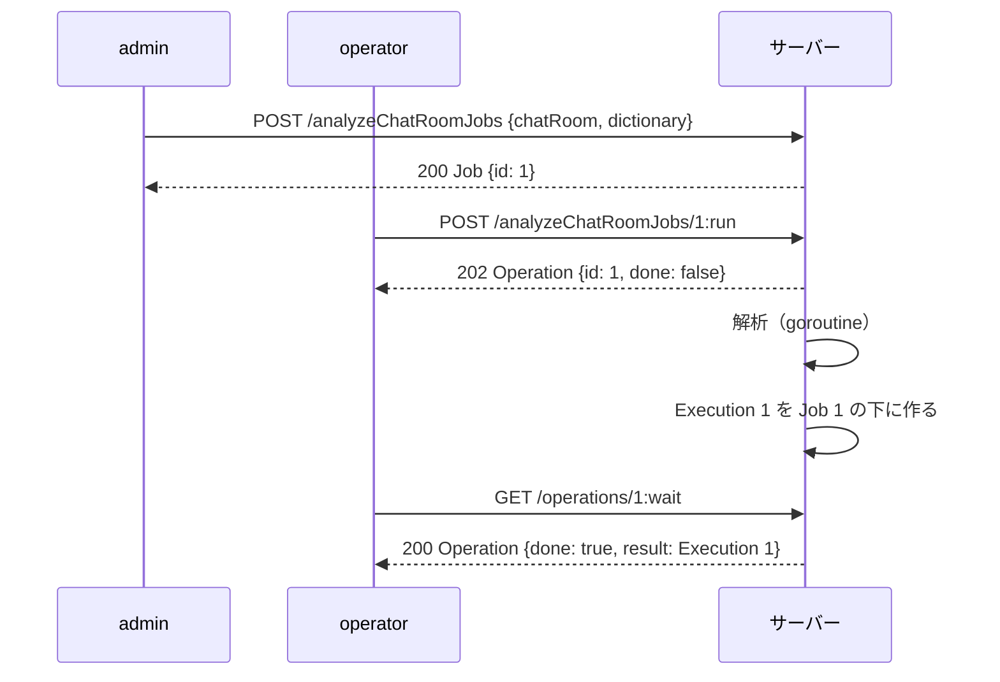

## 本記事の内容
- 『APIデザイン・パターン』(JJ Geewax 著、マイナビ出版) の第 11 章「再実行可能ジョブ」を、Go で書き直しながら読んだメモです
- パターンを使わない実装と使う実装を同じ手順で動かして、何が変わるかを出力で確かめます
- コードは Go 1.22 以降の `net/http` と標準ライブラリだけで動きます
- 第 10 章のロングランオペレーション（LRO）を前提にしています
- シリーズの目次は「[Go]APIデザインパターン 00: 目次と、パターンを使わないとどうなるか」にあります

## 1. 結論
時間のかかる処理を、毎回パラメータ付きで起動するカスタムメソッドにする代わりに、設定だけを持つ `Job` リソースを先に作っておき、`POST /analyzeChatRoomJobs/1:run` で実行します。
`run` はパラメータを受け取らず、第 10 章の `Operation` を返します。
結果が既存のリソースの変更にも外部への書き出しにもならない処理では、1 回ごとの結果を `Execution` リソースとして Job の下に残します。

## 2. 困る場面
第 10 章で作った `POST /chatRooms/1/messages:analyze` を、そのまま使い続けた場合を考えます。
解析には「どの辞書で乱暴な言葉を数えるか」という設定があり、呼び出すたびに利用者が渡します。

書籍が挙げる困りごとは 3 つです。

- 設定を毎回利用者が渡すので、正しい設定が API のどこにも保存されません。誰かの手元のスクリプトにしか無い状態になります
- 「設定を決めてよい人」と「実行してよい人」を分けられません。実行できる人は設定も自由に変えられます
- 定期実行したければ、cron のような外部の仕組みが設定ごと持つことになります

もう 1 つ、解析の結果が LRO の `result` にしか残らない、という問題もあります。
第 10 章で決めたとおり `Operation` には期限があるので、結果も一緒に消えます。

## 3. 足すもの
増えるのは、設定を持つ `Job` リソース、それを動かす `run` カスタムメソッド、結果を残す `Execution` リソースの 3 つです。

| メソッド | HTTP | 役割 |
|---|---|---|
| CreateAnalyzeChatRoomJob | `POST /analyzeChatRoomJobs` | 設定を保存する（admin だけ） |
| GetAnalyzeChatRoomJob / List | `GET /analyzeChatRoomJobs/{id}` / `GET /analyzeChatRoomJobs` | 設定を見る |
| RunAnalyzeChatRoomJob | `POST /analyzeChatRoomJobs/{id}:run` | 実行する。本文は空（operator でもよい） |
| ListExecutions / GetExecution | `GET /analyzeChatRoomJobs/{id}/executions` / `.../executions/{eid}` | 結果を見る |
| GetOperation / WaitOperation | `GET /operations/{id}` / `GET /operations/{id}:wait` | 第 10 章のまま |

Job の update は、実行中に設定が変わる事故を避けるために省いて「削除して作り直す」運用にしてもよい、と書籍は書いています。
Execution は利用者が作ったり更新したりしない読み取り専用のリソースなので、get と list だけを持ちます。

Go の型にするとこうなります。

```go
type AnalyzeChatRoomJob struct { // ①
	ID         string `json:"id"`
	ChatRoom   string `json:"chatRoom"`
	Dictionary string `json:"dictionary"`
}

type AnalyzeChatRoomJobExecution struct { // ②
	ID                 string             `json:"id"`
	Job                AnalyzeChatRoomJob `json:"job"`
	SentenceComplexity float64            `json:"sentenceComplexity"`
	Sentiment          float64            `json:"sentiment"`
	AbuseScore         float64            `json:"abuseScore"`
}

type Operation struct {
	ID         string                        `json:"id"`
	Done       bool                          `json:"done"`
	ExpireTime *time.Time                    `json:"expireTime,omitempty"`
	Result     any                           `json:"result,omitempty"` // ③
	Metadata   RunAnalyzeChatRoomJobMetadata `json:"metadata"`
}
```

- ① 第 10 章ではリクエストに乗っていた `dictionary` が、リソースのフィールドになります
- ② `job` には実行した時点の Job の写しを入れます。後で Job の設定を変えても、どの設定で出た結果かが分かります
- ③ `run` の Operation の `result` には `AnalyzeChatRoomJobExecution` が入ります

:::message
この記事では、呼び出した人の役割を `X-Role` ヘッダーの `admin` / `operator` で表しています。
実際の認証・認可の代わりで、第 30 章のリクエストの認証を入れるまでの仮置きです。
:::

## 4. 前後比較
### 4-1. 使わない場合
第 10 章の形に、辞書の指定と役割の確認を足したものです。
`Operation` の保存場所と `score`（解析本体）は省いています。

```go
type AnalyzeMessagesRequest struct {
	Dictionary string `json:"dictionary"` // ①
}

func run(ops *opStore, opID, chatRoom, dictionary string) {
	msgs := rooms[chatRoom]
	for i := range msgs {
		time.Sleep(300 * time.Millisecond)
		ops.update(opID, func(o *Operation) { o.Metadata.MessagesProcessed = i + 1 })
	}
	c, s, a := score(msgs, dictionaries[dictionary])
	ops.finish(opID, MessageAnalysis{ChatRoom: chatRoom, Dictionary: dictionary, SentenceComplexity: c, Sentiment: s, AbuseScore: a})
}

func main() {
	ops := &opStore{ops: map[string]*operation{}}
	mux := http.NewServeMux()

	mux.HandleFunc("POST /chatRooms/{id}/messages:analyze", func(w http.ResponseWriter, req *http.Request) {
		if !requireRole(w, req, "operator", "admin") { // ②
			return
		}
		chatRoom := "chatRooms/" + req.PathValue("id")
		msgs, ok := rooms[chatRoom]
		if !ok {
			http.Error(w, "chat room not found", http.StatusNotFound)
			return
		}
		var in AnalyzeMessagesRequest
		if err := json.NewDecoder(req.Body).Decode(&in); err != nil {
			http.Error(w, "invalid json: "+err.Error(), http.StatusBadRequest)
			return
		}
		if _, ok := dictionaries[in.Dictionary]; !ok {
			http.Error(w, "unknown dictionary: "+in.Dictionary, http.StatusBadRequest)
			return
		}
		id := ops.create(len(msgs))
		go run(ops, id, chatRoom, in.Dictionary)
		snap, _ := ops.snapshot(id)
		writeJSON(w, http.StatusAccepted, snap)
	})

	log.Fatal(http.ListenAndServe(":8011", mux))
}
```

- ① 設定はリクエストにしか無く、サーバーには残りません
- ② 実行できる人なら誰でも、辞書も自由に選べます

### 4-2. 動かすと設定は毎回の呼び出しにしか無い
operator が `ja-standard` で 1 回、`ja-strict` で 1 回実行します。

```
$ curl -s -i -X POST -H 'X-Role: operator' \
    localhost:8011/chatRooms/1/messages:analyze -d '{"dictionary":"ja-standard"}'
HTTP/1.1 202 Accepted
Content-Type: application/json

{"id":"1","done":false,"metadata":{"messagesProcessed":0,"messagesCounted":6}}

$ curl -s localhost:8011/operations/1:wait
{"id":"1","done":true,"expireTime":"2026-11-27T16:13:21.208431+09:00","result":{"chatRoom":"chatRooms/1","dictionary":"ja-standard","sentenceComplexity":7.5,"sentiment":0.3333333333333333,"abuseScore":0.16666666666666666},"metadata":{"messagesProcessed":6,"messagesCounted":6}}

$ curl -s -i -X POST -H 'X-Role: operator' \
    localhost:8011/chatRooms/1/messages:analyze -d '{"dictionary":"ja-strict"}'
HTTP/1.1 202 Accepted
Content-Type: application/json

{"id":"2","done":false,"metadata":{"messagesProcessed":0,"messagesCounted":6}}

$ curl -s localhost:8011/operations/2:wait
{"id":"2","done":true,"expireTime":"2026-11-27T16:13:23.037119+09:00","result":{"chatRoom":"chatRooms/1","dictionary":"ja-strict","sentenceComplexity":7.5,"sentiment":0.3333333333333333,"abuseScore":0.3333333333333333},"metadata":{"messagesProcessed":6,"messagesCounted":6}}
```

どちらも受け付けられ、`abuseScore` は 0.17 と 0.33 で食い違いました。
chatRooms/1 の解析に使うべき辞書がどちらなのかは、API のどこにも書かれていません。
operator が辞書を選べてしまっている点も、`expireTime` のとおり 30 日で結果が消える点も、そのままです。

### 4-3. 使う場合（差分）
解析を始めるルートを、Job を作るルートと `:run` のルートに分けます。
goroutine 側は、結果を `Execution` として Job の下に残すようになります。

```diff go
-func run(ops *opStore, opID, chatRoom, dictionary string) {
-	msgs := rooms[chatRoom]
+func run(s *store, opID string, job AnalyzeChatRoomJob) {
+	msgs := rooms[job.ChatRoom]
 	for i := range msgs {
 		time.Sleep(300 * time.Millisecond)
-		ops.update(opID, func(o *Operation) { o.Metadata.MessagesProcessed = i + 1 })
+		s.updateOp(opID, func(o *Operation) { o.Metadata.MessagesProcessed = i + 1 })
 	}
-	c, s, a := score(msgs, dictionaries[dictionary])
-	ops.finish(opID, MessageAnalysis{ChatRoom: chatRoom, Dictionary: dictionary, SentenceComplexity: c, Sentiment: s, AbuseScore: a})
+	c, sent, abuse := score(msgs, dictionaries[job.Dictionary])
+	exec := s.createExecution(job, c, sent, abuse) // ①
+	s.finishOp(opID, exec)
 }
```

```diff go
-	mux.HandleFunc("POST /chatRooms/{id}/messages:analyze", func(w http.ResponseWriter, req *http.Request) {
-		if !requireRole(w, req, "operator", "admin") {
-			return
-		}
-		chatRoom := "chatRooms/" + req.PathValue("id")
-		msgs, ok := rooms[chatRoom]
-		if !ok {
-			http.Error(w, "chat room not found", http.StatusNotFound)
-			return
-		}
-		var in AnalyzeMessagesRequest
-		if err := json.NewDecoder(req.Body).Decode(&in); err != nil {
-			http.Error(w, "invalid json: "+err.Error(), http.StatusBadRequest)
-			return
-		}
-		if _, ok := dictionaries[in.Dictionary]; !ok {
-			http.Error(w, "unknown dictionary: "+in.Dictionary, http.StatusBadRequest)
-			return
-		}
-		id := ops.create(len(msgs))
-		go run(ops, id, chatRoom, in.Dictionary)
-		snap, _ := ops.snapshot(id)
-		writeJSON(w, http.StatusAccepted, snap)
-	})
+	mux.HandleFunc("POST /analyzeChatRoomJobs", func(w http.ResponseWriter, req *http.Request) {
+		if !requireRole(w, req, "admin") { // ②
+			return
+		}
+		var in CreateAnalyzeChatRoomJobRequest
+		if err := json.NewDecoder(req.Body).Decode(&in); err != nil {
+			http.Error(w, "invalid json: "+err.Error(), http.StatusBadRequest)
+			return
+		}
+		if _, ok := rooms[in.Resource.ChatRoom]; !ok {
+			http.Error(w, "unknown chatRoom: "+in.Resource.ChatRoom, http.StatusBadRequest)
+			return
+		}
+		if _, ok := dictionaries[in.Resource.Dictionary]; !ok {
+			http.Error(w, "unknown dictionary: "+in.Resource.Dictionary, http.StatusBadRequest)
+			return
+		}
+		writeJSON(w, http.StatusOK, s.createJob(in.Resource))
+	})
+
+	mux.HandleFunc("POST /analyzeChatRoomJobs/{idAction}", func(w http.ResponseWriter, req *http.Request) {
+		id, action := splitCustom(req.PathValue("idAction"))
+		if action != "run" {
+			http.Error(w, "unknown custom method: "+action, http.StatusNotFound)
+			return
+		}
+		if !requireRole(w, req, "operator", "admin") {
+			return
+		}
+		job, ok := s.getJob(id)
+		if !ok {
+			http.Error(w, "job not found", http.StatusNotFound)
+			return
+		}
+		dec := json.NewDecoder(req.Body)
+		dec.DisallowUnknownFields()
+		var in struct{}
+		if err := dec.Decode(&in); err != nil && !errors.Is(err, io.EOF) { // ③
+			http.Error(w, "run takes no parameters: "+err.Error(), http.StatusBadRequest)
+			return
+		}
+		opID := s.createOp(len(rooms[job.ChatRoom]))
+		go run(s, opID, job)
+		snap, _ := s.snapshotOp(opID)
+		writeJSON(w, http.StatusAccepted, snap)
+	})
+
+	mux.HandleFunc("GET /analyzeChatRoomJobs/{id}/executions", func(w http.ResponseWriter, req *http.Request) { // ④
+		if _, ok := s.getJob(req.PathValue("id")); !ok {
+			http.Error(w, "job not found", http.StatusNotFound)
+			return
+		}
+		writeJSON(w, http.StatusOK, ListResponse[AnalyzeChatRoomJobExecution]{Results: s.listExecutions(req.PathValue("id"))})
+	})
```

- ① 結果は `Operation` の `result` に入れるだけでなく、`Execution` として Job の下に保存します
- ② 設定を決められるのは admin だけです
- ③ 本文に何かフィールドがあれば 400 で断ります。設定は Job にしか置けません
- ④ Execution は Job の子なので、Job ごとに一覧できます

:::message
本文が空のとき `Decode` は `io.EOF` を返すので、それだけは成功扱いにしています。
`err == io.EOF` ではなく `errors.Is(err, io.EOF)` にしているのは、ラップされたエラーでも判定できるようにするためです。
:::

Job・Execution・Operation の保存場所と `score` を含めた全文は畳んでおきます。

:::details after/main.go の全文
```go
package main

import (
	"encoding/json"
	"errors"
	"io"
	"log"
	"net/http"
	"strconv"
	"strings"
	"sync"
	"time"
)

type AnalyzeChatRoomJob struct {
	ID         string `json:"id"`
	ChatRoom   string `json:"chatRoom"`
	Dictionary string `json:"dictionary"`
}

type CreateAnalyzeChatRoomJobRequest struct {
	Resource AnalyzeChatRoomJob `json:"resource"`
}

type AnalyzeChatRoomJobExecution struct {
	ID                 string             `json:"id"`
	Job                AnalyzeChatRoomJob `json:"job"`
	SentenceComplexity float64            `json:"sentenceComplexity"`
	Sentiment          float64            `json:"sentiment"`
	AbuseScore         float64            `json:"abuseScore"`
}

type RunAnalyzeChatRoomJobMetadata struct {
	MessagesProcessed int `json:"messagesProcessed"`
	MessagesCounted   int `json:"messagesCounted"`
}

type OperationError struct {
	Code    string `json:"code"`
	Message string `json:"message"`
}

type Operation struct {
	ID         string                        `json:"id"`
	Done       bool                          `json:"done"`
	ExpireTime *time.Time                    `json:"expireTime,omitempty"`
	Result     any                           `json:"result,omitempty"`
	Metadata   RunAnalyzeChatRoomJobMetadata `json:"metadata"`
}

type ListResponse[T any] struct {
	Results []T `json:"results"`
}

var rooms = map[string][]string{
	"chatRooms/1": {
		"今日は天気がいいね",
		"最高！ありがとう",
		"うるさい、黙れ",
		"この仕様は最悪だ",
		"了解です",
		"すごく助かりました",
	},
}

var dictionaries = map[string][]string{
	"ja-standard": {"黙れ"},
	"ja-strict":   {"黙れ", "最悪", "うるさい"},
}

var positive = []string{"いい", "最高", "ありがとう", "助かり", "了解"}
var negative = []string{"最悪", "うるさい", "黙れ"}

func containsAny(s string, words []string) bool {
	for _, w := range words {
		if strings.Contains(s, w) {
			return true
		}
	}
	return false
}

func score(msgs []string, abuseWords []string) (complexity, sentiment, abuse float64) {
	var runes, pos, neg, abusive int
	for _, m := range msgs {
		runes += len([]rune(m))
		if containsAny(m, positive) {
			pos++
		}
		if containsAny(m, negative) {
			neg++
		}
		if containsAny(m, abuseWords) {
			abusive++
		}
	}
	n := float64(len(msgs))
	return float64(runes) / n, float64(pos-neg) / n, float64(abusive) / n
}

type operation struct {
	res  Operation
	done chan struct{}
}

type store struct {
	mu    sync.Mutex
	jobs  map[string]AnalyzeChatRoomJob
	execs map[string][]AnalyzeChatRoomJobExecution
	ops   map[string]*operation
	seq   map[string]int
}

func (s *store) next(kind string) string {
	s.seq[kind]++
	return strconv.Itoa(s.seq[kind])
}

func (s *store) createJob(j AnalyzeChatRoomJob) AnalyzeChatRoomJob {
	s.mu.Lock()
	defer s.mu.Unlock()
	j.ID = s.next("job")
	s.jobs[j.ID] = j
	return j
}

func (s *store) getJob(id string) (AnalyzeChatRoomJob, bool) {
	s.mu.Lock()
	defer s.mu.Unlock()
	j, ok := s.jobs[id]
	return j, ok
}

func (s *store) listJobs() []AnalyzeChatRoomJob {
	s.mu.Lock()
	defer s.mu.Unlock()
	out := []AnalyzeChatRoomJob{}
	for i := 1; i <= s.seq["job"]; i++ {
		out = append(out, s.jobs[strconv.Itoa(i)])
	}
	return out
}

func (s *store) createExecution(job AnalyzeChatRoomJob, c, sent, abuse float64) AnalyzeChatRoomJobExecution {
	s.mu.Lock()
	defer s.mu.Unlock()
	e := AnalyzeChatRoomJobExecution{ID: strconv.Itoa(len(s.execs[job.ID]) + 1), Job: job, SentenceComplexity: c, Sentiment: sent, AbuseScore: abuse}
	s.execs[job.ID] = append(s.execs[job.ID], e)
	return e
}

func (s *store) listExecutions(jobID string) []AnalyzeChatRoomJobExecution {
	s.mu.Lock()
	defer s.mu.Unlock()
	return append([]AnalyzeChatRoomJobExecution{}, s.execs[jobID]...)
}

func (s *store) getExecution(jobID, id string) (AnalyzeChatRoomJobExecution, bool) {
	s.mu.Lock()
	defer s.mu.Unlock()
	for _, e := range s.execs[jobID] {
		if e.ID == id {
			return e, true
		}
	}
	return AnalyzeChatRoomJobExecution{}, false
}

func (s *store) createOp(counted int) string {
	s.mu.Lock()
	defer s.mu.Unlock()
	id := s.next("op")
	s.ops[id] = &operation{res: Operation{ID: id, Metadata: RunAnalyzeChatRoomJobMetadata{MessagesCounted: counted}}, done: make(chan struct{})}
	return id
}

func (s *store) getOp(id string) (*operation, bool) {
	s.mu.Lock()
	defer s.mu.Unlock()
	op, ok := s.ops[id]
	return op, ok
}

func (s *store) snapshotOp(id string) (Operation, bool) {
	s.mu.Lock()
	defer s.mu.Unlock()
	op, ok := s.ops[id]
	if !ok {
		return Operation{}, false
	}
	return op.res, true
}

func (s *store) updateOp(id string, fn func(*Operation)) {
	s.mu.Lock()
	defer s.mu.Unlock()
	if op, ok := s.ops[id]; ok {
		fn(&op.res)
	}
}

func (s *store) finishOp(id string, result any) {
	s.mu.Lock()
	defer s.mu.Unlock()
	op, ok := s.ops[id]
	if !ok || op.res.Done {
		return
	}
	expire := time.Now().Add(30 * 24 * time.Hour)
	op.res.Done = true
	op.res.ExpireTime = &expire
	op.res.Result = result
	close(op.done)
}

func run(s *store, opID string, job AnalyzeChatRoomJob) {
	msgs := rooms[job.ChatRoom]
	for i := range msgs {
		time.Sleep(300 * time.Millisecond)
		s.updateOp(opID, func(o *Operation) { o.Metadata.MessagesProcessed = i + 1 })
	}
	c, sent, abuse := score(msgs, dictionaries[job.Dictionary])
	exec := s.createExecution(job, c, sent, abuse)
	s.finishOp(opID, exec)
}

func requireRole(w http.ResponseWriter, req *http.Request, roles ...string) bool {
	got := req.Header.Get("X-Role")
	for _, r := range roles {
		if got == r {
			return true
		}
	}
	http.Error(w, "role "+strconv.Quote(got)+" is not allowed", http.StatusForbidden)
	return false
}

func writeJSON(w http.ResponseWriter, status int, v any) {
	w.Header().Set("Content-Type", "application/json")
	w.WriteHeader(status)
	json.NewEncoder(w).Encode(v)
}

func splitCustom(seg string) (id, action string) {
	id, action, _ = strings.Cut(seg, ":")
	return id, action
}

func main() {
	s := &store{
		jobs:  map[string]AnalyzeChatRoomJob{},
		execs: map[string][]AnalyzeChatRoomJobExecution{},
		ops:   map[string]*operation{},
		seq:   map[string]int{},
	}
	mux := http.NewServeMux()

	mux.HandleFunc("POST /analyzeChatRoomJobs", func(w http.ResponseWriter, req *http.Request) {
		if !requireRole(w, req, "admin") {
			return
		}
		var in CreateAnalyzeChatRoomJobRequest
		if err := json.NewDecoder(req.Body).Decode(&in); err != nil {
			http.Error(w, "invalid json: "+err.Error(), http.StatusBadRequest)
			return
		}
		if _, ok := rooms[in.Resource.ChatRoom]; !ok {
			http.Error(w, "unknown chatRoom: "+in.Resource.ChatRoom, http.StatusBadRequest)
			return
		}
		if _, ok := dictionaries[in.Resource.Dictionary]; !ok {
			http.Error(w, "unknown dictionary: "+in.Resource.Dictionary, http.StatusBadRequest)
			return
		}
		writeJSON(w, http.StatusOK, s.createJob(in.Resource))
	})

	mux.HandleFunc("GET /analyzeChatRoomJobs", func(w http.ResponseWriter, req *http.Request) {
		writeJSON(w, http.StatusOK, ListResponse[AnalyzeChatRoomJob]{Results: s.listJobs()})
	})

	mux.HandleFunc("GET /analyzeChatRoomJobs/{id}", func(w http.ResponseWriter, req *http.Request) {
		job, ok := s.getJob(req.PathValue("id"))
		if !ok {
			http.Error(w, "job not found", http.StatusNotFound)
			return
		}
		writeJSON(w, http.StatusOK, job)
	})

	mux.HandleFunc("POST /analyzeChatRoomJobs/{idAction}", func(w http.ResponseWriter, req *http.Request) {
		id, action := splitCustom(req.PathValue("idAction"))
		if action != "run" {
			http.Error(w, "unknown custom method: "+action, http.StatusNotFound)
			return
		}
		if !requireRole(w, req, "operator", "admin") {
			return
		}
		job, ok := s.getJob(id)
		if !ok {
			http.Error(w, "job not found", http.StatusNotFound)
			return
		}
		dec := json.NewDecoder(req.Body)
		dec.DisallowUnknownFields()
		var in struct{}
		if err := dec.Decode(&in); err != nil && !errors.Is(err, io.EOF) {
			http.Error(w, "run takes no parameters: "+err.Error(), http.StatusBadRequest)
			return
		}
		opID := s.createOp(len(rooms[job.ChatRoom]))
		go run(s, opID, job)
		snap, _ := s.snapshotOp(opID)
		writeJSON(w, http.StatusAccepted, snap)
	})

	mux.HandleFunc("GET /analyzeChatRoomJobs/{id}/executions", func(w http.ResponseWriter, req *http.Request) {
		if _, ok := s.getJob(req.PathValue("id")); !ok {
			http.Error(w, "job not found", http.StatusNotFound)
			return
		}
		writeJSON(w, http.StatusOK, ListResponse[AnalyzeChatRoomJobExecution]{Results: s.listExecutions(req.PathValue("id"))})
	})

	mux.HandleFunc("GET /analyzeChatRoomJobs/{id}/executions/{eid}", func(w http.ResponseWriter, req *http.Request) {
		e, ok := s.getExecution(req.PathValue("id"), req.PathValue("eid"))
		if !ok {
			http.Error(w, "execution not found", http.StatusNotFound)
			return
		}
		writeJSON(w, http.StatusOK, e)
	})

	mux.HandleFunc("GET /operations/{idAction}", func(w http.ResponseWriter, req *http.Request) {
		id, action := splitCustom(req.PathValue("idAction"))
		op, ok := s.getOp(id)
		if !ok {
			http.Error(w, "operation not found", http.StatusNotFound)
			return
		}
		if action == "wait" {
			select {
			case <-op.done:
			case <-req.Context().Done():
				return
			}
		}
		snap, _ := s.snapshotOp(id)
		writeJSON(w, http.StatusOK, snap)
	})

	log.Fatal(http.ListenAndServe(":8111", mux))
}
```
:::

### 4-4. 同じ手順で動かすと設定は Job に 1 つだけ残る
operator は Job を作れず、admin が作ります。
`:run` に設定を渡そうとすると断られ、本文無しで呼ぶと Operation が返ります。

```
$ curl -s -i -X POST -H 'X-Role: operator' localhost:8111/analyzeChatRoomJobs \
    -d '{"resource":{"chatRoom":"chatRooms/1","dictionary":"ja-standard"}}'
HTTP/1.1 403 Forbidden
Content-Type: text/plain; charset=utf-8

role "operator" is not allowed

$ curl -s -i -X POST -H 'X-Role: admin' localhost:8111/analyzeChatRoomJobs \
    -d '{"resource":{"chatRoom":"chatRooms/1","dictionary":"ja-standard"}}'
HTTP/1.1 200 OK
Content-Type: application/json

{"id":"1","chatRoom":"chatRooms/1","dictionary":"ja-standard"}

$ curl -s -i -X POST -H 'X-Role: operator' \
    localhost:8111/analyzeChatRoomJobs/1:run -d '{"dictionary":"ja-strict"}'
HTTP/1.1 400 Bad Request
Content-Type: text/plain; charset=utf-8

run takes no parameters: json: unknown field "dictionary"

$ curl -s -i -X POST -H 'X-Role: operator' localhost:8111/analyzeChatRoomJobs/1:run
HTTP/1.1 202 Accepted
Content-Type: application/json

{"id":"1","done":false,"metadata":{"messagesProcessed":0,"messagesCounted":6}}

$ curl -s localhost:8111/operations/1:wait
{"id":"1","done":true,"expireTime":"2026-11-27T16:13:25.442477+09:00","result":{"id":"1","job":{"id":"1","chatRoom":"chatRooms/1","dictionary":"ja-standard"},"sentenceComplexity":7.5,"sentiment":0.3333333333333333,"abuseScore":0.16666666666666666},"metadata":{"messagesProcessed":6,"messagesCounted":6}}
```

もう一度 `:run` を呼ぶと、同じ設定で 2 回目の Execution ができます。
Job の下に 2 回分が残り、どちらも `job` に使った設定の写しを持っています。

```
$ curl -s -X POST -H 'X-Role: operator' localhost:8111/analyzeChatRoomJobs/1:run
{"id":"2","done":false,"metadata":{"messagesProcessed":0,"messagesCounted":6}}

$ curl -s localhost:8111/operations/2:wait
{"id":"2","done":true,"expireTime":"2026-11-27T16:13:27.278571+09:00","result":{"id":"2","job":{"id":"1","chatRoom":"chatRooms/1","dictionary":"ja-standard"},"sentenceComplexity":7.5,"sentiment":0.3333333333333333,"abuseScore":0.16666666666666666},"metadata":{"messagesProcessed":6,"messagesCounted":6}}

$ curl -s localhost:8111/analyzeChatRoomJobs/1/executions
{"results":[{"id":"1","job":{"id":"1","chatRoom":"chatRooms/1","dictionary":"ja-standard"},"sentenceComplexity":7.5,"sentiment":0.3333333333333333,"abuseScore":0.16666666666666666},{"id":"2","job":{"id":"1","chatRoom":"chatRooms/1","dictionary":"ja-standard"},"sentenceComplexity":7.5,"sentiment":0.3333333333333333,"abuseScore":0.16666666666666666}]}

$ curl -s localhost:8111/analyzeChatRoomJobs
{"results":[{"id":"1","chatRoom":"chatRooms/1","dictionary":"ja-standard"}]}
```

## 5. 1 リクエストの流れ
`POST /analyzeChatRoomJobs/1:run` から Execution ができるまでを順に追います。
送る側を利用者、受ける側をサーバーと呼びます。

1. operator が `POST /analyzeChatRoomJobs/1:run` を本文無しで送る
2. サーバーはパスを `1` と `run` に分け、`X-Role` を見る。operator でも admin でもなければ 403
3. Job 1 を読む。無ければ 404
4. 本文にフィールドがあれば 400 を返す。設定は Job にしか無い
5. Operation を作り、goroutine で解析を始め、202 Accepted で Operation を返す
6. goroutine は進捗を `metadata` に書き、終わったら Execution を Job 1 の下に作って、Operation の `result` に入れる
7. 利用者は `GET /operations/1:wait` で Execution を受け取る。後から `GET /analyzeChatRoomJobs/1/executions` で履歴も見られる



## 6. 疑問と答え
読みながら引っかかったところです。

**LRO を返すカスタムメソッドがあるのに、なぜ Job という別のリソースが要るのか**
違いは設定の置き場所です。
カスタムメソッドでは設定が毎回のリクエストに乗るので、API の中には残りません。
Job は設定だけを持つリソースなので、作った後は `:run` を呼ぶだけで同じ処理が同じ設定で走ります。

**権限を分けたいだけなら、パラメータの値ごとに権限を付ければよいのでは**
書籍もその選択肢をトレードオフに挙げています。
「この利用者はこの辞書でしか実行できない」のような制御は、リクエストの中身まで見る権限システムが要り、関係者全員の負担が大きくなります。
作成と実行を別のメソッドにしておけば、メソッド単位の権限で済みます。
AWS の IAM で言えば、`Action` 単位の許可で書ける、という感覚です。

**`:run` の結果が Operation にあるなら Execution は要らないのでは**
Operation は第 10 章で決めたとおり一定期間で消えます。
解析結果のように、既存のリソースにも外部ストレージにも書かれない出力は、Operation が消えると一緒に消えます。
Execution は Job の子として残り、Job 単位で一覧できます。

**Execution を利用者が作ったり更新したりできるのか**
できません。
`:run` の結果としてサーバーが作る読み取り専用のリソースで、get と list（必要なら delete）だけを持ちます。

**バックアップのように結果が外部に書かれる処理でも Execution にするのか**
書籍 11.3.2 のバックアップの例では、`:run` の結果は保存先の URI を返すレスポンスで、Execution は作っていません。
既存のリソースを変えたり外部に書いたりする処理は、その結果自体が残るので Execution は要らない、という整理です。

**Job の update は要るのか**
実行中に設定が変わる事故を避けるため、update を持たずに「削除して作り直す」運用にしてもよい、と書籍は書いています。
この記事のコードも update を省いています。

ここまでを自分の言葉でまとめると、設定は Job リソースに 1 回だけ入れ、実行はパラメータ無しの `:run` に分け、消えては困る結果は Job の下の Execution に残す、です。

## 7. トレードオフ
得られるのは、設定が API に残ること、作成と実行の権限が分けられること、将来スケジュール実行を足す時に「決まった時刻に `:run` を呼ぶ」だけで済むことです。
引き換えに、1 つの処理に Job・Operation・Execution の 3 種類のリソースが関わるので、利用者が覚える手順は増えます。

書籍は、権限の問題だけならリクエストの中身まで見る権限システムという選択肢も、Execution の代わりに Operation を永久に残す選択肢もあると書いた上で、前者は負担が大きく、後者は Job に紐づく結果を探すのにフィルタが要る、と比べています。

## 8. 参考
- 『APIデザイン・パターン』JJ Geewax 著、マイナビ出版、第 11 章
- https://google.aip.dev/152
- AWS Glue では、設定を持つ Job に対して `StartJobRun` で実行を始め、返ってきた `JobRunId` を `GetJobRun` に渡して `JobRunState` を見ます。JobRun が本記事の Execution に当たり、履歴は 365 日見られます。ただし `StartJobRun` は `Arguments` で設定を上書きできるので、「`:run` はパラメータを取らない」という書籍の決め方とは違います: https://docs.aws.amazon.com/glue/latest/webapi/API_StartJobRun.html / https://docs.aws.amazon.com/glue/latest/webapi/API_GetJobRun.html
