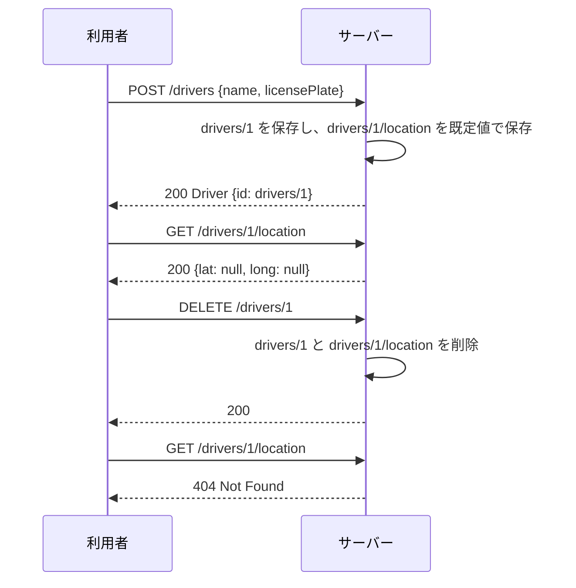

## 本記事の内容
- 『APIデザイン・パターン』(JJ Geewax 著、マイナビ出版) の第 12 章「シングルトンサブリソース」を、Go で書き直しながら読んだメモです
- パターンを使わない実装と使う実装を同じ手順で動かして、何が変わるかを出力で確かめます
- コードは Go 1.22 以降の `net/http` と標準ライブラリだけで動きます
- シリーズの目次は「[Go]APIデザインパターン 00: 目次と、パターンを使わないとどうなるか」にあります

## 1. 結論
リソースの一部ではあるけれど、大きすぎる・権限が違う・更新の頻度が違うという理由で一緒に持ちたくない項目は、`/drivers/1/location` のような単数のサブリソースに切り出します。
サブリソースに用意するのは取得と更新だけです。
作成と削除は親に任せて、親を作れば既定値で存在し、親を消せば一緒に消えるようにします。

親と一緒に 1 回のリクエストで作りたい項目や、同じ種類のものを複数ぶら下げたい項目には向きません。
後者はサブコレクションの出番です。

## 2. 困る場面
配車サービスの `Driver` を考えます。
位置情報は走っている間ずっと数秒ごとに更新されますが、名前やナンバープレートはほとんど変わりません。
この 2 つを 1 つのリソースに入れておくと、3 つの不便が出てきます。

一覧を取るたびに、興味のない位置情報まで全員分ついてきます。
位置を書き込むアプリに、`Driver` 全体を更新する権限を渡すことになります。
そして位置の更新と他の項目の更新が同じリソースにぶつかるので、片方の変更がもう片方に上書きされて消えることがあります。

書籍はこの 3 つを、サイズ、セキュリティ、ボラティリティ（更新頻度の偏り）と呼んでいます。
4-2 では 3 つ目の、変更が消えるところを実際に見ます。

## 3. 足すもの
`Driver` から位置の項目を抜き、`DriverLocation` という別のリソースにします。
識別子は親に従属させて `drivers/1/location` とし、親 1 つにつき必ず 1 つだけ存在させます。

標準メソッドの扱いは、通常のリソースとプロパティの中間です。

| 標準メソッド | 振る舞い |
|---|---|
| Get | 通常のリソースと同じ（`GET /drivers/1/location`） |
| Update | 通常のリソースと同じ（`PATCH /drivers/1/location`） |
| Create | 用意しない。親を作ると既定値で存在する |
| Delete | 用意しない。親を消すと一緒に消える |
| List | 用意しない（1 つしか無い） |

既定値に戻したい時のために、`POST /drivers/1/location:reset` というカスタムメソッドを足します。
削除の代わりに reset を置くのは、「親がある限り存在する」という約束を守るためです。

階層には 2 つの決まりがあります。
サブリソースは必ず親を持ち、API のルートには置きません。
ルートに置くと全利用者が 1 つの状態を共有することになり、書き込みが 1 か所に集中するからです。
もう 1 つは、サブリソースの下にさらにサブリソースを置かないことで、必要なら同じ親の兄弟にします。

Go の型にするとこうなります。

```go
type Driver struct {
	ID           string `json:"id"`
	Name         string `json:"name"`
	LicensePlate string `json:"licensePlate"` // ①
}

type DriverLocation struct {
	ID         string     `json:"id"` // ②
	Lat        *float64   `json:"lat"`
	Long       *float64   `json:"long"`
	UpdateTime *time.Time `json:"updateTime"`
}
```

- ① 位置の項目は `Driver` にはありません
- ② 値は `drivers/1/location` のように、親の識別子から決まります

:::message
`lat` や `updateTime` をポインタ（`*float64`、`*time.Time`）にしているのは、「まだ値が無い」を JSON の `null` として返すためです。
`float64` のままだと、未設定と `0` の区別がつきません。
:::

## 4. 前後比較
### 4-1. 使わない場合
`Driver` の中に `location` を持たせ、更新は `PUT` でリソース全体を置き換える形です。
最初に書くならこうなると思います。
`store` は `map[string]Driver` を `sync.Mutex` で守るだけの構造体で、`GET` のハンドラは省いています。

```go
type Location struct {
	Lat  *float64 `json:"lat"`
	Long *float64 `json:"long"`
}

type Driver struct {
	ID           string   `json:"id"`
	Name         string   `json:"name"`
	LicensePlate string   `json:"licensePlate"`
	Location     Location `json:"location"` // ①
}

func main() {
	s := &store{drivers: map[string]Driver{}}
	mux := http.NewServeMux()

	mux.HandleFunc("POST /drivers", func(w http.ResponseWriter, req *http.Request) {
		var d Driver
		if err := json.NewDecoder(req.Body).Decode(&d); err != nil {
			http.Error(w, "invalid json: "+err.Error(), http.StatusBadRequest)
			return
		}
		s.mu.Lock()
		s.seq++
		d.ID = "drivers/" + strconv.Itoa(s.seq)
		s.drivers[d.ID] = d
		s.mu.Unlock()
		writeJSON(w, http.StatusOK, d)
	})

	mux.HandleFunc("PUT /drivers/{n}", func(w http.ResponseWriter, req *http.Request) { // ②
		var d Driver
		if err := json.NewDecoder(req.Body).Decode(&d); err != nil {
			http.Error(w, "invalid json: "+err.Error(), http.StatusBadRequest)
			return
		}
		id := "drivers/" + req.PathValue("n")
		s.mu.Lock()
		_, ok := s.drivers[id]
		if ok {
			d.ID = id
			s.drivers[id] = d
		}
		s.mu.Unlock()
		if !ok {
			http.Error(w, "driver not found", http.StatusNotFound)
			return
		}
		writeJSON(w, http.StatusOK, d)
	})

	log.Fatal(http.ListenAndServe(":8012", mux))
}
```

- ① 位置はただのプロパティです。一覧にも取得にも毎回含まれます
- ② 送られてきた `Driver` で丸ごと置き換えます。送った側が手元に持っていた古い値も、そのまま書き込まれます

### 4-2. 動かすと位置の更新がナンバープレートの変更を消す
管理画面 A と位置更新アプリ B が、同じ `Driver` を相手にします。
B は位置だけを変えたいのですが、API には `PUT` しかないので、手元にある `Driver` 全体を送ります。

```
$ curl -s -i -X POST localhost:8012/drivers \
    -d '{"name":"Jimmy","licensePlate":"ABC-123","location":{"lat":40.741718,"long":-74.004159}}'
HTTP/1.1 200 OK
Content-Type: application/json

{"id":"drivers/1","name":"Jimmy","licensePlate":"ABC-123","location":{"lat":40.741718,"long":-74.004159}}

# B が今の Driver を取得して手元に持つ
$ curl -s localhost:8012/drivers/1
{"id":"drivers/1","name":"Jimmy","licensePlate":"ABC-123","location":{"lat":40.741718,"long":-74.004159}}

# A がナンバープレートを変える
$ curl -s -X PUT localhost:8012/drivers/1 \
    -d '{"name":"Jimmy","licensePlate":"XYZ-999","location":{"lat":40.741718,"long":-74.004159}}'
{"id":"drivers/1","name":"Jimmy","licensePlate":"XYZ-999","location":{"lat":40.741718,"long":-74.004159}}

# B が位置だけ変えたつもりで、手元の Driver 全体を送る
$ curl -s -X PUT localhost:8012/drivers/1 \
    -d '{"name":"Jimmy","licensePlate":"ABC-123","location":{"lat":40.742,"long":-74.004159}}'
{"id":"drivers/1","name":"Jimmy","licensePlate":"ABC-123","location":{"lat":40.742,"long":-74.004159}}

$ curl -s localhost:8012/drivers/1
{"id":"drivers/1","name":"Jimmy","licensePlate":"ABC-123","location":{"lat":40.742,"long":-74.004159}}
```

A が入れた `XYZ-999` が消えて、`ABC-123` に戻りました。
B は位置しか触っていないつもりでも、`Driver` 全体を送った時点で A の変更を上書きしています。
位置は数秒ごとに更新されるので、この事故は珍しいものではなくなります。

### 4-3. 使う場合（差分）
`Driver` から `location` を抜き、`DriverLocation` を別の map で持ちます。
親の作成時に既定値で一緒に作り、位置のハンドラは `drivers` の map を一切触りません。

```diff go
-type Location struct {
-	Lat  *float64 `json:"lat"`
-	Long *float64 `json:"long"`
-}
-
 type Driver struct {
 	ID           string   `json:"id"`
 	Name         string   `json:"name"`
 	LicensePlate string   `json:"licensePlate"`
-	Location     Location `json:"location"`
 }
+
+type DriverLocation struct {
+	ID         string     `json:"id"` // ①
+	Lat        *float64   `json:"lat"`
+	Long       *float64   `json:"long"`
+	UpdateTime *time.Time `json:"updateTime"`
+}

 type store struct {
 	mu        sync.Mutex
 	seq       int
 	drivers   map[string]Driver
+	locations map[string]DriverLocation
 }

 	mux.HandleFunc("POST /drivers", func(w http.ResponseWriter, req *http.Request) {
 		...
 		s.drivers[d.ID] = d
+		s.locations[d.ID] = DriverLocation{ID: d.ID + "/location"} // ②
 		s.mu.Unlock()
 		writeJSON(w, http.StatusOK, d)
 	})

+	mux.HandleFunc("DELETE /drivers/{n}", func(w http.ResponseWriter, req *http.Request) {
+		id := "drivers/" + req.PathValue("n")
+		s.mu.Lock()
+		_, ok := s.drivers[id]
+		delete(s.drivers, id)
+		delete(s.locations, id) // ③
+		s.mu.Unlock()
+		...
+	})
+
+	mux.HandleFunc("PATCH /drivers/{n}/location", func(w http.ResponseWriter, req *http.Request) { // ④
+		var in struct {
+			Lat  *float64 `json:"lat"`
+			Long *float64 `json:"long"`
+		}
+		if err := json.NewDecoder(req.Body).Decode(&in); err != nil {
+			http.Error(w, "invalid json: "+err.Error(), http.StatusBadRequest)
+			return
+		}
+		id := "drivers/" + req.PathValue("n")
+		s.mu.Lock()
+		loc, ok := s.locations[id]
+		if ok {
+			if in.Lat != nil {
+				loc.Lat = in.Lat
+			}
+			if in.Long != nil {
+				loc.Long = in.Long
+			}
+			now := time.Now().UTC().Truncate(time.Second)
+			loc.UpdateTime = &now
+			s.locations[id] = loc
+		}
+		s.mu.Unlock()
+		...
+		writeJSON(w, http.StatusOK, loc)
+	})
+
+	mux.HandleFunc("POST /drivers/{n}/location:reset", func(w http.ResponseWriter, req *http.Request) { // ⑤
+		id := "drivers/" + req.PathValue("n")
+		s.mu.Lock()
+		_, ok := s.locations[id]
+		loc := DriverLocation{ID: id + "/location"}
+		if ok {
+			s.locations[id] = loc
+		}
+		s.mu.Unlock()
+		...
+		writeJSON(w, http.StatusOK, loc)
+	})
```

- ① 識別子は親の識別子に `/location` を足しただけです
- ② `POST /drivers/{n}/location` は作りません。親を作った時にここで一緒に作ります
- ③ 親を消す時に一緒に消します。位置だけを消すメソッドはありません
- ④ JSON に入っていた項目だけ上書きします。`in.Lat` が `nil` なら送られてこなかった、と分かります
- ⑤ 既定値（全部 `null`）で置き換えます

:::message
`PATCH` の入力を `*float64` で受けると、「JSON に `lat` が無かった」を `nil` で判別できます。
値型の `float64` だと、無かった時も `0` が入るので、`0` を送ったのか省略したのかが分かりません。
書籍では `fieldMask` で更新する項目を指定しますが、第 8 章の話なので、この記事ではポインタで代用しています。
:::

:::details after/main.go の全文
```go
package main

import (
	"encoding/json"
	"log"
	"net/http"
	"strconv"
	"sync"
	"time"
)

type Driver struct {
	ID           string `json:"id"`
	Name         string `json:"name"`
	LicensePlate string `json:"licensePlate"`
}

type DriverLocation struct {
	ID         string     `json:"id"`
	Lat        *float64   `json:"lat"`
	Long       *float64   `json:"long"`
	UpdateTime *time.Time `json:"updateTime"`
}

type store struct {
	mu        sync.Mutex
	seq       int
	drivers   map[string]Driver
	locations map[string]DriverLocation
}

func writeJSON(w http.ResponseWriter, status int, v any) {
	w.Header().Set("Content-Type", "application/json")
	w.WriteHeader(status)
	json.NewEncoder(w).Encode(v)
}

func main() {
	s := &store{drivers: map[string]Driver{}, locations: map[string]DriverLocation{}}
	mux := http.NewServeMux()

	mux.HandleFunc("POST /drivers", func(w http.ResponseWriter, req *http.Request) {
		var d Driver
		if err := json.NewDecoder(req.Body).Decode(&d); err != nil {
			http.Error(w, "invalid json: "+err.Error(), http.StatusBadRequest)
			return
		}
		s.mu.Lock()
		s.seq++
		d.ID = "drivers/" + strconv.Itoa(s.seq)
		s.drivers[d.ID] = d
		s.locations[d.ID] = DriverLocation{ID: d.ID + "/location"}
		s.mu.Unlock()
		writeJSON(w, http.StatusOK, d)
	})

	mux.HandleFunc("GET /drivers", func(w http.ResponseWriter, req *http.Request) {
		s.mu.Lock()
		out := make([]Driver, 0, len(s.drivers))
		for i := 1; i <= s.seq; i++ {
			if d, ok := s.drivers["drivers/"+strconv.Itoa(i)]; ok {
				out = append(out, d)
			}
		}
		s.mu.Unlock()
		writeJSON(w, http.StatusOK, map[string]any{"results": out})
	})

	mux.HandleFunc("GET /drivers/{n}", func(w http.ResponseWriter, req *http.Request) {
		s.mu.Lock()
		d, ok := s.drivers["drivers/"+req.PathValue("n")]
		s.mu.Unlock()
		if !ok {
			http.Error(w, "driver not found", http.StatusNotFound)
			return
		}
		writeJSON(w, http.StatusOK, d)
	})

	mux.HandleFunc("PUT /drivers/{n}", func(w http.ResponseWriter, req *http.Request) {
		var d Driver
		if err := json.NewDecoder(req.Body).Decode(&d); err != nil {
			http.Error(w, "invalid json: "+err.Error(), http.StatusBadRequest)
			return
		}
		id := "drivers/" + req.PathValue("n")
		s.mu.Lock()
		_, ok := s.drivers[id]
		if ok {
			d.ID = id
			s.drivers[id] = d
		}
		s.mu.Unlock()
		if !ok {
			http.Error(w, "driver not found", http.StatusNotFound)
			return
		}
		writeJSON(w, http.StatusOK, d)
	})

	mux.HandleFunc("DELETE /drivers/{n}", func(w http.ResponseWriter, req *http.Request) {
		id := "drivers/" + req.PathValue("n")
		s.mu.Lock()
		_, ok := s.drivers[id]
		delete(s.drivers, id)
		delete(s.locations, id)
		s.mu.Unlock()
		if !ok {
			http.Error(w, "driver not found", http.StatusNotFound)
			return
		}
		w.WriteHeader(http.StatusOK)
	})

	mux.HandleFunc("GET /drivers/{n}/location", func(w http.ResponseWriter, req *http.Request) {
		s.mu.Lock()
		loc, ok := s.locations["drivers/"+req.PathValue("n")]
		s.mu.Unlock()
		if !ok {
			http.Error(w, "driver location not found", http.StatusNotFound)
			return
		}
		writeJSON(w, http.StatusOK, loc)
	})

	mux.HandleFunc("PATCH /drivers/{n}/location", func(w http.ResponseWriter, req *http.Request) {
		var in struct {
			Lat  *float64 `json:"lat"`
			Long *float64 `json:"long"`
		}
		if err := json.NewDecoder(req.Body).Decode(&in); err != nil {
			http.Error(w, "invalid json: "+err.Error(), http.StatusBadRequest)
			return
		}
		id := "drivers/" + req.PathValue("n")
		s.mu.Lock()
		loc, ok := s.locations[id]
		if ok {
			if in.Lat != nil {
				loc.Lat = in.Lat
			}
			if in.Long != nil {
				loc.Long = in.Long
			}
			now := time.Now().UTC().Truncate(time.Second)
			loc.UpdateTime = &now
			s.locations[id] = loc
		}
		s.mu.Unlock()
		if !ok {
			http.Error(w, "driver location not found", http.StatusNotFound)
			return
		}
		writeJSON(w, http.StatusOK, loc)
	})

	mux.HandleFunc("POST /drivers/{n}/location:reset", func(w http.ResponseWriter, req *http.Request) {
		id := "drivers/" + req.PathValue("n")
		s.mu.Lock()
		_, ok := s.locations[id]
		loc := DriverLocation{ID: id + "/location"}
		if ok {
			s.locations[id] = loc
		}
		s.mu.Unlock()
		if !ok {
			http.Error(w, "driver location not found", http.StatusNotFound)
			return
		}
		writeJSON(w, http.StatusOK, loc)
	})

	log.Fatal(http.ListenAndServe(":8112", mux))
}
```
:::

### 4-4. 同じ手順で動かすとナンバープレートの変更が残る
今度は B が `PATCH /drivers/1/location` に位置だけを送ります。
作ってすぐに `location` を取ると、作成していないのに既定値で存在しています。

```
$ curl -s -i -X POST localhost:8112/drivers \
    -d '{"name":"Jimmy","licensePlate":"ABC-123"}'
HTTP/1.1 200 OK
Content-Type: application/json

{"id":"drivers/1","name":"Jimmy","licensePlate":"ABC-123"}

$ curl -s -i localhost:8112/drivers/1/location
HTTP/1.1 200 OK
Content-Type: application/json

{"id":"drivers/1/location","lat":null,"long":null,"updateTime":null}

# A がナンバープレートを変える
$ curl -s -X PUT localhost:8112/drivers/1 \
    -d '{"name":"Jimmy","licensePlate":"XYZ-999"}'
{"id":"drivers/1","name":"Jimmy","licensePlate":"XYZ-999"}

# B は位置だけを送る
$ curl -s -X PATCH localhost:8112/drivers/1/location \
    -d '{"lat":40.742,"long":-74.004159}'
{"id":"drivers/1/location","lat":40.742,"long":-74.004159,"updateTime":"2026-10-28T07:12:22Z"}

$ curl -s localhost:8112/drivers/1
{"id":"drivers/1","name":"Jimmy","licensePlate":"XYZ-999"}

$ curl -s localhost:8112/drivers
{"results":[{"id":"drivers/1","name":"Jimmy","licensePlate":"XYZ-999"}]}
```

`XYZ-999` が残り、一覧にも位置が含まれなくなりました。
続けて、reset と、作成が無いこと、親と一緒に消えることを確かめます。

```
$ curl -s -i -X POST localhost:8112/drivers/1/location:reset
HTTP/1.1 200 OK
Content-Type: application/json

{"id":"drivers/1/location","lat":null,"long":null,"updateTime":null}

$ curl -s -i -X POST localhost:8112/drivers/1/location -d '{"lat":1,"long":2}'
HTTP/1.1 405 Method Not Allowed
Allow: GET, HEAD, PATCH
Content-Type: text/plain; charset=utf-8

Method Not Allowed

$ curl -s -i -X DELETE localhost:8112/drivers/1
HTTP/1.1 200 OK

$ curl -s -i localhost:8112/drivers/1/location
HTTP/1.1 404 Not Found
Content-Type: text/plain; charset=utf-8

driver location not found
```

`POST` で作ろうとすると 405 Method Not Allowed になり、`Allow` ヘッダに `GET, HEAD, PATCH` しか無いことが返ってきます。
これは Go 1.22 の `ServeMux` が、同じパスに登録されたメソッドから自動で返してくれるものです。

## 5. 1 リクエストの流れ
位置更新アプリ B のリクエストが、本番でサーバーの中をどう通るかを順に追います。

1. B が `PATCH /drivers/1/location` に `{"lat": 40.742, "long": -74.004159}` を送る
2. サーバーはパスの `1` から親の識別子 `drivers/1` を組み立て、`locations` を引く。無ければ 404
3. JSON に含まれていた `lat` と `long` だけを上書きし、`updateTime` に現在時刻を入れる
4. 保存して、`DriverLocation` を 200 で返す

`drivers` の側（名前・ナンバープレート）は一度も読み書きしないので、A のリクエストと交差しません。
親を作ってから消すまでの流れは次のとおりです。



## 6. 疑問と答え
読みながら引っかかったところです。

**作成するメソッドが無いのに、最初の値はどうやって入れるのか**
親を作った時点で既定値で存在するので、入れる操作はありません。
親の作成リクエストに位置の初期値を含める方法も用意しません。
その代わり、既定値（この記事では全部 `null`）のままでも困らないように決めておきます。

**削除ではなく reset を置くのはなぜか**
「親がある限り存在する」という約束なので、消すと「無い」状態ができてしまいます。
既定値に戻す操作として reset を用意して、削除とは呼ばないようにしています。

**全体で 1 つの設定のような、親の無いシングルトンは駄目なのか**
ルートに置くと全利用者が 1 つの状態を共有し、書き込みが 1 か所に集中します。
必ず何かの親にぶら下げます。

**サブリソースの下にさらにサブリソースを置けるか**
置きません。
分けたいものが増えたら、同じ親の兄弟として並べます。

**部分更新（第 8 章）があれば、一緒に持ったままでも上書き事故は防げるのでは**
上書き事故は防げます。
ただ、一覧が位置で膨らむことと、位置更新アプリに `Driver` 全体の更新権限を渡すことは変わりません。
分ける理由は 3 つあって、更新頻度の偏りはそのうちの 1 つです。

**論理削除や時間のかかる削除で親を消す時、サブリソースはいつ消えるのか**
親が「消えた」と見なされるまでは残ります。
親の削除がどういう形であれ、サブリソースはそれに合わせるだけです。

ここまでを自分の言葉でまとめると、親と一緒に持てない項目を `親/項目名` という単数のリソースに分けて、取得と更新だけを持たせ、作成と削除は親に合わせる、です。

## 7. トレードオフ
得られるのは、一覧や取得が軽くなること、位置だけを更新する権限を分けられること、更新同士がぶつからなくなることです。
引き換えに、親とサブリソースを 1 回のリクエストでまとめて作ったり更新したりはできなくなります。
位置を持った `Driver` を 1 回で作ることが以前はできましたが、分けた時点でそれは諦めることになります。
同じ型のサブリソースを 2 つ以上持つこともできません。

書籍は、親を消すとサブリソースも消えるという振る舞いが利用者を驚かせるようなら、そもそもこのパターンに合っていない、と注意しています。
その場合は独立したリソースにするか、普通のプロパティのままにします。

## 8. 参考
- 『APIデザイン・パターン』JJ Geewax 著、マイナビ出版、第 12 章
- https://google.aip.dev/156
- AWS S3 のバケットポリシーは、バケットにぶら下がる単数のサブリソースです。`GET /?policy`、`PUT /?policy`、`DELETE /?policy` の 3 つで、作成のメソッドはありません。`DeleteBucketPolicy` はポリシーを無い状態に戻すので、本記事の reset に近い位置付けです: https://docs.aws.amazon.com/AmazonS3/latest/API/API_GetBucketPolicy.html
