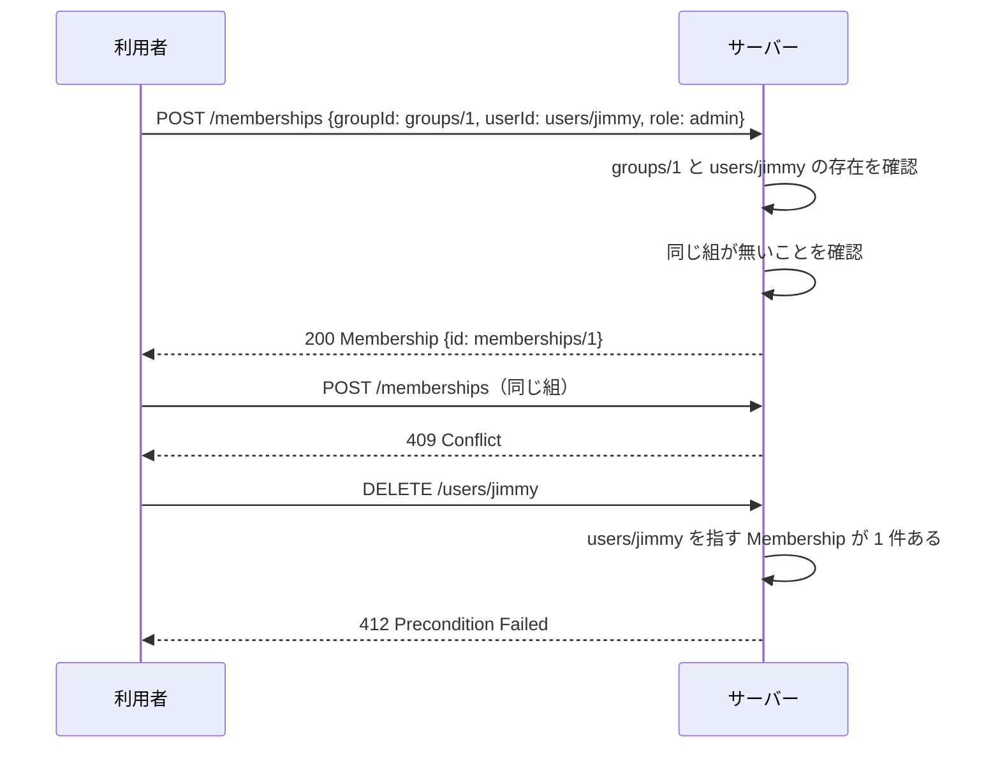

## 本記事の内容
- 『APIデザイン・パターン』(JJ Geewax 著、マイナビ出版) の第 14 章「アソシエーションリソース」を、Go で書き直しながら読んだメモです
- パターンを使わない実装と使う実装を同じ手順で動かして、何が変わるかを出力で確かめます
- コードは Go 1.22 以降の `net/http` と標準ライブラリだけで動きます
- シリーズの目次は「[Go]APIデザインパターン 00: 目次と、パターンを使わないとどうなるか」にあります

## 1. 結論
ユーザーとグループのような多対多の関係は、2 つをつなぐ 3 つ目のリソース（`Membership`）として表します。
`Membership` は `groupId` と `userId` の参照を持ち、役割や有効期限のような関係そのものの情報を一緒に持てます。
同じ組み合わせは 1 つだけで、2 つ目を作ろうとすると 409 Conflict です。
`groupId` と `userId` は作った後に変えられず、更新で送られてきても無視します。

「このグループのユーザーは？」のようによく聞く質問には、`GET /groups/1/users` のようなエイリアスを足せます。
関係に持たせたい情報が何も無いなら、第 15 章の add / remove のほうが軽く済みます。

## 2. 困る場面
グループにメンバーを持たせたい時、`Group` に `users: ["users/jimmy", ...]` という配列を置くのが一番早い方法です。
私も最初はそう書きました。

ところが「Jimmy はいつ参加した？」「役割は管理者？」と聞かれた時に、その情報を置く場所がありません。
配列には識別子の文字列しか入らないからです。
同じユーザーを 2 回入れても何も止めてくれません。
逆向きの「Jimmy はどのグループにいる？」には、全グループを取ってきて自分で探すことになります。
4-2 でこの 3 つを見ます。

## 3. 足すもの
`User` と `Group` の間に、`Membership` という独立したリソースを置きます。
親を持たないトップレベルのコレクション `/memberships` です。

```go
type Membership struct { // ①
	ID         string     `json:"id"`
	GroupID    string     `json:"groupId"`
	UserID     string     `json:"userId"`
	Role       string     `json:"role"`
	ExpireTime *time.Time `json:"expireTime"`
}
```

- ① `groupId` と `userId` が参照で、`role` と `expireTime` が関係そのものの情報です

標準メソッドのうち、作成・一覧・削除は必ず用意します。
取得と更新は、関係に情報がある時に用意します。

| 標準メソッド | 役割 | 必要か |
|---|---|---|
| Create | 2 つを結び付ける | 必要 |
| Get | 関係の情報を取る | 情報がある時 |
| List | 関係を一覧する（フィルタで絞る） | 必要 |
| Update | 関係の情報を変える | 情報がある時 |
| Delete | 結び付きを外す | 必要 |

普通のリソースと違う決まりが 3 つあります。
同じ `groupId` と `userId` の組は 1 つしか作れず、2 つ目は 409 Conflict にします。
`groupId` と `userId` は作成後に変えられないので、更新リクエストに入っていても無視します。
参照しているユーザーを消そうとした時は、412 Precondition Failed で止めるか、何もせず参照が無効のまま残るのに任せるかのどちらかにします。
連鎖して消す方法や参照を `null` に直す方法は、削除の雪崩や大量の更新を招くので避けます。

よく聞く質問のために、エイリアスのメソッドを足せます。
`GET /groups/1/users` はグループのユーザー一覧、`GET /users/jimmy/groups` はユーザーの所属グループ一覧です。
名前は「単数の持ち主 + 複数の相手」で、`ListGroupUsers` と `ListUserGroups` になります。

## 4. 前後比較
### 4-1. 使わない場合
`Group` に `users` の配列を持たせ、`PATCH` で配列を置き換える形です。
ユーザーとグループは起動時に用意しておき、`GET` のハンドラは省いています。

```go
type Group struct {
	ID    string   `json:"id"`
	Name  string   `json:"name"`
	Users []string `json:"users"` // ①
}

func main() {
	s := &store{
		users: map[string]User{
			"users/jimmy": {ID: "users/jimmy", EmailAddress: "jimmy@example.com"},
			"users/sally": {ID: "users/sally", EmailAddress: "sally@example.com"},
		},
		groups: map[string]Group{
			"groups/1": {ID: "groups/1", Name: "admins", Users: []string{}},
			"groups/2": {ID: "groups/2", Name: "developers", Users: []string{}},
		},
	}
	mux := http.NewServeMux()

	mux.HandleFunc("PATCH /groups/{n}", func(w http.ResponseWriter, req *http.Request) {
		var in struct {
			Name  *string   `json:"name"`
			Users *[]string `json:"users"` // ②
		}
		if err := json.NewDecoder(req.Body).Decode(&in); err != nil {
			http.Error(w, "invalid json: "+err.Error(), http.StatusBadRequest)
			return
		}
		id := "groups/" + req.PathValue("n")
		s.mu.Lock()
		g, ok := s.groups[id]
		if ok {
			if in.Name != nil {
				g.Name = *in.Name
			}
			if in.Users != nil {
				g.Users = *in.Users // ③
			}
			s.groups[id] = g
		}
		s.mu.Unlock()
		if !ok {
			http.Error(w, "group not found", http.StatusNotFound)
			return
		}
		writeJSON(w, http.StatusOK, g)
	})

	log.Fatal(http.ListenAndServe(":8014", mux))
}
```

- ① メンバーは識別子の文字列の配列です
- ② 配列の中身は文字列しか受け付けません
- ③ 送られてきた配列で丸ごと置き換えます。重複も確かめません

### 4-2. 動かすと役割を置く場所が無い
Jimmy をグループに入れた後、管理者であることを記録しようとします。

```
$ curl -s -i -X PATCH localhost:8014/groups/1 -d '{"users":["users/jimmy"]}'
HTTP/1.1 200 OK
Content-Type: application/json

{"id":"groups/1","name":"admins","users":["users/jimmy"]}

# Jimmy を管理者（role）として記録したい
$ curl -s -i -X PATCH localhost:8014/groups/1 \
    -d '{"users":[{"id":"users/jimmy","role":"admin"}]}'
HTTP/1.1 400 Bad Request
Content-Type: text/plain; charset=utf-8

invalid json: json: cannot unmarshal object into .users.0 of type string

# 同じユーザーをもう一度入れても止まらない
$ curl -s -i -X PATCH localhost:8014/groups/1 \
    -d '{"users":["users/jimmy","users/jimmy"]}'
HTTP/1.1 200 OK
Content-Type: application/json

{"id":"groups/1","name":"admins","users":["users/jimmy","users/jimmy"]}

# Jimmy はどのグループに入っている？
$ curl -s localhost:8014/groups
{"results":[{"id":"groups/1","name":"admins","users":["users/jimmy","users/jimmy"]},{"id":"groups/2","name":"developers","users":[]}]}
```

役割を送ると 400 になり、同じユーザーが 2 回入り、所属グループを知るには全件を取って探すしかありません。
配列に `{id, role}` のようなオブジェクトを入れられるように変えることもできますが、それは関係を表すものを `Group` の中に埋め込んでいるだけで、ユーザー側から引く問題は残ります。

### 4-3. 使う場合（差分）
`Group` から `users` を外し、`Membership` の map を足します。
作成で重複を 409 にし、更新では `groupId` と `userId` を受け取らず、ユーザーの削除は参照が残っていれば 412 で止めます。

```diff go
 type Group struct {
-	ID    string   `json:"id"`
-	Name  string   `json:"name"`
-	Users []string `json:"users"`
+	ID   string `json:"id"`
+	Name string `json:"name"`
 }
+
+type Membership struct { // ①
+	ID         string     `json:"id"`
+	GroupID    string     `json:"groupId"`
+	UserID     string     `json:"userId"`
+	Role       string     `json:"role"`
+	ExpireTime *time.Time `json:"expireTime"`
+}

 type store struct {
-	mu     sync.Mutex
-	users  map[string]User
-	groups map[string]Group
+	mu          sync.Mutex
+	seq         int
+	users       map[string]User
+	groups      map[string]Group
+	memberships map[string]Membership
 }

-	mux.HandleFunc("PATCH /groups/{n}", func(w http.ResponseWriter, req *http.Request) {
-		var in struct {
-			Name  *string   `json:"name"`
-			Users *[]string `json:"users"`
-		}
-		...
-	})
+	mux.HandleFunc("POST /memberships", func(w http.ResponseWriter, req *http.Request) {
+		var m Membership
+		if err := json.NewDecoder(req.Body).Decode(&m); err != nil {
+			http.Error(w, "invalid json: "+err.Error(), http.StatusBadRequest)
+			return
+		}
+		s.mu.Lock()
+		defer s.mu.Unlock()
+		if _, ok := s.groups[m.GroupID]; !ok {
+			http.Error(w, "unknown groupId: "+m.GroupID, http.StatusBadRequest)
+			return
+		}
+		if _, ok := s.users[m.UserID]; !ok {
+			http.Error(w, "unknown userId: "+m.UserID, http.StatusBadRequest)
+			return
+		}
+		for _, e := range s.memberships {
+			if e.GroupID == m.GroupID && e.UserID == m.UserID { // ②
+				http.Error(w, "membership of "+m.UserID+" in "+m.GroupID+" already exists", http.StatusConflict)
+				return
+			}
+		}
+		s.seq++
+		m.ID = "memberships/" + strconv.Itoa(s.seq)
+		s.memberships[m.ID] = m
+		writeJSON(w, http.StatusOK, m)
+	})
+
+	mux.HandleFunc("PATCH /memberships/{n}", func(w http.ResponseWriter, req *http.Request) {
+		var in struct { // ③
+			Role       *string    `json:"role"`
+			ExpireTime *time.Time `json:"expireTime"`
+		}
+		...
+	})
+
+	mux.HandleFunc("GET /groups/{n}/users", func(w http.ResponseWriter, req *http.Request) { // ④
+		groupID := "groups/" + req.PathValue("n")
+		s.mu.Lock()
+		out := []User{}
+		for _, m := range s.ordered() {
+			if m.GroupID == groupID {
+				out = append(out, s.users[m.UserID])
+			}
+		}
+		s.mu.Unlock()
+		writeJSON(w, http.StatusOK, map[string]any{"results": out})
+	})
+
+	mux.HandleFunc("DELETE /users/{name}", func(w http.ResponseWriter, req *http.Request) { // ⑤
+		id := "users/" + req.PathValue("name")
+		s.mu.Lock()
+		defer s.mu.Unlock()
+		n := 0
+		for _, m := range s.memberships {
+			if m.UserID == id {
+				n++
+			}
+		}
+		if n > 0 {
+			http.Error(w, id+" is referenced by "+strconv.Itoa(n)+" membership(s)", http.StatusPreconditionFailed)
+			return
+		}
+		delete(s.users, id)
+		w.WriteHeader(http.StatusOK)
+	})
```

- ① 関係そのものがリソースになり、`role` と `expireTime` の置き場所ができます
- ② 識別子が違っても、結び付ける 2 つが同じなら同じリソースと見なして 409 にします
- ③ 更新の入力に `groupId` と `userId` を用意しません。送られてきても捨てられます
- ④ 「グループ 1 のユーザーは？」に 1 回で答えるエイリアスです
- ⑤ `Membership` から参照されている間は、ユーザーを 412 Precondition Failed で消させません

:::message
③ で `groupId` を無視できるのは、Go の `encoding/json` が構造体に無いキーを黙って捨てるからです。
入力用の構造体に書かなかったフィールドは、それだけで読み取り専用になります。
:::

:::message
`defer s.mu.Unlock()` を使うと、途中の `return` でも必ずロックが外れます。
`http.Error` で早期に抜ける分岐が多いハンドラでは、`Unlock` の書き忘れを防げます。
:::

`GET /memberships/{n}`、`DELETE /memberships/{n}`、フィルタ付きの `GET /memberships`、もう 1 つのエイリアス `GET /users/{name}/groups` は全文のほうにあります。

:::details after/main.go の全文
```go
package main

import (
	"encoding/json"
	"log"
	"net/http"
	"strconv"
	"sync"
	"time"
)

type User struct {
	ID           string `json:"id"`
	EmailAddress string `json:"emailAddress"`
}

type Group struct {
	ID   string `json:"id"`
	Name string `json:"name"`
}

type Membership struct {
	ID         string     `json:"id"`
	GroupID    string     `json:"groupId"`
	UserID     string     `json:"userId"`
	Role       string     `json:"role"`
	ExpireTime *time.Time `json:"expireTime"`
}

type store struct {
	mu          sync.Mutex
	seq         int
	users       map[string]User
	groups      map[string]Group
	memberships map[string]Membership
}

func (s *store) ordered() []Membership {
	out := []Membership{}
	for i := 1; i <= s.seq; i++ {
		if m, ok := s.memberships["memberships/"+strconv.Itoa(i)]; ok {
			out = append(out, m)
		}
	}
	return out
}

func writeJSON(w http.ResponseWriter, status int, v any) {
	w.Header().Set("Content-Type", "application/json")
	w.WriteHeader(status)
	json.NewEncoder(w).Encode(v)
}

func main() {
	s := &store{
		users: map[string]User{
			"users/jimmy": {ID: "users/jimmy", EmailAddress: "jimmy@example.com"},
			"users/sally": {ID: "users/sally", EmailAddress: "sally@example.com"},
		},
		groups: map[string]Group{
			"groups/1": {ID: "groups/1", Name: "admins"},
			"groups/2": {ID: "groups/2", Name: "developers"},
		},
		memberships: map[string]Membership{},
	}
	mux := http.NewServeMux()

	mux.HandleFunc("POST /memberships", func(w http.ResponseWriter, req *http.Request) {
		var m Membership
		if err := json.NewDecoder(req.Body).Decode(&m); err != nil {
			http.Error(w, "invalid json: "+err.Error(), http.StatusBadRequest)
			return
		}
		s.mu.Lock()
		defer s.mu.Unlock()
		if _, ok := s.groups[m.GroupID]; !ok {
			http.Error(w, "unknown groupId: "+m.GroupID, http.StatusBadRequest)
			return
		}
		if _, ok := s.users[m.UserID]; !ok {
			http.Error(w, "unknown userId: "+m.UserID, http.StatusBadRequest)
			return
		}
		for _, e := range s.memberships {
			if e.GroupID == m.GroupID && e.UserID == m.UserID {
				http.Error(w, "membership of "+m.UserID+" in "+m.GroupID+" already exists", http.StatusConflict)
				return
			}
		}
		s.seq++
		m.ID = "memberships/" + strconv.Itoa(s.seq)
		s.memberships[m.ID] = m
		writeJSON(w, http.StatusOK, m)
	})

	mux.HandleFunc("GET /memberships/{n}", func(w http.ResponseWriter, req *http.Request) {
		s.mu.Lock()
		m, ok := s.memberships["memberships/"+req.PathValue("n")]
		s.mu.Unlock()
		if !ok {
			http.Error(w, "membership not found", http.StatusNotFound)
			return
		}
		writeJSON(w, http.StatusOK, m)
	})

	mux.HandleFunc("PATCH /memberships/{n}", func(w http.ResponseWriter, req *http.Request) {
		var in struct {
			Role       *string    `json:"role"`
			ExpireTime *time.Time `json:"expireTime"`
		}
		if err := json.NewDecoder(req.Body).Decode(&in); err != nil {
			http.Error(w, "invalid json: "+err.Error(), http.StatusBadRequest)
			return
		}
		id := "memberships/" + req.PathValue("n")
		s.mu.Lock()
		m, ok := s.memberships[id]
		if ok {
			if in.Role != nil {
				m.Role = *in.Role
			}
			if in.ExpireTime != nil {
				m.ExpireTime = in.ExpireTime
			}
			s.memberships[id] = m
		}
		s.mu.Unlock()
		if !ok {
			http.Error(w, "membership not found", http.StatusNotFound)
			return
		}
		writeJSON(w, http.StatusOK, m)
	})

	mux.HandleFunc("DELETE /memberships/{n}", func(w http.ResponseWriter, req *http.Request) {
		id := "memberships/" + req.PathValue("n")
		s.mu.Lock()
		_, ok := s.memberships[id]
		delete(s.memberships, id)
		s.mu.Unlock()
		if !ok {
			http.Error(w, "membership not found", http.StatusNotFound)
			return
		}
		w.WriteHeader(http.StatusOK)
	})

	mux.HandleFunc("GET /memberships", func(w http.ResponseWriter, req *http.Request) {
		q := req.URL.Query()
		s.mu.Lock()
		out := []Membership{}
		for _, m := range s.ordered() {
			if g := q.Get("groupId"); g != "" && m.GroupID != g {
				continue
			}
			if u := q.Get("userId"); u != "" && m.UserID != u {
				continue
			}
			out = append(out, m)
		}
		s.mu.Unlock()
		writeJSON(w, http.StatusOK, map[string]any{"results": out})
	})

	mux.HandleFunc("GET /groups/{n}/users", func(w http.ResponseWriter, req *http.Request) {
		groupID := "groups/" + req.PathValue("n")
		s.mu.Lock()
		out := []User{}
		for _, m := range s.ordered() {
			if m.GroupID == groupID {
				out = append(out, s.users[m.UserID])
			}
		}
		s.mu.Unlock()
		writeJSON(w, http.StatusOK, map[string]any{"results": out})
	})

	mux.HandleFunc("GET /users/{name}/groups", func(w http.ResponseWriter, req *http.Request) {
		userID := "users/" + req.PathValue("name")
		s.mu.Lock()
		out := []Group{}
		for _, m := range s.ordered() {
			if m.UserID == userID {
				out = append(out, s.groups[m.GroupID])
			}
		}
		s.mu.Unlock()
		writeJSON(w, http.StatusOK, map[string]any{"results": out})
	})

	mux.HandleFunc("DELETE /users/{name}", func(w http.ResponseWriter, req *http.Request) {
		id := "users/" + req.PathValue("name")
		s.mu.Lock()
		defer s.mu.Unlock()
		n := 0
		for _, m := range s.memberships {
			if m.UserID == id {
				n++
			}
		}
		if n > 0 {
			http.Error(w, id+" is referenced by "+strconv.Itoa(n)+" membership(s)", http.StatusPreconditionFailed)
			return
		}
		delete(s.users, id)
		w.WriteHeader(http.StatusOK)
	})

	log.Fatal(http.ListenAndServe(":8114", mux))
}
```
:::

### 4-4. 同じ手順で動かすと役割が付き、2 回目は 409 になる
Jimmy を管理者としてグループに入れ、もう一度同じ組を作ろうとし、役割を変え、ユーザーを消そうとします。

```
$ curl -s -i -X POST localhost:8114/memberships \
    -d '{"groupId":"groups/1","userId":"users/jimmy","role":"admin"}'
HTTP/1.1 200 OK
Content-Type: application/json

{"id":"memberships/1","groupId":"groups/1","userId":"users/jimmy","role":"admin","expireTime":null}

$ curl -s -i -X POST localhost:8114/memberships \
    -d '{"groupId":"groups/1","userId":"users/jimmy","role":"admin"}'
HTTP/1.1 409 Conflict
Content-Type: text/plain; charset=utf-8

membership of users/jimmy in groups/1 already exists

$ curl -s -i -X PATCH localhost:8114/memberships/1 \
    -d '{"userId":"users/sally","role":"user"}'
HTTP/1.1 200 OK
Content-Type: application/json

{"id":"memberships/1","groupId":"groups/1","userId":"users/jimmy","role":"user","expireTime":null}

$ curl -s localhost:8114/groups/1/users
{"results":[{"id":"users/jimmy","emailAddress":"jimmy@example.com"}]}

$ curl -s localhost:8114/users/jimmy/groups
{"results":[{"id":"groups/1","name":"admins"}]}

$ curl -s -i -X DELETE localhost:8114/users/jimmy
HTTP/1.1 412 Precondition Failed
Content-Type: text/plain; charset=utf-8

users/jimmy is referenced by 1 membership(s)

$ curl -s -i -X DELETE localhost:8114/memberships/1
HTTP/1.1 200 OK

$ curl -s localhost:8114/groups/1/users
{"results":[]}
```

`role` が `admin` として保存され、2 回目の作成は 409 で止まりました。
更新で `userId` を Sally に変えようとしても Jimmy のままで、`role` だけが `user` になっています。
所属グループはユーザー側からも 1 回で引けて、参照が残っている間はユーザーを消せません。

## 5. 1 リクエストの流れ
`Membership` を作るリクエストが、本番でサーバーの中をどう通るかを順に追います。

1. 利用者が `POST /memberships` に `{"groupId": "groups/1", "userId": "users/jimmy", "role": "admin"}` を送る
2. サーバーは JSON を `Membership` に入れる。読めなければ 400
3. `groupId` と `userId` が実在するかを map で確かめる。無ければ 400
4. 既存の `Membership` を走査し、同じ `groupId` と `userId` の組があれば 409 を返す
5. 識別子 `memberships/1` を振って保存し、`Membership` を 200 で返す

ユーザーを消すリクエストは、`memberships` の中にそのユーザーを指すものが 1 つでもあれば 412 を返し、無ければ消します。



## 6. 疑問と答え
読みながら引っかかったところです。

**関係を表すリソースの名前はどう付けるか**
文脈から自明なら、受講登録の `CourseRegistration` のようにそのまま名付けます。
しっくりくる言葉が無い時は `Membership` や `Association` に修飾子を付けて、どの 2 つの関係かが分かるようにします。

**`groupId` と `userId` を更新で変えられないのはなぜか**
変えると別の関係になってしまうからです。
別の関係にしたいなら、古い `Membership` を消して新しく作ります。
送られてきた時はエラーにせず無視して、`role` のような他の項目だけを更新します。

**同じユーザーを同じグループに 2 回入れたらどうなるか**
409 Conflict になります。
普通のリソースは識別子が同じ時だけ衝突しますが、`Membership` は結び付ける 2 つが同じなら衝突です。

**エイリアスのメソッドは必須か**
任意です。
`GET /memberships?groupId=groups/1` のようにフィルタ付きの一覧で同じ結果が取れます。
よく聞く質問に短く答える近道として足すものです。

**ユーザーを消したら `Membership` はどうなるか**
参照が残っている間は 412 で止めるか、何もせず参照が無効のまま残るに任せるかのどちらかです。
連鎖して消したり参照を `null` に直したりは、削除の雪崩や大量の更新になるので選びません。

**`Group` のレスポンスにメンバー一覧を入れないのはなぜか**
一覧が何千件にもなり得るからです。
グループの説明は `GET /groups/1`、メンバーは `GET /groups/1/users` と、取り方が分かれます。

ここまでを自分の言葉でまとめると、多対多は 2 つの参照と関係の情報を持つ 3 つ目のリソースで表し、同じ組は 1 つだけ、参照は作った後に変えない、です。

## 7. トレードオフ
得られるのは、関係そのものに役割や期限のような情報を持てることと、多対多の表し方として一番自由が利くことです。
引き換えに、リソースが 1 つとメソッドが最大 7 つ（標準 5 つとエイリアス 2 つ）増えて、API が大きくなります。
「グループに参加する」という操作が `JoinGroup` ではなく「`Membership` を作る」になるので、直感からは少し離れます。
グループの説明とメンバー一覧の取り方が分かれる点も、同じグループの情報なのに別々、という違和感として残ります。

書籍は、関係に持たせたい情報が無いなら、第 15 章の add / remove のカスタムメソッドで軽く済ませることを勧めています。

## 8. 参考
- 『APIデザイン・パターン』JJ Geewax 著、マイナビ出版、第 14 章
- https://google.aip.dev/124
- AWS EC2 のルートテーブルとサブネットの関連付けは、本記事の `Membership` と同じ形です。`AssociateRouteTable` は関連付けそのものの識別子 `AssociationId` を返し、外す時は `DisassociateRouteTable` にその `AssociationId` を渡します: https://docs.aws.amazon.com/AWSEC2/latest/APIReference/API_AssociateRouteTable.html
