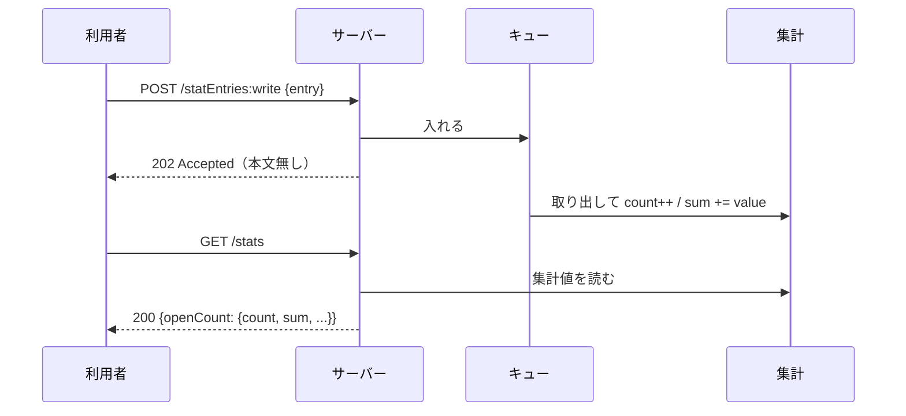

## 本記事の内容
- 『APIデザイン・パターン』(JJ Geewax 著、マイナビ出版) の第 20 章「匿名書き込み」を、Go で書き直しながら読んだメモです
- パターンを使わない実装と使う実装を同じ手順で動かして、何が変わるかを出力で確かめます
- コードは Go 1.22 以降の `net/http` と標準ライブラリだけで動きます
- シリーズの目次は「[Go]APIデザインパターン 00: 目次と、パターンを使わないとどうなるか」にあります

## 1. 結論
ログや統計のように、後から 1 件ずつ取り出すことのないデータは、識別子付きのリソースとして create するのではなく、`:write` カスタムメソッドで「エントリー」として書き込みます。
write は本文を返さず、成功か失敗かだけを返します。
読む側は個々のエントリーではなく、件数や合計のような集計値を取ります。

## 2. 困る場面
ChatRoom が開かれた回数のような統計を集めたいとします。
リソース指向の API では、新しいデータは create で作るのが普通なので、`ChatRoomStat` というリソースを作って 1 件ずつ create したくなります。

ところが利用者が欲しいのは「今月の平均」や「合計」で、特定の 1 件を識別子で取り出すことはありません。
それなのに 1 件ごとに識別子を付けて保存するので、保存量は増え続け、平均を出すには全件を list することになります。
書籍が挙げている BigQuery や InfluxDB のような分析用のストレージは、そもそも 1 件ずつの識別子を持ちません。
4-2 で、1 件ずつ溜まっていくところを見ます。

## 3. 足すもの
`POST /chatRooms/{room}/statEntries:write` を足します。
リクエストは `resource` ではなく `entry` というフィールドにデータを入れ、レスポンスは本文無しです。
複数まとめて書く `:batchWrite` も同じ形で、`requests` の配列を受け取って何も返しません。

URL は `/chatRooms/1:writeStatEntry` ではなく `/chatRooms/1/statEntries:write` にします。
`statEntries` は本当のリソースのコレクションではありませんが、コレクションを対象にしておくと、後から batchWrite や purge を同じ場所に足せます。

一貫性については、create と違う考え方をします。
create したデータはすぐに読めることが期待されますが、エントリーは集計値としてしか読まないので、「自分が書いた分が反映されたか」を確かめる手段がもともとありません。
そのため write は、集計に反映される前に返して構いません。
反映に時間がかかることを伝えたいなら、200 OK ではなく 202 Accepted を返します。
LRO（ロングランオペレーション）を返す案は、識別子の無いエントリーをパイプラインの中で追跡できないことと、write のたびに Operation リソースを作ると保存量を減らした意味が無くなることから、書籍は退けています。

同じエントリーを二重に書きたくない場合は、第 26 章のリクエスト重複実行回避を組み合わせます。

Go の型にするとこうなります。

```go
type ChatRoomStatEntry struct { // ①
	Name  string  `json:"name"`
	Value float64 `json:"value"`
}

type WriteChatRoomStatEntryRequest struct {
	Entry ChatRoomStatEntry `json:"entry"` // ②
}

type BatchWriteChatRoomStatEntryRequest struct {
	Requests []WriteChatRoomStatEntryRequest `json:"requests"`
}

type Aggregate struct { // ③
	Count int     `json:"count"`
	Sum   float64 `json:"sum"`
	Min   float64 `json:"min"`
	Max   float64 `json:"max"`
}
```

- ① 識別子を持ちません。書籍の `value` は数値・文字列・真偽値・null のどれかですが、集計の例を簡単にするため数値だけにしました
- ② create の `resource` に当たる場所が `entry` になります
- ③ 読む側に返すのは、この集計値だけです

## 4. 前後比較
### 4-1. 使わない場合
統計を `ChatRoomStat` リソースとして create します。

```go
type ChatRoomStat struct {
	ID    string  `json:"id"` // ①
	Name  string  `json:"name"`
	Value float64 `json:"value"`
}

func (s *store) create(parent string, r ChatRoomStat) ChatRoomStat {
	s.mu.Lock()
	defer s.mu.Unlock()
	s.seq++
	r.ID = parent + "/stats/" + strconv.Itoa(s.seq)
	s.stats = append(s.stats, r) // ②
	return r
}

mux.HandleFunc("POST /chatRooms/{room}/stats", func(w http.ResponseWriter, req *http.Request) {
	var in CreateChatRoomStatRequest
	if err := json.NewDecoder(req.Body).Decode(&in); err != nil {
		http.Error(w, "invalid json: "+err.Error(), http.StatusBadRequest)
		return
	}
	created := s.create("chatRooms/"+req.PathValue("room"), in.Resource)
	writeJSON(w, http.StatusOK, created)
})
```

- ① 1 件ごとに識別子を付けます
- ② 1 件ずつ全部保存します

### 4-2. 動かすと 1 件ずつ識別子付きで溜まる
`openCount` を 3 回送ります。

```
$ curl -s -i -X POST localhost:8020/chatRooms/1/stats \
    -d '{"resource":{"name":"openCount","value":1}}'
HTTP/1.1 200 OK
Content-Type: application/json

{"id":"chatRooms/1/stats/1","name":"openCount","value":1}

$ curl -s -i -X POST localhost:8020/chatRooms/1/stats \
    -d '{"resource":{"name":"openCount","value":1}}'
HTTP/1.1 200 OK
Content-Type: application/json

{"id":"chatRooms/1/stats/2","name":"openCount","value":1}

$ curl -s -i -X POST localhost:8020/chatRooms/1/stats \
    -d '{"resource":{"name":"openCount","value":3}}'
HTTP/1.1 200 OK
Content-Type: application/json

{"id":"chatRooms/1/stats/3","name":"openCount","value":3}

$ curl -s localhost:8020/chatRooms/1/stats
{"results":[{"id":"chatRooms/1/stats/1","name":"openCount","value":1},{"id":"chatRooms/1/stats/2","name":"openCount","value":1},{"id":"chatRooms/1/stats/3","name":"openCount","value":3}]}
```

`chatRooms/1/stats/1` のような識別子が返りますが、これを使って Get する人はいません。
合計や平均が欲しければ、利用者が全件を list して自分で計算することになります。
1 日に 100 万回開かれる ChatRoom なら、100 万件のリソースがそのまま残ります。

### 4-3. 使う場合（差分）
リソースと保存場所を無くし、書き込みをキューに入れて集計値だけを持つ形に変えます。

```diff go
-type ChatRoomStat struct {
-	ID    string  `json:"id"`
-	Name  string  `json:"name"`
-	Value float64 `json:"value"`
-}
+type ChatRoomStatEntry struct {
+	Name  string  `json:"name"`
+	Value float64 `json:"value"`
+}
 
-type CreateChatRoomStatRequest struct {
-	Resource ChatRoomStat `json:"resource"`
-}
+type WriteChatRoomStatEntryRequest struct {
+	Entry ChatRoomStatEntry `json:"entry"`
+}
 
-type store struct {
-	mu    sync.Mutex
-	seq   int
-	stats []ChatRoomStat
-}
+type analytics struct {
+	mu    sync.Mutex
+	aggs  map[string]map[string]Aggregate
+	queue chan statWrite // ①
+}
 
-func (s *store) create(parent string, r ChatRoomStat) ChatRoomStat {
-	s.mu.Lock()
-	defer s.mu.Unlock()
-	s.seq++
-	r.ID = parent + "/stats/" + strconv.Itoa(s.seq)
-	s.stats = append(s.stats, r)
-	return r
-}
+func (a *analytics) apply(w statWrite) {
+	a.mu.Lock()
+	defer a.mu.Unlock()
+	byName, ok := a.aggs[w.parent]
+	if !ok {
+		byName = map[string]Aggregate{}
+		a.aggs[w.parent] = byName
+	}
+	g, ok := byName[w.entry.Name]
+	if !ok || w.entry.Value < g.Min {
+		g.Min = w.entry.Value
+	}
+	if !ok || w.entry.Value > g.Max {
+		g.Max = w.entry.Value
+	}
+	g.Count++
+	g.Sum += w.entry.Value
+	byName[w.entry.Name] = g // ②
+}
 
-	mux.HandleFunc("POST /chatRooms/{room}/stats", func(w http.ResponseWriter, req *http.Request) {
-		var in CreateChatRoomStatRequest
+	mux.HandleFunc("POST /chatRooms/{room}/statEntries:write", func(w http.ResponseWriter, req *http.Request) {
+		var in WriteChatRoomStatEntryRequest
 		if err := json.NewDecoder(req.Body).Decode(&in); err != nil {
 			http.Error(w, "invalid json: "+err.Error(), http.StatusBadRequest)
 			return
 		}
-		created := s.create("chatRooms/"+req.PathValue("room"), in.Resource)
-		writeJSON(w, http.StatusOK, created)
+		if in.Entry.Name == "" {
+			http.Error(w, "entry.name is required", http.StatusBadRequest)
+			return
+		}
+		a.queue <- statWrite{parent: "chatRooms/" + req.PathValue("room"), entry: in.Entry}
+		w.WriteHeader(http.StatusAccepted) // ③
 	})
```

- ① 書き込みは一度キューに入れ、別の goroutine が取り出して集計します。本番ならここが分析パイプラインに当たります
- ② 個々のエントリーは残さず、件数・合計・最小・最大だけを更新します
- ③ 受け取った時点で 202 Accepted を返します。まだ集計には反映されていません

:::message
`chan statWrite` は goroutine 同士で値を受け渡すチャネルです。
`a.queue <- v` で入れ、別の goroutine が `for w := range a.queue` で順に取り出します。
`newAnalytics` の中で `go func() { ... }()` としてその goroutine を起動しています。
:::

:::message
`w.WriteHeader(http.StatusAccepted)` の後に何も書かなければ、本文の無いレスポンスになります。
`Content-Length: 0` が付くだけです。
:::

全文は畳んでおきます。

:::details after/main.go の全文
```go
package main

import (
	"encoding/json"
	"log"
	"net/http"
	"strconv"
	"sync"
	"time"
)

type ChatRoomStatEntry struct {
	Name  string  `json:"name"`
	Value float64 `json:"value"`
}

type WriteChatRoomStatEntryRequest struct {
	Entry ChatRoomStatEntry `json:"entry"`
}

type BatchWriteChatRoomStatEntryRequest struct {
	Requests []WriteChatRoomStatEntryRequest `json:"requests"`
}

type Aggregate struct {
	Count int     `json:"count"`
	Sum   float64 `json:"sum"`
	Min   float64 `json:"min"`
	Max   float64 `json:"max"`
}

type statWrite struct {
	parent string
	entry  ChatRoomStatEntry
}

type analytics struct {
	mu    sync.Mutex
	aggs  map[string]map[string]Aggregate
	queue chan statWrite
}

func newAnalytics() *analytics {
	a := &analytics{aggs: map[string]map[string]Aggregate{}, queue: make(chan statWrite, 1024)}
	go func() {
		for w := range a.queue {
			time.Sleep(200 * time.Millisecond) // 集計パイプラインの遅延の代わり
			a.apply(w)
		}
	}()
	return a
}

func (a *analytics) apply(w statWrite) {
	a.mu.Lock()
	defer a.mu.Unlock()
	byName, ok := a.aggs[w.parent]
	if !ok {
		byName = map[string]Aggregate{}
		a.aggs[w.parent] = byName
	}
	g, ok := byName[w.entry.Name]
	if !ok || w.entry.Value < g.Min {
		g.Min = w.entry.Value
	}
	if !ok || w.entry.Value > g.Max {
		g.Max = w.entry.Value
	}
	g.Count++
	g.Sum += w.entry.Value
	byName[w.entry.Name] = g
}

func (a *analytics) snapshot(parent string) map[string]Aggregate {
	a.mu.Lock()
	defer a.mu.Unlock()
	out := map[string]Aggregate{}
	for name, g := range a.aggs[parent] {
		out[name] = g
	}
	return out
}

func writeJSON(w http.ResponseWriter, status int, v any) {
	w.Header().Set("Content-Type", "application/json")
	w.WriteHeader(status)
	json.NewEncoder(w).Encode(v)
}

func main() {
	a := newAnalytics()
	mux := http.NewServeMux()

	mux.HandleFunc("POST /chatRooms/{room}/statEntries:write", func(w http.ResponseWriter, req *http.Request) {
		var in WriteChatRoomStatEntryRequest
		if err := json.NewDecoder(req.Body).Decode(&in); err != nil {
			http.Error(w, "invalid json: "+err.Error(), http.StatusBadRequest)
			return
		}
		if in.Entry.Name == "" {
			http.Error(w, "entry.name is required", http.StatusBadRequest)
			return
		}
		a.queue <- statWrite{parent: "chatRooms/" + req.PathValue("room"), entry: in.Entry}
		w.WriteHeader(http.StatusAccepted)
	})

	mux.HandleFunc("POST /chatRooms/{room}/statEntries:batchWrite", func(w http.ResponseWriter, req *http.Request) {
		var in BatchWriteChatRoomStatEntryRequest
		if err := json.NewDecoder(req.Body).Decode(&in); err != nil {
			http.Error(w, "invalid json: "+err.Error(), http.StatusBadRequest)
			return
		}
		for i, r := range in.Requests {
			if r.Entry.Name == "" {
				http.Error(w, "requests["+strconv.Itoa(i)+"].entry.name is required", http.StatusBadRequest)
				return
			}
		}
		for _, r := range in.Requests {
			a.queue <- statWrite{parent: "chatRooms/" + req.PathValue("room"), entry: r.Entry}
		}
		w.WriteHeader(http.StatusAccepted)
	})

	mux.HandleFunc("GET /chatRooms/{room}/stats", func(w http.ResponseWriter, req *http.Request) {
		writeJSON(w, http.StatusOK, a.snapshot("chatRooms/"+req.PathValue("room")))
	})

	log.Fatal(http.ListenAndServe(":8120", mux))
}
```
:::

### 4-4. 同じ手順で動かすと 202 が返り、少し遅れて集計に乗る
同じ `openCount` を write で送り、直後と 0.6 秒後に集計値を読みます。
この実装では集計パイプラインの遅延の代わりに 200 ミリ秒の `Sleep` を入れてあります。

```
$ curl -s -i -X POST localhost:8120/chatRooms/1/statEntries:write \
    -d '{"entry":{"name":"openCount","value":1}}'
HTTP/1.1 202 Accepted

$ curl -s localhost:8120/chatRooms/1/stats
{}

$ sleep 0.6; curl -s localhost:8120/chatRooms/1/stats
{"openCount":{"count":1,"sum":1,"min":1,"max":1}}
```

write の直後は空で、少し待つと `count: 1` になります。
返ってくるのは識別子付きの 1 件ではなく、集計値だけです。
残りの 2 件は `:batchWrite` でまとめて送ります。

```
$ curl -s -i -X POST localhost:8120/chatRooms/1/statEntries:batchWrite \
    -d '{"requests":[{"entry":{"name":"openCount","value":1}},
                     {"entry":{"name":"openCount","value":3}}]}'
HTTP/1.1 202 Accepted

$ sleep 0.8; curl -s localhost:8120/chatRooms/1/stats
{"openCount":{"count":3,"sum":5,"min":1,"max":3}}
```

3 件分が集計に入りましたが、サーバーに残っているのは `count` と `sum` などの数個の値だけです。

## 5. 1 リクエストの流れ
本番で `:write` のリクエストがサーバーの中をどう通るかを、順に追います。
送る側を利用者、受ける側をサーバーと呼びます。

1. 利用者が `POST /chatRooms/1/statEntries:write` に `{"entry": {"name": "openCount", "value": 1}}` を送る
2. サーバーは本文を `WriteChatRoomStatEntryRequest` に入れる。読めなければ 400、`name` が空でも 400
3. エントリーをキューに入れる
4. 本文無しの 202 Accepted を返す。利用者から見たリクエストはここで終わる
5. 別の goroutine がキューから取り出し、`chatRooms/1` の `openCount` の `count` を 1 増やし、`sum` に 1 を足す
6. その後に来た `GET /chatRooms/1/stats` が、更新後の集計値を返す



## 6. 疑問と答え
読みながら引っかかったところです。

**なぜ write は本文を返さないのか**
返せるものが無いからです。
エントリーには識別子が無く、書いた瞬間に集計の一部になるので、「作られたもの」を指し示せません。
成功か失敗かだけが結果です。

**書いた直後に集計に出ないのは不具合ではないのか**
不具合ではありません。
集計値は他の利用者の分も混ざった全体なので、「自分の 1 件が入ったか」を区別する手段がもともとありません。
create の「作ったらすぐ読める」という基準を、write に持ち込む意味が無いということです。

**反映を待てるように LRO を返せばよいのでは**
識別子の無いエントリーはパイプラインの中で追跡できませんし、write のたびに Operation リソースを作ったら、1 件ずつ保存しないために write にした意味が消えます。
反映に時間がかかることを伝えたいなら、202 Accepted で足ります。

**200 と 202 はどう使い分けるのか**
受け取った時点で処理も終わっているなら 200 OK、受け取ったがまだ処理していないなら 202 Accepted です。
4-4 のように、直後に読んでも反映されていない実装では 202 の方が正直です。

**同じエントリーを二重に書いてしまったら**
write 自体には検出する手段がありません。
識別子が無いので、2 件目が再送なのか別の 1 件なのかを区別できないからです。
気になるなら第 26 章の `requestId` を write にも付けます。

**なぜ URL は `/chatRooms/1:writeStatEntry` ではないのか**
エントリーは本当のリソースではありませんが、コレクションを対象にしておくと、`:batchWrite` や `:purge` を同じ `statEntries` の下に足せます。
第 9 章のカスタムメソッドの決まりをそのまま使っています。

ここまでを自分の言葉でまとめると、後から 1 件ずつ取り出さないデータは識別子を付けずに `:write` で流し込み、読む時は集計値だけ、反映は遅れてよい、です。

## 7. トレードオフ
得られるのは、分析用のデータを 1 件ずつリソースにせずに取り込めることと、保存量を集計値の分だけに抑えられることです。
引き換えに、書いたデータは後から取り出せず、削除もできず、反映のタイミングも分かりません。

このパターンの使いどころは分析データに限られる、と書籍は言っています。
トランザクション的なデータには向かない一方で、分析データを取り込む必要がある API では、識別子付きの create で無理をするよりこの形が最も良い、という位置づけです。

## 8. 参考
- 『APIデザイン・パターン』JJ Geewax 著、マイナビ出版、第 20 章
- Amazon CloudWatch の `PutMetricData` は、`Namespace` と `MetricData` の配列を受け取り、1 回に 1,000 メトリクスまで送れます。個々のデータポイントに識別子は無く、本記事の `:batchWrite` に近い形です: https://docs.aws.amazon.com/AmazonCloudWatch/latest/APIReference/API_PutMetricData.html
