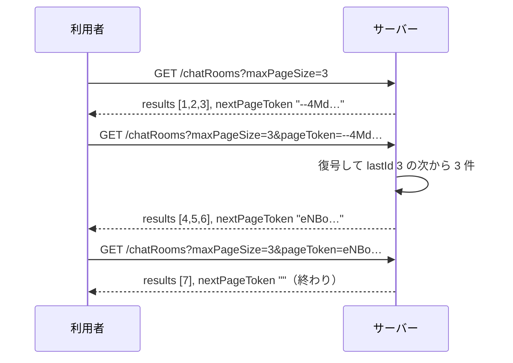

## 本記事の内容
- 『APIデザイン・パターン』(JJ Geewax 著、マイナビ出版) の第 21 章「ページ分割」を、Go で書き直しながら読んだメモです
- パターンを使わない実装と使う実装を同じ手順で動かして、何が変わるかを出力で確かめます
- コードは Go 1.22 以降の `net/http` と標準ライブラリだけで動きます
- シリーズの目次は「[Go]APIデザインパターン 00: 目次と、パターンを使わないとどうなるか」にあります

## 1. 結論
一覧を返すメソッドのリクエストに `maxPageSize` と `pageToken` を、レスポンスに `nextPageToken` を足します。
サーバーは 1 回のレスポンスに `maxPageSize` 件までしか載せず、続きがある時だけ `nextPageToken` を返します。
利用者はそれを次のリクエストの `pageToken` にそのまま入れて、`nextPageToken` が空になるまで繰り返します。
件数がどれだけ増えても、1 回のレスポンスの大きさは変わりません。

件数が増えないと分かっている一覧には要りません。
全件をまとめて外に出したい場合は、第 23 章のインポートとエクスポートの出番です。

## 2. 困る場面
一覧を 1 回のレスポンスで全部返す形は、作った当初は困りません。
困るのはリソースが増えてからで、書籍は 50 万件のメッセージで最大 70MB になる例を挙げています。
利用者は受け取り切るまで何もできず、サーバーも 1 リクエストのために全件を読んで送ることになります。

もう 1 つ、読んでいて気付かされたのは、後からページ分割に変えると既存の利用者が壊れることです。
全件が 1 回で返る前提で書かれたコードは、変更後も最初のページだけを受け取って「これで全部」と思い込みます。
エラーにならないぶん、平均値が少しずれているような不具合は長く気付かれません。
だから最初からこのパターンで作っておく、というのが第 2 章のケーススタディの主張でした。

## 3. 足すもの
フィールドは 3 つだけです。
ただ、それぞれに細かい決まりがあって、そこがこの章の本題でした。

`maxPageSize` は 1 回に返す件数の上限で、ちょうどその件数を返す約束ではありません。
サーバーは制限時間内に見つかった分だけ返してよく、指定が無ければ 10 件、負の値なら 400 Bad Request にします。
大きすぎる値は断ってもよいし、受け取っておいて少なく返しても構いません。

`pageToken` は、前のレスポンスの `nextPageToken` をそのまま渡すための文字列です。
中身の意味を知っているのはサーバーだけで、利用者が読めないように暗号化してから Base64 にします。
有効期限は決めてドキュメントに書くものとされていて、書籍は 60 分を目安にしています。

`nextPageToken` が空なら最後のページです。
`results` が空でも `nextPageToken` が入っていれば続きがあるので、終わりの判定はページが埋まったかどうかではなく、このフィールドが空かどうかで行います。

トークンの中には `OFFSET` の数ではなく、最後に返した要素を入れます。
途中で先頭に要素が追加されても、同じ要素を 2 回返さずに済むからです。

Go の型にするとこうなります。

```go
type ListChatRoomsResponse struct {
	Results       []ChatRoom `json:"results"`
	NextPageToken string     `json:"nextPageToken"` // ①
}

type cursor struct { // ②
	LastID    int   `json:"lastId"`
	ExpiresAt int64 `json:"exp"`
}

type tokenCodec struct{ aead cipher.AEAD } // ③
```

- ① 最後のページでは `""` です。`omitempty` を付けず、必ず出します
- ② トークンの中身で、最後に返した `id` と有効期限です。利用者には見せません
- ③ `cursor` を AES-GCM で暗号化して Base64 にします。鍵はサーバー起動時に作り、外には出しません

## 4. 前後比較
### 4-1. 使わない場合
一覧を全件返すだけです。

```go
func (s *store) listAll() []ChatRoom {
	s.mu.Lock()
	defer s.mu.Unlock()
	out := make([]ChatRoom, 0, len(s.rooms))
	for i := 1; i <= s.seq; i++ {
		if r, ok := s.rooms[strconv.Itoa(i)]; ok {
			out = append(out, r)
		}
	}
	return out
}

func main() {
	s := &store{rooms: map[string]ChatRoom{}}
	for i := 1; i <= 7; i++ {
		s.create(fmt.Sprintf("Room %d", i))
	}
	mux := http.NewServeMux()

	mux.HandleFunc("GET /chatRooms", func(w http.ResponseWriter, req *http.Request) {
		writeJSON(w, http.StatusOK, ListChatRoomsResponse{Results: s.listAll()}) // ①
	})

	log.Fatal(http.ListenAndServe(":8021", mux))
}
```

- ① 件数に関係なく全件を 1 レスポンスに載せます

### 4-2. 動かすと全件が 1 つのレスポンスに入る
7 件入れた状態で呼びます。

```
$ curl -s -i localhost:8021/chatRooms
HTTP/1.1 200 OK
Content-Type: application/json

{"results":[{"id":"1","title":"Room 1"},{"id":"2","title":"Room 2"},{"id":"3","title":"Room 3"},{"id":"4","title":"Room 4"},{"id":"5","title":"Room 5"},{"id":"6","title":"Room 6"},{"id":"7","title":"Room 7"}]}
```

7 件なら読めますが、件数が増えればこの 1 本がそのまま伸びます。
利用者の側には、途中まで受け取る手段も、続きだけを取る手段もありません。

### 4-3. 使う場合（差分）
`store` と `writeJSON` はそのままです。
`listAll` を「最後に返した `id` の次から上限まで読む」`listAfter` に置き換え、ハンドラに `maxPageSize` と `pageToken` の処理を足します。

```diff go
 	mux.HandleFunc("GET /chatRooms", func(w http.ResponseWriter, req *http.Request) {
-		writeJSON(w, http.StatusOK, ListChatRoomsResponse{Results: s.listAll()})
+		q := req.URL.Query()
+		size := defaultPageSize
+		if v := q.Get("maxPageSize"); v != "" {
+			n, err := strconv.Atoi(v)
+			if err != nil || n < 0 {
+				http.Error(w, "maxPageSize must be a non-negative integer", http.StatusBadRequest)
+				return
+			}
+			if n > 0 {
+				size = n
+			}
+		}
+		if size > pageSizeCap { // ①
+			size = pageSizeCap
+		}
+		lastID := 0
+		if tok := q.Get("pageToken"); tok != "" {
+			c, err := codec.decode(tok) // ②
+			if err != nil {
+				http.Error(w, "invalid pageToken: "+err.Error(), http.StatusBadRequest)
+				return
+			}
+			lastID = c.LastID
+		}
+		results, hasMore := s.listAfter(lastID, size) // ③
+		resp := ListChatRoomsResponse{Results: results}
+		if hasMore { // ④
+			last, _ := strconv.Atoi(results[len(results)-1].ID)
+			resp.NextPageToken = codec.encode(cursor{LastID: last, ExpiresAt: time.Now().Add(tokenTTL).Unix()})
+		}
+		writeJSON(w, http.StatusOK, resp)
 	})
```

- ① 大きすぎる `maxPageSize` は断らず、サーバーの上限に丸めます
- ② 復号できないトークンも期限切れのトークンも、400 Bad Request にします
- ③ `OFFSET` ではなく、最後に返した `id` の次から読みます
- ④ 続きがある時だけ `nextPageToken` を入れます。無ければ `""` のままです

`listAfter` は、上限に達した時点で「その先にまだ要素があるか」だけを返します。
ページが埋まったかどうかではなく、続きがあるかどうかで終わりを決めているのはここで、本文は全文の方を見てください。

:::message
`req.URL.Query().Get("maxPageSize")` は、パラメータが無ければ `""` を返します。
`strconv.Atoi` は数値に変換できない文字列に対して `err` を返すので、`?maxPageSize=abc` もここで 400 Bad Request になります。
:::

トークンの暗号化と復号は `tokenCodec` にまとめました。
`encode` は `cursor` を JSON にして AES-GCM で暗号化し、URL に使える Base64 にします。
`decode` はその逆を行い、復号に失敗した時と期限が切れている時にエラーを返します。

:::message
`rand.Read` は `crypto/rand` のものです。
`math/rand` は予測できる乱数なので、鍵や nonce には使いません。
`fmt.Errorf("decrypt: %w", err)` の `%w` は元のエラーを包む書き方で、呼び出し側が `errors.Is` で元のエラーの種類を調べられます。
:::

:::details after/main.go の全文
```go
package main

import (
	"crypto/aes"
	"crypto/cipher"
	"crypto/rand"
	"encoding/base64"
	"encoding/json"
	"errors"
	"fmt"
	"log"
	"net/http"
	"strconv"
	"sync"
	"time"
)

type ChatRoom struct {
	ID    string `json:"id"`
	Title string `json:"title"`
}

type ListChatRoomsResponse struct {
	Results       []ChatRoom `json:"results"`
	NextPageToken string     `json:"nextPageToken"`
}

type store struct {
	mu    sync.Mutex
	seq   int
	rooms map[string]ChatRoom
}

func (s *store) create(title string) ChatRoom {
	s.mu.Lock()
	defer s.mu.Unlock()
	s.seq++
	r := ChatRoom{ID: strconv.Itoa(s.seq), Title: title}
	s.rooms[r.ID] = r
	return r
}

func (s *store) listAfter(lastID int, limit int) (results []ChatRoom, hasMore bool) {
	s.mu.Lock()
	defer s.mu.Unlock()
	results = []ChatRoom{}
	for i := lastID + 1; i <= s.seq; i++ {
		r, ok := s.rooms[strconv.Itoa(i)]
		if !ok {
			continue
		}
		if len(results) == limit {
			return results, true
		}
		results = append(results, r)
	}
	return results, false
}

type cursor struct {
	LastID    int   `json:"lastId"`
	ExpiresAt int64 `json:"exp"`
}

type tokenCodec struct{ aead cipher.AEAD }

func newTokenCodec() *tokenCodec {
	key := make([]byte, 32)
	if _, err := rand.Read(key); err != nil {
		log.Fatal(err)
	}
	block, err := aes.NewCipher(key)
	if err != nil {
		log.Fatal(err)
	}
	aead, err := cipher.NewGCM(block)
	if err != nil {
		log.Fatal(err)
	}
	return &tokenCodec{aead: aead}
}

func (t *tokenCodec) encode(c cursor) string {
	plain, _ := json.Marshal(c)
	nonce := make([]byte, t.aead.NonceSize())
	rand.Read(nonce)
	return base64.RawURLEncoding.EncodeToString(t.aead.Seal(nonce, nonce, plain, nil))
}

func (t *tokenCodec) decode(s string) (cursor, error) {
	raw, err := base64.RawURLEncoding.DecodeString(s)
	if err != nil {
		return cursor{}, err
	}
	n := t.aead.NonceSize()
	if len(raw) < n {
		return cursor{}, errors.New("token too short")
	}
	plain, err := t.aead.Open(nil, raw[:n], raw[n:], nil)
	if err != nil {
		return cursor{}, fmt.Errorf("decrypt: %w", err)
	}
	var c cursor
	if err := json.Unmarshal(plain, &c); err != nil {
		return cursor{}, err
	}
	if time.Now().Unix() > c.ExpiresAt {
		return cursor{}, errors.New("pageToken expired")
	}
	return c, nil
}

const (
	defaultPageSize = 10
	pageSizeCap     = 1000
	tokenTTL        = 60 * time.Minute
)

func writeJSON(w http.ResponseWriter, status int, v any) {
	w.Header().Set("Content-Type", "application/json")
	w.WriteHeader(status)
	json.NewEncoder(w).Encode(v)
}

func main() {
	s := &store{rooms: map[string]ChatRoom{}}
	for i := 1; i <= 7; i++ {
		s.create(fmt.Sprintf("Room %d", i))
	}
	codec := newTokenCodec()
	mux := http.NewServeMux()

	mux.HandleFunc("GET /chatRooms", func(w http.ResponseWriter, req *http.Request) {
		q := req.URL.Query()
		size := defaultPageSize
		if v := q.Get("maxPageSize"); v != "" {
			n, err := strconv.Atoi(v)
			if err != nil || n < 0 {
				http.Error(w, "maxPageSize must be a non-negative integer", http.StatusBadRequest)
				return
			}
			if n > 0 {
				size = n
			}
		}
		if size > pageSizeCap {
			size = pageSizeCap
		}
		lastID := 0
		if tok := q.Get("pageToken"); tok != "" {
			c, err := codec.decode(tok)
			if err != nil {
				http.Error(w, "invalid pageToken: "+err.Error(), http.StatusBadRequest)
				return
			}
			lastID = c.LastID
		}
		results, hasMore := s.listAfter(lastID, size)
		resp := ListChatRoomsResponse{Results: results}
		if hasMore {
			last, _ := strconv.Atoi(results[len(results)-1].ID)
			resp.NextPageToken = codec.encode(cursor{LastID: last, ExpiresAt: time.Now().Add(tokenTTL).Unix()})
		}
		writeJSON(w, http.StatusOK, resp)
	})

	log.Fatal(http.ListenAndServe(":8121", mux))
}
```
:::

### 4-4. 同じ手順で動かすと 3 件ずつ返る
`maxPageSize=3` で呼び、返ってきた `nextPageToken` を次の `pageToken` に渡します。
3 回目は `nextPageToken` が空なので、ここで終わりです。

```
$ curl -s -i "localhost:8121/chatRooms?maxPageSize=3"
HTTP/1.1 200 OK
Content-Type: application/json

{"results":[{"id":"1","title":"Room 1"},{"id":"2","title":"Room 2"},{"id":"3","title":"Room 3"}],"nextPageToken":"--4MdRwYZUsOxAHMa5IyFUx1CjOKQ4kEFAMeoJguw849jypSTj0DwCT3X6ppY6riJwJiwp9O_xCo"}

$ curl -s -G localhost:8121/chatRooms --data-urlencode maxPageSize=3 \
    --data-urlencode pageToken=--4MdRwYZUsOxAHMa5IyFUx1CjOKQ4kEFAMeoJguw849jypSTj0DwCT3X6ppY6riJwJiwp9O_xCo
{"results":[{"id":"4","title":"Room 4"},{"id":"5","title":"Room 5"},{"id":"6","title":"Room 6"}],"nextPageToken":"eNBoHSGI_rGn_nD9T-pwwhuGSvEwqsTOgKp6DWLRUIT6koepyFKuvatv9mu8FomTu7iYB8QJxDEL"}

$ curl -s -G localhost:8121/chatRooms --data-urlencode maxPageSize=3 \
    --data-urlencode pageToken=eNBoHSGI_rGn_nD9T-pwwhuGSvEwqsTOgKp6DWLRUIT6koepyFKuvatv9mu8FomTu7iYB8QJxDEL
{"results":[{"id":"7","title":"Room 7"}],"nextPageToken":""}
```

`maxPageSize=1000` は断られず、7 件と空の `nextPageToken` が返ります。
負の値は 400 Bad Request です。
Base64 を解いて中身を読もうとした自作の `pageToken` も、復号に失敗して 400 Bad Request になります。

```
$ curl -s -i "localhost:8121/chatRooms?maxPageSize=-1"
HTTP/1.1 400 Bad Request
Content-Type: text/plain; charset=utf-8

maxPageSize must be a non-negative integer

$ curl -s -i "localhost:8121/chatRooms?pageToken=eyJvZmZzZXQiOjEwfQ"
HTTP/1.1 400 Bad Request
Content-Type: text/plain; charset=utf-8

invalid pageToken: decrypt: cipher: message authentication failed
```

## 5. 1 リクエストの流れ
本番でリクエストがサーバーの中をどう通るかを、順に追います。
送る側を利用者、受ける側をサーバー、`pageToken` の中身をカーソルと呼びます。

1. 利用者が `GET /chatRooms?maxPageSize=3` を送る。初回なので `pageToken` は付けない
2. サーバーは `maxPageSize` を確認する。無ければ 10、負なら 400、上限を超えていれば上限に丸める
3. `pageToken` があれば復号してカーソルを取り出す。復号できない、または期限切れなら 400
4. カーソルの「最後に返した `id`」の次から、上限件数まで読む。上限に達したら、その先に要素が残っているかだけ確かめる
5. 残っていれば、最後に返した `id` と有効期限を暗号化して `nextPageToken` に入れる。残っていなければ `""`
6. `results` と `nextPageToken` を 200 で返す
7. 利用者は `nextPageToken` が `""` でない間、それを `pageToken` に入れて 1 に戻る



## 6. 疑問と答え
読みながら引っかかったところです。

**なぜ `maxPageSize` は上限で、ちょうどその件数ではないのか**
100 億行から条件に合う行を探す時、10 件揃うまで走査すると応答時間が読めなくなります。
制限時間内に見つかった分だけ返し、続きは `nextPageToken` で取ってもらう方が、応答時間を一定に保てます。
書籍 21.3.1 がこの疑問にそのまま答えていました。

**`results` が空なのに `nextPageToken` が入っている。これは終わりなのか**
終わりではありません。
制限時間内に 1 件も見つからなかっただけで、続きはあります。
終わりは `nextPageToken` が空の時だけです。

**なぜ Base64 だけでなく暗号化までするのか**
利用者が中身を読めると、それに依存したコードが書かれ、トークンの中身が API 定義の一部になってしまいます。
そうなると、カーソルの実装を `id` から別のキーに変えたくなった時に変えられません。

**`offset=30&limit=10` ではなぜだめなのか**
データベースの `OFFSET` と `LIMIT` がそのまま API に出て、ストレージを変えられなくなります。
それに、ページをめくる途中で先頭に 2 件追加されると、前のページで見た要素が次のページにもう一度出ます。
書籍はこの形を「避けるべきパターン」として最後に挙げています。

**めくる途中で誰かが追加や削除をしたらどうなるか**
カーソルが「最後に返した `id`」なので、同じ要素を 2 回返すことはありません。
ただし一覧全体のある時点の写しではないので、その旨をドキュメントに書いておきます。

**`pageToken` はいつまで有効なのか**
決めてドキュメントに書きます。
目安は 60 分で、期限切れは 400 Bad Request にし、利用者は最初のページからやり直します。

ここまでを自分の言葉でまとめると、一覧は `maxPageSize` 件以下ずつ返し、続きは `nextPageToken` を `pageToken` にそのまま渡して取る、トークンの中身は見ない、空のトークンが終わりの合図、です。

## 7. トレードオフ
得られるのは、件数が増えてもレスポンスの大きさが上限を超えないことと、カーソルの実装を利用者に影響なく変えられることです。
引き換えに、前のページには戻れず、5 ページ目に直接飛ぶこともできません。
利用者は `nextPageToken` が空になるまでのループを書くことになります。

書籍は、画面で前後のページを行き来したい時でも API を双方向にはせず、取得済みの結果を利用者側に持たせてその中を移動する形を勧めています。
1 件が大きすぎるリソースを分割して読みたい時は、同じ考え方で `:read` メソッドに `maxBytes` と `fieldMask` を付けます。

## 8. 参考
- 『APIデザイン・パターン』JJ Geewax 著、マイナビ出版、第 21 章
- https://google.aip.dev/158
- AWS S3 の `ListObjectsV2` は同じ形です。`max-keys` が上限、`continuation-token` が `pageToken`、レスポンスの `NextContinuationToken` が続きのトークンで、ドキュメントにも「ContinuationToken は難読化されていて実際のキーではない」と書かれています。終わりは `IsTruncated` が false であることで示します: https://docs.aws.amazon.com/AmazonS3/latest/API/API_ListObjectsV2.html
