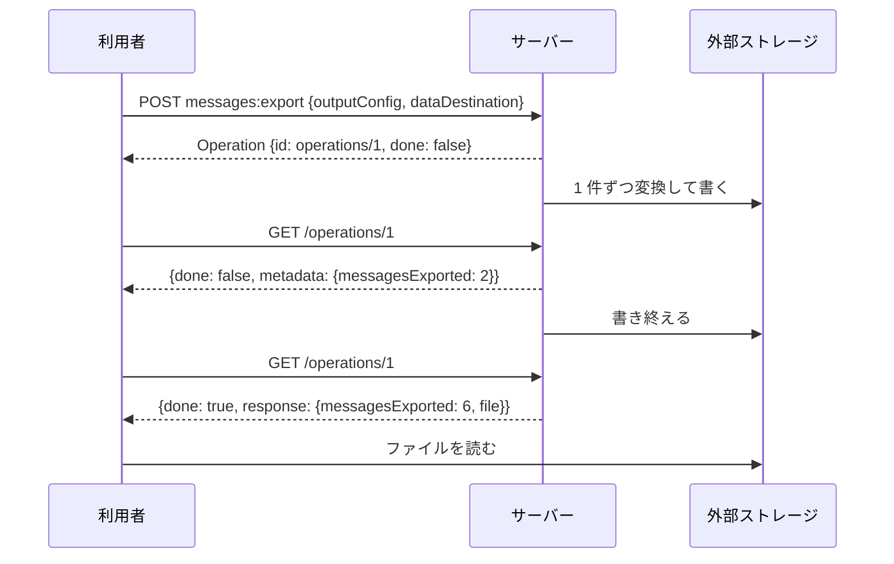

## 本記事の内容
- 『APIデザイン・パターン』(JJ Geewax 著、マイナビ出版) の第 23 章「インポートとエクスポート」を、Go で書き直しながら読んだメモです
- パターンを使わない実装と使う実装を同じ手順で動かして、何が変わるかを出力で確かめます
- コードは Go 1.22 以降の `net/http` と標準ライブラリだけで動きます。外部ストレージの代わりにローカルのファイルを使います
- シリーズの目次は「[Go]APIデザインパターン 00: 目次と、パターンを使わないとどうなるか」にあります

## 1. 結論
リソースのコレクションに `:import` と `:export` のカスタムメソッドを足します。
リクエストには、リソースとバイト列を変換する設定（`inputConfig` / `outputConfig`）と、外部ストレージに関する設定（`dataSource` / `dataDestination`）を別々に持たせます。
どちらのメソッドもすぐに Operation を返し、利用者は進捗を見ながら完了を待ちます。
API が外部ストレージと直接やり取りするので、利用者が中継のプログラムを書いてデータを往復させる必要がなくなります。

バックアップとリストアの代わりにはなりません。
その理由は 6 で書きます。

## 2. 困る場面
大量の Message をストレージから API に入れたい、あるいは API から取り出したい時、API に標準メソッドしか無ければ、利用者はストレージから読んでリソースに変換して create を繰り返すプログラムを書くことになります。
データはストレージから利用者のプログラムを経由して API へと遠回りし、量が増えるほど帯域と時間を食います。

私が最初に思いつく `:export` は、ファイルを書き終えるまで待たせて URL を 1 つ返す形でした。
これだと出力先も形式も選べず、進捗も分からず、途中で止めることもできません。
インポートの側はもっと厄介で、途中で失敗したループをやり直すと同じメッセージが二重に作られます。
4-2 で両方を見ます。

## 3. 足すもの
メソッドは 2 つで、どちらも親リソースの下のコレクションに付けます。
`POST /chatRooms/{room}/messages:export` と `POST /chatRooms/{room}/messages:import` です。
時間がかかる処理なので、戻り値は第 10 章の LRO（ロングランオペレーション）、つまり `Operation` にします。

リクエストの中身は、役割の違う 2 種類の設定に分けます。

- `outputConfig` と `inputConfig` は、リソースとバイト列の変換に関する設定です。形式（json か csv）、圧縮（gzip）、ファイル名のテンプレートを持ちます
- `dataDestination` と `dataSource` は、外部ストレージに関する設定です。`type` でストレージの種類を見分け、種類ごとに必要なフィールドが変わります

読む側と書く側で型を分けるのは、同じ S3 でも、読み込みはグロブで対象のオブジェクトを選び、書き出しはプレフィックスで置き場所を決めるからです。
似ていても同じではないので、独立して変えられるようにしておきます。

振る舞いの決まりは次のとおりです。

- エクスポートは開始時点の写しを取りません。処理中に行われた変更が結果に混じることがあります
- インポートは入力に書かれた `id` を無視して、新しい識別子を振ります。同じファイルを 2 回入れると 2 重に入るのは仕様です
- 失敗したインポートを安全にやり直すために、レコードごとに `importRequestId` を持たせ、処理済みのものは飛ばします
- エクスポートが途中で失敗しても、書き出し済みのデータは消しません
- `filter` はエクスポートにだけ付け、`outputConfig` の中ではなく横に置きます。インポート時のフィルタリングはしません
- 扱うのは 1 種類のリソースだけです。ChatRoom とその中の Message をまとめて、という形にはしません

Go の型にするとこうなります。

```go
type ExportMessagesRequest struct {
	OutputConfig    MessageOutputConfig `json:"outputConfig"`
	DataDestination DataDestination     `json:"dataDestination"`
	Filter          string              `json:"filter,omitempty"` // ①
}

type DataDestination struct {
	Type      string `json:"type"`                // ②
	Directory string `json:"directory,omitempty"` // type が file の時
}

type Operation struct { // ③
	ID       string          `json:"id"`
	Done     bool            `json:"done"`
	Metadata any             `json:"metadata,omitempty"`
	Response any             `json:"response,omitempty"`
	Error    *OperationError `json:"error,omitempty"`
}
```

- ① `outputConfig` はバイト列への変換だけを担当するので、何を出すかを決める `filter` は外に置きます
- ② 書籍は `type: 's3'` の `S3Destination` と `type: 'samba'` の `SambaDestination` を例にしています。この記事では `file` だけ実装しました
- ③ 完了すると `Done` が true になり、`Response` か `Error` のどちらかが入ります。途中は `Metadata` に進捗が入ります

## 4. 前後比較
### 4-1. 使わない場合
`:export` は同期で、固定のディレクトリに JSON を書き終えてから、ダウンロード用の URL を返します。
`:import` はありません。

```go
	mux.HandleFunc("POST /chatRooms/{room}/messages:export", func(w http.ResponseWriter, req *http.Request) {
		room := req.PathValue("room")
		path := filepath.Join(exportDir, "chatRooms-"+room+"-messages.json") // ①
		f, err := os.Create(path)
		if err != nil {
			http.Error(w, "create file: "+err.Error(), http.StatusInternalServerError)
			return
		}
		defer f.Close()
		enc := json.NewEncoder(f)
		for _, m := range s.list(room) {
			enc.Encode(m)
			time.Sleep(300 * time.Millisecond) // ②
		}
		writeJSON(w, http.StatusOK, ExportMessagesResponse{ExportDownloadURI: "http://localhost:8023/downloads/" + filepath.Base(path)})
	})
```

- ① 出力先も形式もサーバーが決め打ちです
- ② 1 件 300 ミリ秒かかる処理のつもりです。書き終えるまでレスポンスを返しません

### 4-2. 動かすと待たされ、やり直すと二重に入る
5 件入った部屋をエクスポートすると、1.5 秒待ってから URL が返ります。

```
$ time curl -s -X POST localhost:8023/chatRooms/1/messages:export
{"exportDownloadUri":"http://localhost:8023/downloads/chatRooms-1-messages.json"}
real 1.540s

$ curl -s localhost:8023/downloads/chatRooms-1-messages.json
{"id":"chatRooms/1/messages/1","sender":"users/2","content":"hi 1"}
{"id":"chatRooms/1/messages/2","sender":"users/1","content":"hi 2"}
{"id":"chatRooms/1/messages/3","sender":"users/2","content":"hi 3"}
{"id":"chatRooms/1/messages/4","sender":"users/1","content":"hi 4"}
{"id":"chatRooms/1/messages/5","sender":"users/2","content":"hi 5"}
```

インポートは、利用者がファイルを読んで 1 行ずつ create を呼ぶしかありません。
2 行目まで入れたところでプログラムが落ちたとして、最初からやり直すとこうなります。

```
$ cat ch23/import.csv
importRequestId,id,sender,content
imp-0001,chatRooms/9/messages/97,users/1,hello
imp-0002,chatRooms/9/messages/98,users/2,hello back
imp-0003,chatRooms/9/messages/99,users/1,see you

$ tail -n +2 ch23/import.csv | head -2 | while IFS=, read rid id sender content; do
    curl -s -X POST localhost:8023/chatRooms/2/messages \
        -d "{\"sender\":\"$sender\",\"content\":\"$content\"}"
  done
{"id":"chatRooms/2/messages/1","sender":"users/1","content":"hello"}
{"id":"chatRooms/2/messages/2","sender":"users/2","content":"hello back"}

$ tail -n +2 ch23/import.csv | while IFS=, read rid id sender content; do
    curl -s -X POST localhost:8023/chatRooms/2/messages \
        -d "{\"sender\":\"$sender\",\"content\":\"$content\"}"
  done
{"id":"chatRooms/2/messages/3","sender":"users/1","content":"hello"}
{"id":"chatRooms/2/messages/4","sender":"users/2","content":"hello back"}
{"id":"chatRooms/2/messages/5","sender":"users/1","content":"see you"}

$ curl -s localhost:8023/chatRooms/2/messages
{"results":[{"id":"chatRooms/2/messages/1","sender":"users/1","content":"hello"},{"id":"chatRooms/2/messages/2","sender":"users/2","content":"hello back"},{"id":"chatRooms/2/messages/3","sender":"users/1","content":"hello"},{"id":"chatRooms/2/messages/4","sender":"users/2","content":"hello back"},{"id":"chatRooms/2/messages/5","sender":"users/1","content":"see you"}]}
```

3 件のはずが 5 件になりました。
API 側には「これは前にも入れたレコードだ」と知る手がかりがありません。

### 4-3. 使う場合（差分）
`:export` のハンドラは、設定を検証して `Operation` を作り、実際の書き出しは goroutine に任せてすぐ返す形に変わります。

```diff go
 	mux.HandleFunc("POST /chatRooms/{room}/messages:export", func(w http.ResponseWriter, req *http.Request) {
 		room := req.PathValue("room")
-		path := filepath.Join(exportDir, "chatRooms-"+room+"-messages.json")
-		f, err := os.Create(path)
-		if err != nil {
-			http.Error(w, "create file: "+err.Error(), http.StatusInternalServerError)
-			return
-		}
-		defer f.Close()
-		enc := json.NewEncoder(f)
-		for _, m := range s.list(room) {
-			enc.Encode(m)
-			time.Sleep(300 * time.Millisecond)
-		}
-		writeJSON(w, http.StatusOK, ExportMessagesResponse{ExportDownloadURI: "http://localhost:8023/downloads/" + filepath.Base(path)})
+		var in ExportMessagesRequest
+		if err := json.NewDecoder(req.Body).Decode(&in); err != nil {
+			http.Error(w, "invalid json: "+err.Error(), http.StatusBadRequest)
+			return
+		}
+		if in.OutputConfig.ContentType == "" {
+			in.OutputConfig.ContentType = "json"
+		}
+		if in.OutputConfig.FilenameTemplate == "" {
+			in.OutputConfig.FilenameTemplate = "messages-part-${number}"
+		}
+		if in.OutputConfig.ContentType != "json" && in.OutputConfig.ContentType != "csv" {
+			http.Error(w, "outputConfig.contentType must be json or csv", http.StatusBadRequest)
+			return
+		}
+		if in.OutputConfig.CompressionFormat != "" && in.OutputConfig.CompressionFormat != "gzip" {
+			http.Error(w, "outputConfig.compressionFormat must be gzip or empty", http.StatusBadRequest)
+			return
+		}
+		if in.DataDestination.Type != "file" || in.DataDestination.Directory == "" { // ①
+			http.Error(w, "dataDestination.type must be file with directory", http.StatusBadRequest)
+			return
+		}
+		op := ops.create(ExportMessagesMetadata{ChatRoom: "chatRooms/" + room})
+		go s.runExport(ops, op.ID, room, in) // ②
+		writeJSON(w, http.StatusOK, op)
 	})
```

- ① 送り先は `type` で見分けます。対応していない種類はここで 400 Bad Request です
- ② 書き出しはバックグラウンドで進め、`Operation` をすぐ返します。利用者は `GET /operations/{id}` で進捗を見ます

書き出しの本体 `runExport` で読んでほしいのはループの条件です。
開始時点の写しは取らず、毎回その時の件数まで読むので、処理中に追加された Message も、処理中に消された Message も結果に混じります。

```go
	n := 0
	for i := 1; i <= s.seqOf(room); i++ { // ①
		m, ok := s.get(room, i)
		if !ok {
			continue
		}
		if req.Filter != "" {
			match, err := matchFilter(req.Filter, m)
			if err != nil {
				fail("INVALID_FILTER", err)
				return
			}
			if !match {
				continue
			}
		}
		if err := rw.Write(m); err != nil {
			fail("WRITE_FAILED", err)
			return
		}
		n++
		ops.update(opID, func(op *Operation) { op.Metadata = ExportMessagesMetadata{ChatRoom: "chatRooms/" + room, MessagesExported: n} })
		time.Sleep(300 * time.Millisecond)
	}
```

- ① `s.seqOf(room)` は毎回いまの件数を返します。`s.list(room)` を先に取って回す形にすると、開始時点の写しになります

インポートの側は、レコードごとの `importRequestId` を保存場所で覚えておき、見たことがあれば飛ばします。
入力に書かれた `id` は使いません。

```go
func (s *store) createImported(room, importRequestID string, m Message) (Message, bool) {
	s.mu.Lock()
	defer s.mu.Unlock()
	r := s.room(room)
	if importRequestID != "" && r.imported[importRequestID] { // ①
		return Message{}, false
	}
	if importRequestID != "" {
		r.imported[importRequestID] = true
	}
	return s.createLocked(room, m), true
}
```

- ① `importRequestId` が無いレコードは毎回作ります。第 26 章の `requestId` と同じ考え方を、1 レコードずつに適用しています

:::message
`go s.runExport(...)` で始めた goroutine は、ハンドラが返った後も動き続けます。
`Operation` の中身はハンドラと goroutine の両方から触るので、`operations` の `map` も `sync.Mutex` で囲んでいます。
:::

:::message
`runExport` では `defer f.Close()` の後に `defer gz.Close()` を書いています。
`defer` は後に書いたものから実行されるので、gzip の終端を書いてからファイルを閉じる順になります。
:::

CSV と JSON の読み書き、`Operation` の保存場所を含めた全文は畳んでおきます。

:::details after/main.go の全文
```go
package main

import (
	"compress/gzip"
	"encoding/csv"
	"encoding/json"
	"errors"
	"fmt"
	"io"
	"log"
	"net/http"
	"os"
	"path/filepath"
	"regexp"
	"strconv"
	"strings"
	"sync"
	"time"
)

type Message struct {
	ID      string `json:"id"`
	Sender  string `json:"sender"`
	Content string `json:"content"`
}

// ---- 入出力の設定（変換の設定と、ストレージの設定を分ける） ----

type MessageOutputConfig struct {
	ContentType       string `json:"contentType,omitempty"`       // "json" | "csv"。未指定は json
	CompressionFormat string `json:"compressionFormat,omitempty"` // "gzip"。未指定は圧縮しない
	FilenameTemplate  string `json:"filenameTemplate,omitempty"`  // 既定 "messages-part-${number}"
}

type MessageInputConfig struct {
	ContentType       string `json:"contentType,omitempty"` // 未指定は拡張子から判定
	CompressionFormat string `json:"compressionFormat,omitempty"`
}

type DataDestination struct {
	Type      string `json:"type"`                // "file"
	Directory string `json:"directory,omitempty"` // type が file の時
}

type DataSource struct {
	Type string `json:"type"`           // "file"
	Path string `json:"path,omitempty"` // type が file の時
}

type ExportMessagesRequest struct {
	OutputConfig    MessageOutputConfig `json:"outputConfig"`
	DataDestination DataDestination     `json:"dataDestination"`
	Filter          string              `json:"filter,omitempty"`
}

type ImportMessagesRequest struct {
	InputConfig MessageInputConfig `json:"inputConfig"`
	DataSource  DataSource         `json:"dataSource"`
}

type ExportMessagesMetadata struct {
	ChatRoom         string `json:"chatRoom"`
	MessagesExported int    `json:"messagesExported"`
}

type ExportMessagesResponse struct {
	ChatRoom         string `json:"chatRoom"`
	MessagesExported int    `json:"messagesExported"`
	File             string `json:"file"`
}

type ImportMessagesMetadata struct {
	ChatRoom         string `json:"chatRoom"`
	MessagesImported int    `json:"messagesImported"`
}

type ImportMessagesResponse struct {
	ChatRoom          string `json:"chatRoom"`
	MessagesImported  int    `json:"messagesImported"`
	DuplicatesSkipped int    `json:"duplicatesSkipped"`
}

// ---- LRO（ロングランオペレーション） ----

type OperationError struct {
	Code    string `json:"code"`
	Message string `json:"message"`
}

type Operation struct {
	ID       string          `json:"id"`
	Done     bool            `json:"done"`
	Metadata any             `json:"metadata,omitempty"`
	Response any             `json:"response,omitempty"`
	Error    *OperationError `json:"error,omitempty"`
}

type operations struct {
	mu  sync.Mutex
	seq int
	ops map[string]Operation
}

func (o *operations) create(metadata any) Operation {
	o.mu.Lock()
	defer o.mu.Unlock()
	o.seq++
	op := Operation{ID: "operations/" + strconv.Itoa(o.seq), Metadata: metadata}
	o.ops[op.ID] = op
	return op
}

func (o *operations) update(id string, fn func(op *Operation)) {
	o.mu.Lock()
	defer o.mu.Unlock()
	op := o.ops[id]
	fn(&op)
	o.ops[id] = op
}

func (o *operations) get(id string) (Operation, bool) {
	o.mu.Lock()
	defer o.mu.Unlock()
	op, ok := o.ops[id]
	return op, ok
}

// ---- 保存場所 ----

type roomData struct {
	seq      int
	messages map[int]Message
	imported map[string]bool // 使用済みの importRequestId
}

type store struct {
	mu    sync.Mutex
	rooms map[string]*roomData
}

func (s *store) room(name string) *roomData {
	r, ok := s.rooms[name]
	if !ok {
		r = &roomData{messages: map[int]Message{}, imported: map[string]bool{}}
		s.rooms[name] = r
	}
	return r
}

func (s *store) create(room string, m Message) Message {
	s.mu.Lock()
	defer s.mu.Unlock()
	return s.createLocked(room, m)
}

func (s *store) createLocked(room string, m Message) Message {
	r := s.room(room)
	r.seq++
	m.ID = fmt.Sprintf("chatRooms/%s/messages/%d", room, r.seq)
	r.messages[r.seq] = m
	return m
}

func (s *store) createImported(room, importRequestID string, m Message) (Message, bool) {
	s.mu.Lock()
	defer s.mu.Unlock()
	r := s.room(room)
	if importRequestID != "" && r.imported[importRequestID] {
		return Message{}, false
	}
	if importRequestID != "" {
		r.imported[importRequestID] = true
	}
	return s.createLocked(room, m), true
}

func (s *store) delete(room string, id int) bool {
	s.mu.Lock()
	defer s.mu.Unlock()
	r := s.room(room)
	_, ok := r.messages[id]
	delete(r.messages, id)
	return ok
}

func (s *store) get(room string, id int) (Message, bool) {
	s.mu.Lock()
	defer s.mu.Unlock()
	m, ok := s.room(room).messages[id]
	return m, ok
}

func (s *store) seqOf(room string) int {
	s.mu.Lock()
	defer s.mu.Unlock()
	return s.room(room).seq
}

func (s *store) list(room string) []Message {
	s.mu.Lock()
	defer s.mu.Unlock()
	r := s.room(room)
	out := []Message{}
	for i := 1; i <= r.seq; i++ {
		if m, ok := r.messages[i]; ok {
			out = append(out, m)
		}
	}
	return out
}

// ---- リソースとバイト列の変換 ----

type recordWriter interface {
	Write(Message) error
	Flush() error
}

type jsonRecords struct{ enc *json.Encoder }

func (j jsonRecords) Write(m Message) error { return j.enc.Encode(m) }
func (j jsonRecords) Flush() error          { return nil }

type csvRecords struct{ w *csv.Writer }

func (c csvRecords) Write(m Message) error {
	return c.w.Write([]string{m.ID, m.Sender, m.Content})
}
func (c csvRecords) Flush() error { c.w.Flush(); return c.w.Error() }

func newRecordWriter(w io.Writer, contentType string) (recordWriter, error) {
	switch contentType {
	case "json":
		return jsonRecords{enc: json.NewEncoder(w)}, nil
	case "csv":
		cw := csv.NewWriter(w)
		if err := cw.Write([]string{"id", "sender", "content"}); err != nil {
			return nil, err
		}
		return csvRecords{w: cw}, nil
	}
	return nil, fmt.Errorf("unsupported contentType %q", contentType)
}

type importRecord struct {
	ImportRequestID string `json:"importRequestId"`
	ID              string `json:"id"`
	Sender          string `json:"sender"`
	Content         string `json:"content"`
}

func readRecords(r io.Reader, contentType string) ([]importRecord, error) {
	var out []importRecord
	switch contentType {
	case "json":
		dec := json.NewDecoder(r)
		for {
			var rec importRecord
			if err := dec.Decode(&rec); err == io.EOF {
				return out, nil
			} else if err != nil {
				return nil, err
			}
			out = append(out, rec)
		}
	case "csv":
		rows, err := csv.NewReader(r).ReadAll()
		if err != nil {
			return nil, err
		}
		if len(rows) == 0 {
			return nil, errors.New("csv has no header row")
		}
		col := map[string]int{}
		for i, name := range rows[0] {
			col[strings.TrimSpace(name)] = i
		}
		pick := func(row []string, name string) string {
			if i, ok := col[name]; ok && i < len(row) {
				return strings.TrimSpace(row[i])
			}
			return ""
		}
		for _, row := range rows[1:] {
			out = append(out, importRecord{
				ImportRequestID: pick(row, "importRequestId"),
				ID:              pick(row, "id"),
				Sender:          pick(row, "sender"),
				Content:         pick(row, "content"),
			})
		}
		return out, nil
	}
	return nil, fmt.Errorf("unsupported contentType %q", contentType)
}

// ---- エクスポート時のフィルター（field = "value" だけ対応） ----

var simpleFilter = regexp.MustCompile(`^(\w+)\s*=\s*"([^"]*)"$`)

func matchFilter(filter string, m Message) (bool, error) {
	g := simpleFilter.FindStringSubmatch(filter)
	if g == nil {
		return false, fmt.Errorf("unsupported filter %q", filter)
	}
	switch g[1] {
	case "id":
		return m.ID == g[2], nil
	case "sender":
		return m.Sender == g[2], nil
	case "content":
		return m.Content == g[2], nil
	}
	return false, fmt.Errorf("invalid field %q", g[1])
}

// ---- バックグラウンドの処理 ----

func (s *store) runExport(ops *operations, opID, room string, req ExportMessagesRequest) {
	fail := func(code string, err error) {
		ops.update(opID, func(op *Operation) { op.Done = true; op.Error = &OperationError{Code: code, Message: err.Error()} })
	}
	name := strings.ReplaceAll(req.OutputConfig.FilenameTemplate, "${number}", "0001") + "." + req.OutputConfig.ContentType
	if req.OutputConfig.CompressionFormat == "gzip" {
		name += ".gz"
	}
	path := filepath.Join(req.DataDestination.Directory, name)
	f, err := os.Create(path)
	if err != nil {
		fail("DESTINATION_UNAVAILABLE", err)
		return
	}
	defer f.Close()
	var w io.Writer = f
	if req.OutputConfig.CompressionFormat == "gzip" {
		gz := gzip.NewWriter(f)
		defer gz.Close()
		w = gz
	}
	rw, err := newRecordWriter(w, req.OutputConfig.ContentType)
	if err != nil {
		fail("INVALID_OUTPUT_CONFIG", err)
		return
	}
	n := 0
	for i := 1; i <= s.seqOf(room); i++ {
		m, ok := s.get(room, i)
		if !ok {
			continue
		}
		if req.Filter != "" {
			match, err := matchFilter(req.Filter, m)
			if err != nil {
				fail("INVALID_FILTER", err)
				return
			}
			if !match {
				continue
			}
		}
		if err := rw.Write(m); err != nil {
			fail("WRITE_FAILED", err)
			return
		}
		n++
		ops.update(opID, func(op *Operation) {
			op.Metadata = ExportMessagesMetadata{ChatRoom: "chatRooms/" + room, MessagesExported: n}
		})
		time.Sleep(300 * time.Millisecond)
	}
	if err := rw.Flush(); err != nil {
		fail("WRITE_FAILED", err)
		return
	}
	ops.update(opID, func(op *Operation) {
		op.Done = true
		op.Response = ExportMessagesResponse{ChatRoom: "chatRooms/" + room, MessagesExported: n, File: path}
	})
}

func (s *store) runImport(ops *operations, opID, room string, req ImportMessagesRequest) {
	fail := func(code string, err error) {
		ops.update(opID, func(op *Operation) { op.Done = true; op.Error = &OperationError{Code: code, Message: err.Error()} })
	}
	f, err := os.Open(req.DataSource.Path)
	if err != nil {
		fail("SOURCE_UNAVAILABLE", err)
		return
	}
	defer f.Close()
	var r io.Reader = f
	if req.InputConfig.CompressionFormat == "gzip" {
		gz, err := gzip.NewReader(f)
		if err != nil {
			fail("INVALID_INPUT_CONFIG", err)
			return
		}
		defer gz.Close()
		r = gz
	}
	records, err := readRecords(r, req.InputConfig.ContentType)
	if err != nil {
		fail("INVALID_INPUT", err)
		return
	}
	n, skipped := 0, 0
	for _, rec := range records {
		_, created := s.createImported(room, rec.ImportRequestID, Message{Sender: rec.Sender, Content: rec.Content})
		if !created {
			skipped++
			continue
		}
		n++
		ops.update(opID, func(op *Operation) {
			op.Metadata = ImportMessagesMetadata{ChatRoom: "chatRooms/" + room, MessagesImported: n}
		})
		time.Sleep(100 * time.Millisecond)
	}
	ops.update(opID, func(op *Operation) {
		op.Done = true
		op.Response = ImportMessagesResponse{ChatRoom: "chatRooms/" + room, MessagesImported: n, DuplicatesSkipped: skipped}
	})
}

func writeJSON(w http.ResponseWriter, status int, v any) {
	w.Header().Set("Content-Type", "application/json")
	w.WriteHeader(status)
	json.NewEncoder(w).Encode(v)
}

func main() {
	s := &store{rooms: map[string]*roomData{}}
	ops := &operations{ops: map[string]Operation{}}
	for i := 1; i <= 5; i++ {
		s.create("1", Message{Sender: "users/" + strconv.Itoa(i%2+1), Content: "hi " + strconv.Itoa(i)})
	}
	mux := http.NewServeMux()

	mux.HandleFunc("POST /chatRooms/{room}/messages", func(w http.ResponseWriter, req *http.Request) {
		var m Message
		if err := json.NewDecoder(req.Body).Decode(&m); err != nil {
			http.Error(w, "invalid json: "+err.Error(), http.StatusBadRequest)
			return
		}
		writeJSON(w, http.StatusOK, s.create(req.PathValue("room"), m))
	})

	mux.HandleFunc("GET /chatRooms/{room}/messages", func(w http.ResponseWriter, req *http.Request) {
		writeJSON(w, http.StatusOK, map[string]any{"results": s.list(req.PathValue("room"))})
	})

	mux.HandleFunc("DELETE /chatRooms/{room}/messages/{id}", func(w http.ResponseWriter, req *http.Request) {
		id, _ := strconv.Atoi(req.PathValue("id"))
		if !s.delete(req.PathValue("room"), id) {
			http.Error(w, "not found", http.StatusNotFound)
			return
		}
		w.WriteHeader(http.StatusNoContent)
	})

	mux.HandleFunc("POST /chatRooms/{room}/messages:export", func(w http.ResponseWriter, req *http.Request) {
		room := req.PathValue("room")
		var in ExportMessagesRequest
		if err := json.NewDecoder(req.Body).Decode(&in); err != nil {
			http.Error(w, "invalid json: "+err.Error(), http.StatusBadRequest)
			return
		}
		if in.OutputConfig.ContentType == "" {
			in.OutputConfig.ContentType = "json"
		}
		if in.OutputConfig.FilenameTemplate == "" {
			in.OutputConfig.FilenameTemplate = "messages-part-${number}"
		}
		if in.OutputConfig.ContentType != "json" && in.OutputConfig.ContentType != "csv" {
			http.Error(w, "outputConfig.contentType must be json or csv", http.StatusBadRequest)
			return
		}
		if in.OutputConfig.CompressionFormat != "" && in.OutputConfig.CompressionFormat != "gzip" {
			http.Error(w, "outputConfig.compressionFormat must be gzip or empty", http.StatusBadRequest)
			return
		}
		if in.DataDestination.Type != "file" || in.DataDestination.Directory == "" {
			http.Error(w, "dataDestination.type must be file with directory", http.StatusBadRequest)
			return
		}
		op := ops.create(ExportMessagesMetadata{ChatRoom: "chatRooms/" + room})
		go s.runExport(ops, op.ID, room, in)
		writeJSON(w, http.StatusOK, op)
	})

	mux.HandleFunc("POST /chatRooms/{room}/messages:import", func(w http.ResponseWriter, req *http.Request) {
		room := req.PathValue("room")
		var in ImportMessagesRequest
		if err := json.NewDecoder(req.Body).Decode(&in); err != nil {
			http.Error(w, "invalid json: "+err.Error(), http.StatusBadRequest)
			return
		}
		if in.DataSource.Type != "file" || in.DataSource.Path == "" {
			http.Error(w, "dataSource.type must be file with path", http.StatusBadRequest)
			return
		}
		if in.InputConfig.ContentType == "" {
			in.InputConfig.ContentType = strings.TrimPrefix(filepath.Ext(strings.TrimSuffix(in.DataSource.Path, ".gz")), ".")
		}
		if in.InputConfig.ContentType != "json" && in.InputConfig.ContentType != "csv" {
			http.Error(w, "inputConfig.contentType must be json or csv", http.StatusBadRequest)
			return
		}
		op := ops.create(ImportMessagesMetadata{ChatRoom: "chatRooms/" + room})
		go s.runImport(ops, op.ID, room, in)
		writeJSON(w, http.StatusOK, op)
	})

	mux.HandleFunc("GET /operations/{id}", func(w http.ResponseWriter, req *http.Request) {
		op, ok := ops.get("operations/" + req.PathValue("id"))
		if !ok {
			http.Error(w, "not found", http.StatusNotFound)
			return
		}
		writeJSON(w, http.StatusOK, op)
	})

	log.Fatal(http.ListenAndServe(":8123", mux))
}
```
:::

### 4-4. 同じ手順で動かすとすぐ返り、やり直しても二重に入らない
エクスポートを頼むと、書き出しが終わる前に `Operation` が返ります。
その直後に Message 1 を消し、Message 6 を足してから、進捗を 2 回見ます。

```
$ curl -s -X POST localhost:8123/chatRooms/1/messages:export \
    -d '{"outputConfig":{"contentType":"csv"},"dataDestination":{"type":"file","directory":"ch23/out"}}'
{"id":"operations/1","done":false,"metadata":{"chatRoom":"chatRooms/1","messagesExported":0}}

$ curl -s -i -X DELETE localhost:8123/chatRooms/1/messages/1
HTTP/1.1 204 No Content

$ curl -s -X POST localhost:8123/chatRooms/1/messages -d '{"sender":"users/3","content":"late"}'
{"id":"chatRooms/1/messages/6","sender":"users/3","content":"late"}

$ curl -s localhost:8123/operations/1
{"id":"operations/1","done":false,"metadata":{"chatRoom":"chatRooms/1","messagesExported":2}}

$ curl -s localhost:8123/operations/1
{"id":"operations/1","done":true,"metadata":{"chatRoom":"chatRooms/1","messagesExported":6},"response":{"chatRoom":"chatRooms/1","messagesExported":6,"file":"ch23/out/messages-part-0001.csv"}}

$ cat ch23/out/messages-part-0001.csv
id,sender,content
chatRooms/1/messages/1,users/2,hi 1
chatRooms/1/messages/2,users/1,hi 2
chatRooms/1/messages/3,users/2,hi 3
chatRooms/1/messages/4,users/1,hi 4
chatRooms/1/messages/5,users/2,hi 5
chatRooms/1/messages/6,users/3,late

$ curl -s localhost:8123/chatRooms/1/messages
{"results":[{"id":"chatRooms/1/messages/2","sender":"users/1","content":"hi 2"},{"id":"chatRooms/1/messages/3","sender":"users/2","content":"hi 3"},{"id":"chatRooms/1/messages/4","sender":"users/1","content":"hi 4"},{"id":"chatRooms/1/messages/5","sender":"users/2","content":"hi 5"},{"id":"chatRooms/1/messages/6","sender":"users/3","content":"late"}]}
```

書き出されたファイルには 1 から 6 までの 6 件が入っていますが、API の中に 1 と 6 が同時に存在した瞬間はありません。
これが書籍の表 23.1 で説明されている「最新ではないデータ」です。

同じ CSV を 2 回インポートすると、2 回目は 3 件とも飛ばされます。
入力の `id` 列（`chatRooms/9/messages/97` など）は使われず、新しい識別子が振られています。

```
$ curl -s -X POST localhost:8123/chatRooms/2/messages:import \
    -d '{"inputConfig":{"contentType":"csv"},"dataSource":{"type":"file","path":"ch23/import.csv"}}'
{"id":"operations/2","done":false,"metadata":{"chatRoom":"chatRooms/2","messagesImported":0}}

$ curl -s localhost:8123/operations/2
{"id":"operations/2","done":true,"metadata":{"chatRoom":"chatRooms/2","messagesImported":3},"response":{"chatRoom":"chatRooms/2","messagesImported":3,"duplicatesSkipped":0}}

$ curl -s -X POST localhost:8123/chatRooms/2/messages:import \
    -d '{"inputConfig":{"contentType":"csv"},"dataSource":{"type":"file","path":"ch23/import.csv"}}'
{"id":"operations/3","done":false,"metadata":{"chatRoom":"chatRooms/2","messagesImported":0}}

$ curl -s localhost:8123/operations/3
{"id":"operations/3","done":true,"metadata":{"chatRoom":"chatRooms/2","messagesImported":0},"response":{"chatRoom":"chatRooms/2","messagesImported":0,"duplicatesSkipped":3}}

$ curl -s localhost:8123/chatRooms/2/messages
{"results":[{"id":"chatRooms/2/messages/1","sender":"users/1","content":"hello"},{"id":"chatRooms/2/messages/2","sender":"users/2","content":"hello back"},{"id":"chatRooms/2/messages/3","sender":"users/1","content":"see you"}]}
```

`filter` と gzip を付けたエクスポートと、対応していない送り先、解釈できない `filter` も試しておきます。
送り先の誤りはリクエストの時点で 400 Bad Request になり、`filter` の誤りは `Operation` の `error` に入ります。

```
$ curl -s -X POST localhost:8123/chatRooms/1/messages:export \
    -d '{"outputConfig":{"contentType":"json","compressionFormat":"gzip"},
         "dataDestination":{"type":"file","directory":"ch23/out"},"filter":"sender = \"users/1\""}'
{"id":"operations/4","done":false,"metadata":{"chatRoom":"chatRooms/1","messagesExported":0}}

$ gunzip -c ch23/out/messages-part-0001.json.gz
{"id":"chatRooms/1/messages/2","sender":"users/1","content":"hi 2"}
{"id":"chatRooms/1/messages/4","sender":"users/1","content":"hi 4"}

$ curl -s -i -X POST localhost:8123/chatRooms/1/messages:export \
    -d '{"outputConfig":{},"dataDestination":{"type":"s3","bucketId":"my-bucket"}}'
HTTP/1.1 400 Bad Request
Content-Type: text/plain; charset=utf-8

dataDestination.type must be file with directory

$ curl -s -X POST localhost:8123/chatRooms/1/messages:export \
    -d '{"outputConfig":{},"dataDestination":{"type":"file","directory":"ch23/out"},"filter":"admin.name = \"Luca\""}'
{"id":"operations/5","done":false,"metadata":{"chatRoom":"chatRooms/1","messagesExported":0}}

$ curl -s localhost:8123/operations/5
{"id":"operations/5","done":true,"metadata":{"chatRoom":"chatRooms/1","messagesExported":0},"error":{"code":"INVALID_FILTER","message":"unsupported filter \"admin.name = \\\"Luca\\\"\""}}
```

## 5. 1 リクエストの流れ
エクスポートを頼んでから結果を受け取るまでを、順に追います。
送る側を利用者、受ける側をサーバー、書き出し先を外部ストレージと呼びます。

1. 利用者が `POST /chatRooms/1/messages:export` に `outputConfig` と `dataDestination` を送る
2. サーバーは JSON を読み、形式と圧縮と送り先の `type` を確認する。対応していなければ 400
3. `Operation` を作って保存し、書き出しを goroutine で始め、`done: false` の `Operation` を 200 で返す
4. goroutine は送り先にファイルを開き、Message を 1 件ずつ読んでは変換して書き、`metadata.messagesExported` を進める。`filter` があれば 1 件ごとに判定する
5. 利用者は `GET /operations/1` で進捗を見る。`done: false` の間は `metadata` だけが入っている
6. 全件書き終えたら `done: true` にし、`response` に件数とファイル名を入れる。途中で失敗したら `error` に理由を入れて `done: true` にする
7. 利用者は `done: true` を見てから、外部ストレージのファイルを読む



## 6. 疑問と答え
読みながら引っかかったところです。

**なぜ結果ではなく `Operation` を返すのか**
件数が多いと数分から数時間かかるので、同期で返すとその間ずっと接続を保つことになるからです。
`Operation` を返しておけば、利用者は進捗を見ながら待てますし、サーバーは途中経過を `metadata` に書くだけで済みます。
`Operation` そのものの設計は第 10 章にあります。

**`inputConfig` と `dataSource` を 1 つにまとめてはいけないのか**
変換の設定とストレージの設定は、独立に増えていくからです。
1 つにまとめると、S3 用の鍵と Samba 用のパスワードを同じ `password` フィールドで兼ねたくなり、どの場面で何が必須かが分からなくなります。
分けておけば、S3 の設定を User のインポートでも Message のインポートでも使い回せます。

**存在したことのない組み合わせがエクスポートされるのは、なぜ許されるのか**
ある時点の写しを読める仕組みを、すべてのストレージが持っているわけではないからです。
`:export` は list と同じ「その時に読めたもの」を外に流すだけで、写しの保証はしません。
それでは困る用途なら、エクスポート中の書き込みを止めるか、写しを取れる仕組みの上で動かします。

**インポートの時に `id` を無視するのはなぜか**
`:import` は、ファイルを読んで create を大量に呼ぶのと同じ機能として定義されているからです。
利用者が識別子を指定できない API（第 6 章）なら、create と同じく無視します。
元の `id` を残すのはエクスポートの側で、後からどこから来たデータかを辿るためです。

**同じファイルを 2 回入れたら二重になるのでは**
`importRequestId` が無ければそのとおりで、書籍はそれを意図した動作だと書いています。
二重を避けたいのは「途中で失敗したやり直し」の場面で、そのためにレコードごとの `importRequestId` があります。
エクスポート時に `importRequestId` を書き出すオプションを `outputConfig` に足す案も書籍に出てきます。

**エクスポートに失敗したら、書きかけのファイルは消すべきか**
消しません。
API に外部ストレージの削除権限があるとは限りませんし、途中までのデータに価値があるかどうかはサーバーには判断できません。
消すかどうかはストレージの持ち主に任せます。

**ChatRoom ごと、中の Message も一緒にエクスポートしたい**
それはバックアップとリストアの領域で、この 2 つのメソッドの守備範囲ではありません。
`:import` と `:export` は 1 種類のリソースだけを扱い、親子関係や参照の整合は見ません。

ここまでを自分の言葉でまとめると、`:import` と `:export` は API と外部ストレージを直結する配管であって、写しの保証も親子関係の扱いもしない、やり直しの安全は `importRequestId` で確保する、です。

## 7. トレードオフ
得られるのは、利用者が中継のプログラムを書かずに済むことと、データが遠回りしないことです。
変換の設定とストレージの設定を分けてあるので、新しいストレージへの対応も `type` を 1 つ増やすだけで済みます。
引き換えに、このパターンでできるのは 1 種類のリソースを出し入れすることだけで、親子関係のあるデータをまとめて扱うことも、ある時点の写しを保証することもできません。

書籍は、関連リソースごと保存して戻したい用途にはバックアップとリストアを別に用意し、この 2 つのメソッドを混同しないよう念を押しています。

## 8. 参考
- 『APIデザイン・パターン』JJ Geewax 著、マイナビ出版、第 23 章
- https://google.aip.dev/153
- AWS DynamoDB の `ExportTableToPointInTime` は、リクエストに `S3Bucket` と `S3Prefix`（送り先）と `ExportFormat`（形式）を持ち、`ExportArn` と `ExportStatus` を含む `ExportDescription` をすぐ返します。進捗は `DescribeExport` で見ます。こちらはポイントインタイムの写しを書き出す側の例です: https://docs.aws.amazon.com/amazondynamodb/latest/APIReference/API_ExportTableToPointInTime.html
