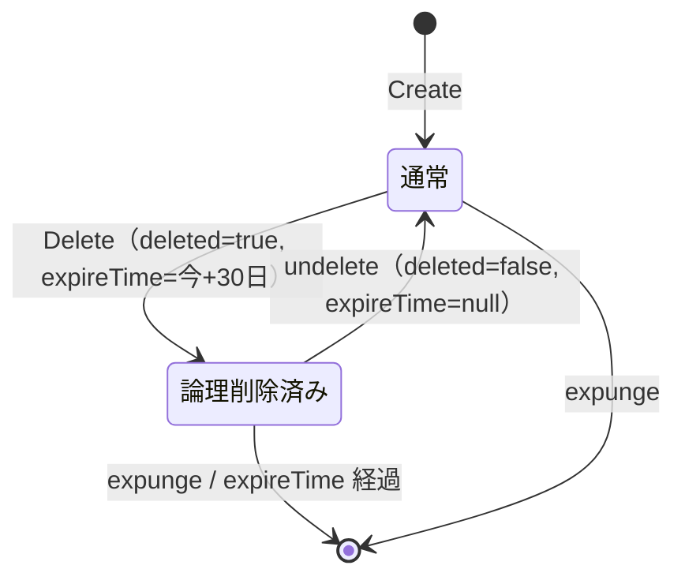

## 本記事の内容
- 『APIデザイン・パターン』(JJ Geewax 著、マイナビ出版) の第 25 章「論理削除」を、Go で書き直しながら読んだメモです
- パターンを使わない実装と使う実装を同じ手順で動かして、何が変わるかを出力で確かめます
- コードは Go 1.22 以降の `net/http` と標準ライブラリだけで動きます
- シリーズの目次は「[Go]APIデザインパターン 00: 目次と、パターンを使わないとどうなるか」にあります

## 1. 結論
リソースに出力専用の `deleted` と `expireTime` を足します。
標準の delete は、この 2 つに値を入れるだけの処理に変えます。
削除を取り消す `:undelete` を用意しておけば、間違えて消しても戻せます。
本当に消す処理は、カスタムメソッドの `:expunge` と期限切れの定期処理だけが持ちます。

規制で「要求されたら確実に消す」ことが求められるデータには向きません。
その場合は物理削除のままにして、誤削除にはバックアップで備える方が筋が通ります。

## 2. 困る場面
削除した後で「間違えた」と気付くことは、API でも普通に起きます。
条件を間違えたスクリプトで対象外まで消してしまう、不要だと思って消したら必要だった、といった場面です。
標準の delete が物理削除だと、気付いた時には戻す手段がありません。
4-2 で、DELETE の直後に GET が 404 Not Found になるところを見ます。

## 3. 足すもの
増えるのはリソースのフィールド 2 つ、list のパラメータ 1 つ、カスタムメソッド 2 つ、それに期限切れを消す定期処理です。

`deleted` は bool で、出力専用にします。
update で `deleted: true` を送られても無視して 200 OK を返し、値を変えるのは delete と `:undelete` だけです。
既に状態フィールド（承認待ち、アクティブ、停止）があるリソースなら「削除済み」の状態を足す案もありますが、復元先の状態が決められなくなるので、直交する bool を別に持つ方が扱いやすいです。

`expireTime` には delete の時に「今 + 保持期間」を入れ、`:undelete` で null に戻します。
期限の計算を delete 側に持たせておくと、保持期間を 30 日から 45 日に変えても、新しく削除したものにだけ効きます。

標準メソッドは 3 つ変わります。
get は削除済みでも返します（404 にしません）。
list は既定で削除済みを除き、`includeDeleted=true` で含めます。
`filter` と混ぜないのは、`filter` が結果を絞る役で、`includeDeleted` は母集団を増やす役だからです。
delete は印を付けてそのリソースを返し、既に削除済みなら 412 Precondition Failed にします。

カスタムメソッドは `:undelete` と `:expunge` の 2 つです。
`:expunge` は論理削除済みかどうかを問わず物理削除して、204 No Content を返します。
delete に `?expunge=true` を足す案は、クエリ 1 つで結果が激変するうえ権限を分けにくいので採りません。

書籍 25.3 はこのほかに、参照整合性とバッチ delete、既存 API への追加にも触れています。
物理削除の時に課していた制約や連鎖はそのまま論理削除にも適用し、バッチ delete も論理削除になります。
既存の API に後から足す時は delete の振る舞いが変わるので、原則として後方互換性のない変更として扱います。

HTTP との対応を表にします。

| リクエスト | 成功 | 前提条件違反 | 無い |
|---|---|---|---|
| `DELETE /chatRooms/{id}` | 200 OK とリソース | 412 | 404 |
| `POST /chatRooms/{id}:undelete` | 200 OK とリソース | 412 | 404 |
| `POST /chatRooms/{id}:expunge` | 204 No Content | - | 404 |
| `GET /chatRooms?includeDeleted=true` | 200 OK | - | - |

Go の型にするとこうなります。

```go
type ChatRoom struct {
	ID         string     `json:"id"`
	Title      string     `json:"title"`
	Deleted    bool       `json:"deleted"`    // ①
	ExpireTime *time.Time `json:"expireTime"` // ②
}

const retention = 30 * 24 * time.Hour

var (
	errNotFound     = errors.New("not found")
	errPrecondition = errors.New("precondition failed")
)

func statusOf(err error) int { // ③
	switch {
	case errors.Is(err, errNotFound):
		return http.StatusNotFound
	case errors.Is(err, errPrecondition):
		return http.StatusPreconditionFailed
	default:
		return http.StatusInternalServerError
	}
}
```

- ① 出力専用です。利用者が送ってきても `create` で捨てます
- ② `*time.Time` にしているのは JSON で `null` を出すためです。値型の `time.Time` だと `0001-01-01T00:00:00Z` が出ます
- ③ 保存場所が返した原因（無い、前提条件違反）をステータスコードに変えます

:::message
`fmt.Errorf("chatRoom %s: %w", id, errNotFound)` のように `%w` で包むと、呼び出し側の `errors.Is(err, errNotFound)` が真になります。
文字列を見比べずに原因を判定できるので、ハンドラでステータスコードを決める時に使えます。
:::

## 4. 前後比較
### 4-1. 使わない場合
delete は `map` から消して 204 No Content を返す形です。

```go
func (s *store) delete(id string) bool {
	s.mu.Lock()
	defer s.mu.Unlock()
	if _, ok := s.rooms[id]; !ok {
		return false
	}
	delete(s.rooms, id) // ①
	return true
}

func main() {
	s := &store{rooms: map[string]ChatRoom{}}
	mux := http.NewServeMux()

	mux.HandleFunc("DELETE /chatRooms/{id}", func(w http.ResponseWriter, req *http.Request) {
		if !s.delete(req.PathValue("id")) {
			http.Error(w, "not found", http.StatusNotFound)
			return
		}
		w.WriteHeader(http.StatusNoContent)
	})

	log.Fatal(http.ListenAndServe(":8025", mux))
}
```

- ① 組み込み関数 `delete` で map の要素を消します。消した後に同じ id で読んでも何もありません

`POST /chatRooms`、`GET /chatRooms`、`GET /chatRooms/{id}` は第 26 章の記事と同じ形です。

### 4-2. 動かすと消した部屋が二度と読めない
2 つ作って 1 つ消し、消したものを読みます。

```
$ curl -s -X POST localhost:8025/chatRooms \
    -d '{"resource":{"title":"Chat about A"}}'
{"id":"1","title":"Chat about A"}

$ curl -s -X POST localhost:8025/chatRooms \
    -d '{"resource":{"title":"Chat about B"}}'
{"id":"2","title":"Chat about B"}

$ curl -s -i -X DELETE localhost:8025/chatRooms/1
HTTP/1.1 204 No Content

$ curl -s -i localhost:8025/chatRooms/1
HTTP/1.1 404 Not Found
Content-Type: text/plain; charset=utf-8

not found

$ curl -s localhost:8025/chatRooms
{"results":[{"id":"2","title":"Chat about B"}]}
```

`id: 1` は 204 の時点で無くなり、間違いだったと気付いても API には戻す手段がありません。

### 4-3. 使う場合（差分）
保存場所の操作を、印を付ける `softDelete`、外す `undelete`、本当に消す `expunge`、期限切れを消す `sweep` の 4 つにします。
4-1 の `delete` はこう変わります。

```diff go
-func (s *store) delete(id string) bool {
+func (s *store) softDelete(id string, now time.Time) (ChatRoom, error) {
 	s.mu.Lock()
 	defer s.mu.Unlock()
-	if _, ok := s.rooms[id]; !ok {
-		return false
+	r, ok := s.rooms[id]
+	if !ok {
+		return ChatRoom{}, fmt.Errorf("chatRoom %s: %w", id, errNotFound)
 	}
-	delete(s.rooms, id)
-	return true
+	if r.Deleted {
+		return ChatRoom{}, fmt.Errorf("chatRoom %s is already deleted: %w", id, errPrecondition) // ①
+	}
+	exp := now.Add(retention)
+	r.Deleted, r.ExpireTime = true, &exp // ②
+	s.rooms[id] = r
+	return r, nil
 }
```

ハンドラ側は DELETE の返し方が変わり、`:undelete` と `:expunge` を受ける POST が増えます。

```diff go
 	mux.HandleFunc("DELETE /chatRooms/{id}", func(w http.ResponseWriter, req *http.Request) {
-		if !s.delete(req.PathValue("id")) {
-			http.Error(w, "not found", http.StatusNotFound)
+		room, err := s.softDelete(req.PathValue("id"), time.Now())
+		if err != nil {
+			http.Error(w, err.Error(), statusOf(err))
 			return
 		}
-		w.WriteHeader(http.StatusNoContent)
+		writeJSON(w, http.StatusOK, room) // ③
 	})
+	mux.HandleFunc("POST /chatRooms/{idverb}", func(w http.ResponseWriter, req *http.Request) {
+		id, verb, _ := strings.Cut(req.PathValue("idverb"), ":") // ④
+		switch verb {
+		case "undelete":
+			room, err := s.undelete(id)
+			if err != nil {
+				http.Error(w, err.Error(), statusOf(err))
+				return
+			}
+			writeJSON(w, http.StatusOK, room)
+		case "expunge":
+			if err := s.expunge(id); err != nil {
+				http.Error(w, err.Error(), statusOf(err))
+				return
+			}
+			w.WriteHeader(http.StatusNoContent)
+		default:
+			http.NotFound(w, req)
+		}
+	})
```

- ① 既に削除済みなら前提条件違反として返し、`statusOf` が 412 にします
- ② 4-1 で `delete(s.rooms, id)` だった行が、印と期限の書き込みに変わります
- ③ 以前の 204 ではなく、印の付いたリソースを返します
- ④ Go 1.22 の `ServeMux` では `{id}:undelete` のようにセグメントの一部だけを変数にできないので、`1:undelete` 全体を受けて `:` で分けます

`GET /chatRooms` は `includeDeleted` クエリを見て `list(includeDeleted)` を呼ぶように変わり、`GET /chatRooms/{id}` は変えていません。
`undelete`、`expunge`、`sweep` を含めた全文は畳んでおきます。

:::message
`main` の先頭で `go func() { ... }()` を使い、`time.Tick(time.Minute)` で 1 分ごとに `sweep` を回す goroutine を起動しています。
`go` を付けた関数呼び出しは別の goroutine で走り、`main` はそのまま次の行に進みます。
:::

:::details after/main.go の全文
```go
package main

import (
	"encoding/json"
	"errors"
	"fmt"
	"log"
	"net/http"
	"strconv"
	"strings"
	"sync"
	"time"
)

type ChatRoom struct {
	ID         string     `json:"id"`
	Title      string     `json:"title"`
	Deleted    bool       `json:"deleted"`
	ExpireTime *time.Time `json:"expireTime"`
}

type CreateChatRoomRequest struct {
	Resource ChatRoom `json:"resource"`
}

const retention = 30 * 24 * time.Hour

var (
	errNotFound     = errors.New("not found")
	errPrecondition = errors.New("precondition failed")
)

type store struct {
	mu    sync.Mutex
	seq   int
	rooms map[string]ChatRoom
}

func (s *store) create(r ChatRoom) ChatRoom {
	s.mu.Lock()
	defer s.mu.Unlock()
	s.seq++
	r.ID = strconv.Itoa(s.seq)
	r.Deleted, r.ExpireTime = false, nil
	s.rooms[r.ID] = r
	return r
}

func (s *store) get(id string) (ChatRoom, bool) {
	s.mu.Lock()
	defer s.mu.Unlock()
	r, ok := s.rooms[id]
	return r, ok
}

func (s *store) list(includeDeleted bool) []ChatRoom {
	s.mu.Lock()
	defer s.mu.Unlock()
	out := []ChatRoom{}
	for i := 1; i <= s.seq; i++ {
		r, ok := s.rooms[strconv.Itoa(i)]
		if !ok || (r.Deleted && !includeDeleted) {
			continue
		}
		out = append(out, r)
	}
	return out
}

func (s *store) softDelete(id string, now time.Time) (ChatRoom, error) {
	s.mu.Lock()
	defer s.mu.Unlock()
	r, ok := s.rooms[id]
	if !ok {
		return ChatRoom{}, fmt.Errorf("chatRoom %s: %w", id, errNotFound)
	}
	if r.Deleted {
		return ChatRoom{}, fmt.Errorf("chatRoom %s is already deleted: %w", id, errPrecondition)
	}
	exp := now.Add(retention)
	r.Deleted, r.ExpireTime = true, &exp
	s.rooms[id] = r
	return r, nil
}

func (s *store) undelete(id string) (ChatRoom, error) {
	s.mu.Lock()
	defer s.mu.Unlock()
	r, ok := s.rooms[id]
	if !ok {
		return ChatRoom{}, fmt.Errorf("chatRoom %s: %w", id, errNotFound)
	}
	if !r.Deleted {
		return ChatRoom{}, fmt.Errorf("chatRoom %s is not deleted: %w", id, errPrecondition)
	}
	r.Deleted, r.ExpireTime = false, nil
	s.rooms[id] = r
	return r, nil
}

func (s *store) expunge(id string) error {
	s.mu.Lock()
	defer s.mu.Unlock()
	if _, ok := s.rooms[id]; !ok {
		return fmt.Errorf("chatRoom %s: %w", id, errNotFound)
	}
	delete(s.rooms, id)
	return nil
}

func (s *store) sweep(now time.Time) {
	s.mu.Lock()
	defer s.mu.Unlock()
	for id, r := range s.rooms {
		if r.Deleted && !r.ExpireTime.After(now) {
			delete(s.rooms, id)
		}
	}
}

func statusOf(err error) int {
	switch {
	case errors.Is(err, errNotFound):
		return http.StatusNotFound
	case errors.Is(err, errPrecondition):
		return http.StatusPreconditionFailed
	default:
		return http.StatusInternalServerError
	}
}

func writeJSON(w http.ResponseWriter, status int, v any) {
	w.Header().Set("Content-Type", "application/json")
	w.WriteHeader(status)
	json.NewEncoder(w).Encode(v)
}

func main() {
	s := &store{rooms: map[string]ChatRoom{}}
	go func() {
		for now := range time.Tick(time.Minute) {
			s.sweep(now)
		}
	}()
	mux := http.NewServeMux()

	mux.HandleFunc("POST /chatRooms", func(w http.ResponseWriter, req *http.Request) {
		var in CreateChatRoomRequest
		if err := json.NewDecoder(req.Body).Decode(&in); err != nil {
			http.Error(w, "invalid json: "+err.Error(), http.StatusBadRequest)
			return
		}
		writeJSON(w, http.StatusOK, s.create(in.Resource))
	})
	mux.HandleFunc("GET /chatRooms", func(w http.ResponseWriter, req *http.Request) {
		includeDeleted := req.URL.Query().Get("includeDeleted") == "true"
		writeJSON(w, http.StatusOK, map[string]any{"results": s.list(includeDeleted)})
	})
	mux.HandleFunc("GET /chatRooms/{id}", func(w http.ResponseWriter, req *http.Request) {
		room, ok := s.get(req.PathValue("id"))
		if !ok {
			http.Error(w, "not found", http.StatusNotFound)
			return
		}
		writeJSON(w, http.StatusOK, room)
	})
	mux.HandleFunc("DELETE /chatRooms/{id}", func(w http.ResponseWriter, req *http.Request) {
		room, err := s.softDelete(req.PathValue("id"), time.Now())
		if err != nil {
			http.Error(w, err.Error(), statusOf(err))
			return
		}
		writeJSON(w, http.StatusOK, room)
	})
	mux.HandleFunc("POST /chatRooms/{idverb}", func(w http.ResponseWriter, req *http.Request) {
		id, verb, _ := strings.Cut(req.PathValue("idverb"), ":")
		switch verb {
		case "undelete":
			room, err := s.undelete(id)
			if err != nil {
				http.Error(w, err.Error(), statusOf(err))
				return
			}
			writeJSON(w, http.StatusOK, room)
		case "expunge":
			if err := s.expunge(id); err != nil {
				http.Error(w, err.Error(), statusOf(err))
				return
			}
			w.WriteHeader(http.StatusNoContent)
		default:
			http.NotFound(w, req)
		}
	})

	log.Fatal(http.ListenAndServe(":8125", mux))
}
```
:::

### 4-4. 同じ手順で動かすと消した部屋が戻せる
4-2 と同じ手順に、取り消しと物理削除を足します。

```
$ curl -s -X POST localhost:8125/chatRooms \
    -d '{"resource":{"title":"Chat about A"}}'
{"id":"1","title":"Chat about A","deleted":false,"expireTime":null}

$ curl -s -X POST localhost:8125/chatRooms \
    -d '{"resource":{"title":"Chat about B"}}'
{"id":"2","title":"Chat about B","deleted":false,"expireTime":null}

$ curl -s -i -X DELETE localhost:8125/chatRooms/1
HTTP/1.1 200 OK
Content-Type: application/json

{"id":"1","title":"Chat about A","deleted":true,"expireTime":"2026-11-27T16:09:17.789129+09:00"}

$ curl -s localhost:8125/chatRooms
{"results":[{"id":"2","title":"Chat about B","deleted":false,"expireTime":null}]}

$ curl -s 'localhost:8125/chatRooms?includeDeleted=true'
{"results":[{"id":"1","title":"Chat about A","deleted":true,"expireTime":"2026-11-27T16:09:17.789129+09:00"},{"id":"2","title":"Chat about B","deleted":false,"expireTime":null}]}

$ curl -s -i localhost:8125/chatRooms/1
HTTP/1.1 200 OK
Content-Type: application/json

{"id":"1","title":"Chat about A","deleted":true,"expireTime":"2026-11-27T16:09:17.789129+09:00"}
```

DELETE は 204 ではなく、`deleted: true` と 30 日後の `expireTime` が入ったリソースを 200 で返します。
list からは消えますが、`includeDeleted=true` と get では読めています。

```
$ curl -s -i -X DELETE localhost:8125/chatRooms/1
HTTP/1.1 412 Precondition Failed
Content-Type: text/plain; charset=utf-8

chatRoom 1 is already deleted: precondition failed

$ curl -s -i -X POST localhost:8125/chatRooms/1:undelete
HTTP/1.1 200 OK
Content-Type: application/json

{"id":"1","title":"Chat about A","deleted":false,"expireTime":null}

$ curl -s -i -X POST localhost:8125/chatRooms/1:undelete
HTTP/1.1 412 Precondition Failed
Content-Type: text/plain; charset=utf-8

chatRoom 1 is not deleted: precondition failed

$ curl -s -i -X POST localhost:8125/chatRooms/1:expunge
HTTP/1.1 204 No Content

$ curl -s -i localhost:8125/chatRooms/1
HTTP/1.1 404 Not Found
Content-Type: text/plain; charset=utf-8

not found
```

2 回目の DELETE と、削除済みでないものへの `:undelete` は 412 になります。
`:undelete` で `deleted: false`、`expireTime: null` に戻り、`:expunge` の後だけ 404 になりました。

## 5. 1 リクエストの流れ
本番で削除のリクエストがサーバーの中をどう通るかを、順に追います。
送る側を利用者、受ける側をサーバー、`map` を保存場所と呼びます。

1. 利用者が `DELETE /chatRooms/1` を送る
2. サーバーは id で保存場所を引く。無ければ 404
3. 既に `deleted == true` なら 412 を返す。このリクエストが削除したのではない、と利用者に分かる
4. `deleted = true`、`expireTime = 今 + 30 日` にして保存し、そのリソースを 200 で返す
5. 以後 `GET /chatRooms` には出ないが、`GET /chatRooms/1` と `?includeDeleted=true` では読める
6. 利用者が `POST /chatRooms/1:undelete` を送ると、`deleted = false`、`expireTime = null` に戻して 200 で返す
7. 誰も戻さなければ、定期処理が `expireTime` を過ぎたものを物理削除する。`:expunge` を送れば即座に消える



## 6. 疑問と答え
読みながら引っかかったところです。

**論理削除とは何か**
保存場所から消さずに `deleted` の印だけ付けて、list から見えなくすることです。

**なぜ delete の後の get が 404 にならないのか**
id を指定して取りに来た利用者は、削除済みかどうかも含めて見たいと明示しています。
list は「今使えるもの」を返す場なので、そちらでは除きます。

**なぜ既に削除済みのリソースへの delete が 412 なのか**
「このリクエストで削除した」のか「結果として削除済みなだけ」なのかを、利用者が区別できるようにするためです。
削除済みでないものへの `:undelete` も同じ理由で 412 になります。
第 7 章の標準メソッドで出てきた、命令型と宣言型の区別がここでも効いています。

**なぜ `deleted` は update で変えられないのか**
値を変える入口を delete と `:undelete` に限定しないと、権限の制御と期限の設定が漏れます。
update で送られた `deleted` は無視して、200 を返します。

**物理削除は `DELETE ?expunge=true` ではだめなのか**
クエリ 1 つで「戻せる」と「戻せない」が入れ替わるのは危険です。
別メソッドにしておけば、論理削除は許可して物理削除は禁止する、という権限の分け方が簡単になります。

**`:expunge` は論理削除してからでないと呼べないのか**
どちらでも呼べます。
先に論理削除を強制しても、1 回で済む操作が 2 回になるだけです。
書籍 25.3.4 もそう書いています。

ここまでを自分の言葉でまとめると、delete は印を付けるだけにして get と `:undelete` で戻せるようにし、本当に消すのは `:expunge` か期限切れだけ、です。

## 7. トレードオフ
得られるのは、誤削除から戻せることと、保持期間を過ぎたものが自動で片付くことです。
引き換えに、get、list、delete の 3 つの標準メソッドの振る舞いが変わり、カスタムメソッドが 2 つ増えます。
参照整合性の制約も、物理削除の時と同じだけ残ります。

書籍 25.4 は、データが規制の対象かどうかで決めるよう勧めています。
「要求されたら確実に消す」が要るデータは物理削除のままにして、誤削除にはバックアップで備えます。
逆に「消してはいけない」データなら、`:expunge` と期限を実装しないことでその規制を守れます。

## 8. 参考
- 『APIデザイン・パターン』JJ Geewax 著、マイナビ出版、第 25 章
- https://google.aip.dev/164
- AWS KMS の `ScheduleKeyDeletion` は鍵を即座に消さず `PendingDeletion` 状態にし、待機期間（`PendingWindowInDays`、7〜30 日、既定 30 日）の間は `CancelKeyDeletion` で取り消せます。期間を過ぎると鍵を削除します: https://docs.aws.amazon.com/kms/latest/APIReference/API_ScheduleKeyDeletion.html
