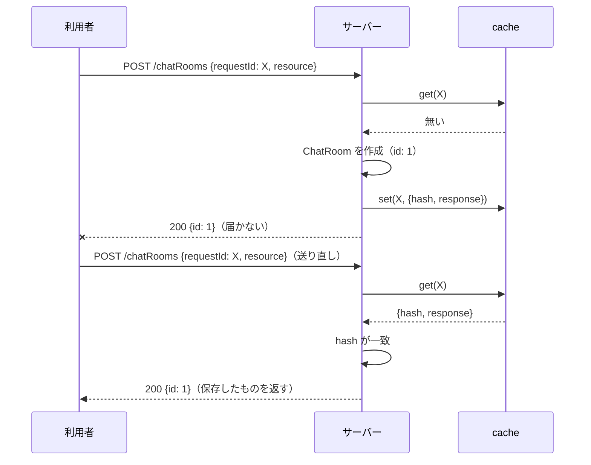

## 本記事の内容
- 『APIデザイン・パターン』(JJ Geewax 著、マイナビ出版) の第 26 章「リクエストの重複実行回避」を、Go で書き直しながら読んだメモです
- パターンを使わない実装と使う実装を同じ手順で動かして、何が変わるかを出力で確かめます
- コードは Go 1.22 以降の `net/http` と標準ライブラリだけで動きます
- シリーズの目次は「[Go]APIデザインパターン 00: 目次と、パターンを使わないとどうなるか」にあります

## 1. 結論
作成や更新のリクエストに、利用者が決めた `requestId` を 1 つ足します。
サーバーは `requestId` ごとに返したレスポンスを保存しておき、同じ `requestId` が来たら保存したものをそのまま返します。
これで、レスポンスが届かなかった時に同じリクエストを送り直しても、作成や更新は 1 回しか実行されません。

GET のように何度実行しても結果が変わらないメソッドには要りません。

## 2. 困る場面
リクエストを送ったのにレスポンスが返ってこない、という状況は普通に起きます。
この時、原因は 2 つ考えられますが、利用者の側からはどちらなのか分かりません。

- リクエストがサーバーに届いていない
- サーバーは処理してレスポンスを返したが、そのレスポンスが利用者に届いていない

前者なら送り直せば済みます。
問題は後者で、送り直すと同じ処理がもう 1 回実行されます。
作成なら同じ内容のリソースが 2 つでき、決済なら 2 回課金されます。
4-2 で、実際に 2 つできるところを見ます。

## 3. 足すもの
増えるのは、リクエストのフィールド 1 つと、サーバー側の保存場所です。

`CreateChatRoomRequest` に `requestId` を足します。
省略可能で、利用者が UUID のようなランダムな文字列を自分で決めて付けます。
サーバーは形式を決めておき、`"1"` のような推測できる値は 400 Bad Request で断ります。
`requestId` が無いリクエストは、今までどおり毎回実行します。

サーバー側には `requestId` を key にした保存場所を用意します。
value には、返したレスポンスと、リクエスト本文の SHA-256 ハッシュを入れます。
ハッシュを一緒に持つのは、別の利用者がたまたま同じ `requestId` を使った時に、無関係なレスポンスを返さないためです。
保存は 5 分で期限切れにし、読まれるたびに延長します。

リクエストが来た時の判定は 3 通りです。

| 保存場所 | ハッシュ | 動作 |
|---|---|---|
| 無い | - | 実行して、レスポンスとハッシュを保存する |
| 有る | 一致 | 保存したレスポンスを返す（実行しない） |
| 有る | 不一致 | 409 Conflict |

Go の型にするとこうなります。

```go
type ChatRoom struct {
	ID    string `json:"id"`
	Title string `json:"title"`
}

type CreateChatRoomRequest struct {
	RequestID string   `json:"requestId,omitempty"` // ①
	Resource  ChatRoom `json:"resource"`
}

type cacheEntry struct { // ②
	hash      string
	response  []byte
	expiresAt time.Time
}

type requestCache struct {
	mu      sync.Mutex
	entries map[string]cacheEntry
	ttl     time.Duration
}
```

- ① 書籍の `requestId?: string` に当たります。JSON に無ければ `""` になります
- ② `requestId` 1 つにつき 1 件です。`response` は返した JSON のバイト列そのものです

:::message
`map` は複数のリクエストから同時に書き込むと panic するので、`sync.Mutex` で囲んでいます。
:::

## 4. 前後比較
### 4-1. 使わない場合
最初に思いつく形です。
本文を struct に入れて、作って、返すだけです。

```go
type store struct {
	mu    sync.Mutex
	seq   int
	rooms map[string]ChatRoom
}

func (s *store) create(r ChatRoom) ChatRoom {
	s.mu.Lock()
	defer s.mu.Unlock()
	s.seq++
	r.ID = strconv.Itoa(s.seq)
	s.rooms[r.ID] = r
	return r
}

func main() {
	s := &store{rooms: map[string]ChatRoom{}}
	mux := http.NewServeMux()

	mux.HandleFunc("POST /chatRooms", func(w http.ResponseWriter, req *http.Request) {
		var in CreateChatRoomRequest
		if err := json.NewDecoder(req.Body).Decode(&in); err != nil {
			http.Error(w, "invalid json: "+err.Error(), http.StatusBadRequest)
			return
		}
		room := s.create(in.Resource) // ①
		writeJSON(w, http.StatusOK, room)
	})

	mux.HandleFunc("GET /chatRooms", func(w http.ResponseWriter, req *http.Request) {
		writeJSON(w, http.StatusOK, map[string]any{"results": s.list()})
	})

	log.Fatal(http.ListenAndServe(":8026", mux))
}
```

- ① リクエストが届くたびに必ず作成します。前に同じリクエストを処理したかどうかは見ていません

### 4-2. 動かすと同じ部屋が 2 つできる
同じ本文を 2 回送ります。
2 回目は「レスポンスが届かなかったので送り直した」つもりのリクエストです。

```
$ curl -s -i -X POST localhost:8026/chatRooms \
    -d '{"resource":{"title":"Chat about A"}}'
HTTP/1.1 200 OK
Content-Type: application/json

{"id":"1","title":"Chat about A"}

$ curl -s -i -X POST localhost:8026/chatRooms \
    -d '{"resource":{"title":"Chat about A"}}'
HTTP/1.1 200 OK
Content-Type: application/json

{"id":"2","title":"Chat about A"}

$ curl -s localhost:8026/chatRooms
{"results":[{"id":"1","title":"Chat about A"},{"id":"2","title":"Chat about A"}]}
```

`id: 1` と `id: 2` の 2 つができました。
サーバーには「送り直し」と「もう 1 つ作りたい」の区別がつきません。

### 4-3. 使う場合（差分）
`store` と `GET /chatRooms` はそのままで、ハンドラに判定を足します。
差分だけ見るとこうなります。

```diff go
 	mux.HandleFunc("POST /chatRooms", func(w http.ResponseWriter, req *http.Request) {
-		var in CreateChatRoomRequest
-		if err := json.NewDecoder(req.Body).Decode(&in); err != nil {
+		body, err := io.ReadAll(req.Body) // ①
+		if err != nil {
+			http.Error(w, "read body: "+err.Error(), http.StatusBadRequest)
+			return
+		}
+		var in CreateChatRoomRequest
+		if err := json.NewDecoder(bytes.NewReader(body)).Decode(&in); err != nil {
 			http.Error(w, "invalid json: "+err.Error(), http.StatusBadRequest)
 			return
 		}
-		room := s.create(in.Resource)
-		writeJSON(w, http.StatusOK, room)
+		if in.RequestID == "" { // ②
+			writeJSON(w, http.StatusOK, s.create(in.Resource))
+			return
+		}
+		if !requestIDPattern.MatchString(in.RequestID) {
+			http.Error(w, "requestId must match "+requestIDPattern.String(), http.StatusBadRequest)
+			return
+		}
+		sum := sha256.Sum256(body)
+		hash := hex.EncodeToString(sum[:])
+
+		if e, ok := cache.get(in.RequestID); ok { // ③
+			if e.hash != hash {
+				http.Error(w, "requestId reused with a different request body", http.StatusConflict)
+				return
+			}
+			w.Header().Set("Content-Type", "application/json")
+			w.Write(e.response)
+			return
+		}
+		room := s.create(in.Resource)
+		resp, _ := json.Marshal(room)
+		cache.set(in.RequestID, cacheEntry{hash: hash, response: append(resp, '\n')}) // ④
+		w.Header().Set("Content-Type", "application/json")
+		w.Write(append(resp, '\n'))
 	})
```

- ① 本文を先にバイト列として読み切ります。JSON の解釈とハッシュ計算の両方に使うためです
- ② `requestId` が無ければ、保存場所を見ずに実行します
- ③ 保存が有れば、ハッシュが同じ時だけ保存したレスポンスをそのまま返します。違えば 409 Conflict です
- ④ 新しく実行した時は、ハッシュとレスポンスを一緒に保存します

:::message
`req.Body` は 1 回しか読めません。
`json.NewDecoder(req.Body)` に渡してしまうと、後からハッシュを取るための本文が残らないので、先に `io.ReadAll` で取り出しています。
また、`w.Write` の前に `w.WriteHeader` を呼ばなければ、ステータスは 200 OK になります。
:::

保存場所（`requestCache`）の実装を含めた全文は畳んでおきます。

:::details after/main.go の全文
```go
package main

import (
	"bytes"
	"crypto/sha256"
	"encoding/hex"
	"encoding/json"
	"io"
	"log"
	"net/http"
	"regexp"
	"strconv"
	"sync"
	"time"
)

type ChatRoom struct {
	ID    string `json:"id"`
	Title string `json:"title"`
}

type CreateChatRoomRequest struct {
	RequestID string   `json:"requestId,omitempty"`
	Resource  ChatRoom `json:"resource"`
}

type store struct {
	mu    sync.Mutex
	seq   int
	rooms map[string]ChatRoom
}

func (s *store) create(r ChatRoom) ChatRoom {
	s.mu.Lock()
	defer s.mu.Unlock()
	s.seq++
	r.ID = strconv.Itoa(s.seq)
	s.rooms[r.ID] = r
	return r
}

func (s *store) list() []ChatRoom {
	s.mu.Lock()
	defer s.mu.Unlock()
	out := make([]ChatRoom, 0, len(s.rooms))
	for i := 1; i <= s.seq; i++ {
		out = append(out, s.rooms[strconv.Itoa(i)])
	}
	return out
}

type cacheEntry struct {
	hash      string
	response  []byte
	expiresAt time.Time
}

type requestCache struct {
	mu      sync.Mutex
	entries map[string]cacheEntry
	ttl     time.Duration
}

func (c *requestCache) get(id string) (cacheEntry, bool) {
	c.mu.Lock()
	defer c.mu.Unlock()
	e, ok := c.entries[id]
	if !ok || time.Now().After(e.expiresAt) {
		delete(c.entries, id)
		return cacheEntry{}, false
	}
	e.expiresAt = time.Now().Add(c.ttl)
	c.entries[id] = e
	return e, true
}

func (c *requestCache) set(id string, e cacheEntry) {
	c.mu.Lock()
	defer c.mu.Unlock()
	e.expiresAt = time.Now().Add(c.ttl)
	c.entries[id] = e
}

var requestIDPattern = regexp.MustCompile(`^[A-Za-z0-9-]{16,64}$`)

func writeJSON(w http.ResponseWriter, status int, v any) {
	w.Header().Set("Content-Type", "application/json")
	w.WriteHeader(status)
	json.NewEncoder(w).Encode(v)
}

func main() {
	s := &store{rooms: map[string]ChatRoom{}}
	cache := &requestCache{entries: map[string]cacheEntry{}, ttl: 5 * time.Minute}
	mux := http.NewServeMux()

	mux.HandleFunc("POST /chatRooms", func(w http.ResponseWriter, req *http.Request) {
		body, err := io.ReadAll(req.Body)
		if err != nil {
			http.Error(w, "read body: "+err.Error(), http.StatusBadRequest)
			return
		}
		var in CreateChatRoomRequest
		if err := json.NewDecoder(bytes.NewReader(body)).Decode(&in); err != nil {
			http.Error(w, "invalid json: "+err.Error(), http.StatusBadRequest)
			return
		}
		if in.RequestID == "" {
			writeJSON(w, http.StatusOK, s.create(in.Resource))
			return
		}
		if !requestIDPattern.MatchString(in.RequestID) {
			http.Error(w, "requestId must match "+requestIDPattern.String(), http.StatusBadRequest)
			return
		}
		sum := sha256.Sum256(body)
		hash := hex.EncodeToString(sum[:])

		if e, ok := cache.get(in.RequestID); ok {
			if e.hash != hash {
				http.Error(w, "requestId reused with a different request body", http.StatusConflict)
				return
			}
			w.Header().Set("Content-Type", "application/json")
			w.Write(e.response)
			return
		}
		room := s.create(in.Resource)
		resp, _ := json.Marshal(room)
		cache.set(in.RequestID, cacheEntry{hash: hash, response: append(resp, '\n')})
		w.Header().Set("Content-Type", "application/json")
		w.Write(append(resp, '\n'))
	})

	mux.HandleFunc("GET /chatRooms", func(w http.ResponseWriter, req *http.Request) {
		writeJSON(w, http.StatusOK, map[string]any{"results": s.list()})
	})

	log.Fatal(http.ListenAndServe(":8126", mux))
}
```
:::

### 4-4. 同じ手順で動かすと 1 つのまま
4-2 と同じ手順に `requestId` を付けて送ります。

```
$ curl -s -i -X POST localhost:8126/chatRooms \
    -d '{"requestId":"4f2c0d9e-7b1a-4c3e-9d2f-1a2b3c4d5e6f","resource":{"title":"Chat about A"}}'
HTTP/1.1 200 OK
Content-Type: application/json

{"id":"1","title":"Chat about A"}

$ curl -s -i -X POST localhost:8126/chatRooms \
    -d '{"requestId":"4f2c0d9e-7b1a-4c3e-9d2f-1a2b3c4d5e6f","resource":{"title":"Chat about A"}}'
HTTP/1.1 200 OK
Content-Type: application/json

{"id":"1","title":"Chat about A"}

$ curl -s localhost:8126/chatRooms
{"results":[{"id":"1","title":"Chat about A"}]}
```

2 回目も `id: 1` が返り、一覧は 1 件のままです。
同じ `requestId` で本文だけ変えると 409 Conflict に、形式に合わない `requestId` は 400 Bad Request になります。

```
$ curl -s -i -X POST localhost:8126/chatRooms \
    -d '{"requestId":"4f2c0d9e-7b1a-4c3e-9d2f-1a2b3c4d5e6f","resource":{"title":"Chat about B"}}'
HTTP/1.1 409 Conflict
Content-Type: text/plain; charset=utf-8

requestId reused with a different request body

$ curl -s -i -X POST localhost:8126/chatRooms \
    -d '{"requestId":"1","resource":{"title":"Chat about B"}}'
HTTP/1.1 400 Bad Request
Content-Type: text/plain; charset=utf-8

requestId must match ^[A-Za-z0-9-]{16,64}$
```

## 5. 1 リクエストの流れ
本番でリクエストがサーバーの中をどう通るかを、順に追います。
送る側を利用者、受ける側をサーバー、`requestId` ごとの保存場所を cache と呼びます。

1. 利用者が `requestId` を生成して `POST /chatRooms` を送る
2. サーバーは本文を読み切り、JSON を `CreateChatRoomRequest` に入れる。読めなければ 400
3. `requestId` が空なら、cache を見ずに作成して 200 を返す
4. `requestId` の形式を確認する。合わなければ 400
5. 本文の SHA-256 を計算する
6. cache を `requestId` で引く
    - 無ければ作成し、レスポンスとハッシュを cache に入れて 200 を返す
    - 有ってハッシュが一致すれば、保存したレスポンスを 200 で返す。作成はしない
    - 有ってハッシュが違えば 409 を返す
7. レスポンスが届かなかった利用者は、同じ `requestId` と同じ本文で送り直す。6 の 2 つ目に入る



## 6. 疑問と答え
読みながら引っかかったところです。

**べき等とは何か**
同じリクエストを何回実行しても、1 回実行した時と結果が変わらない性質です。
GET はもともとべき等で、POST で作成するメソッドはべき等ではありません。

**サーバーが本文のハッシュで判定すれば、`requestId` は要らないのでは**
本文が同じでも、「もう 1 つ作りたい」のか「送り直し」なのかはサーバーには分かりません。
意図を知っているのは利用者だけなので、利用者に `requestId` で明示してもらいます。
書籍 26.3.1 のコラムが、この疑問にそのまま答えています。

**`requestId` があるのに、なぜ本文のハッシュも保存するのか**
利用者は一意な値を作るのが意外と下手で、`requestId` が衝突することがあります。
衝突に気付けないと、User を作ったのに ChatRoom が返ってくる、という無関係なレスポンスを返してしまいます。
本文のハッシュが一致するかで、本当に同じリクエストの送り直しかを確かめます。

**2 回目に返る保存済みのレスポンスは古くないか**
古いことがあります。
別の利用者が後から更新していても、保存した時点のレスポンスを返します。
このパターンの目的は「1 回目に届いていたら受け取っていたはずの結果を返すこと」なので、保存したものを更新してはいけません。

**保存は何分持てばよいか**
再試行は数秒以内に来るので、まず 5 分です。
読まれるたびに延長します。
メモリ量と利用者の挙動を見て、後から変えられます。

**cache が落ちていたらどうなるか**
保存の有無が分からないので、二重実行を防げません。
cache に届かない時に 503 Service Unavailable で断るか、二重実行を許すかは、メソッドごとに決めることになります。
書籍の練習問題 3 がこの論点です。

ここまでを自分の言葉でまとめると、利用者が付けた `requestId` でサーバーが「処理済みか」を判定し、処理済みなら前と同じレスポンスを返す、`requestId` が同じで本文が違えば 409、です。

## 7. トレードオフ
得られるのは、作成・更新・決済のようなべき等でないメソッドを、二重実行を気にせず再試行できることです。
引き換えに、ハンドラの分岐が増え、レスポンス全体を保存するメモリが要ります。
100 件を一度に作るバッチ作成のようにレスポンスが大きいと、1 リクエスト分の保存量もそのぶん大きくなります。

書籍は、二重実行が致命的なメソッドから付け始めて、必要なら `requestId` を必須にする、という進め方を勧めています。

「同じ本文は一定時間に 1 回だけ」と制限したいだけなら、本文のハッシュで判定する方法もあります。
ただしそれは有効期限付きの速度制限であって、利用者の意図（送り直しか、もう 1 つか）は区別できません。

## 8. 参考
- 『APIデザイン・パターン』JJ Geewax 著、マイナビ出版、第 26 章
- https://google.aip.dev/155
- AWS EC2 の `RunInstances` などには、同じ役割の `ClientToken` パラメータ（最大 64 文字の ASCII）があります。同じ `ClientToken` でパラメータが違う再試行は `IdempotentParameterMismatch` エラーになり、本記事の 409 Conflict に当たります: https://docs.aws.amazon.com/AWSEC2/latest/APIReference/Run_Instance_Idempotency.html
