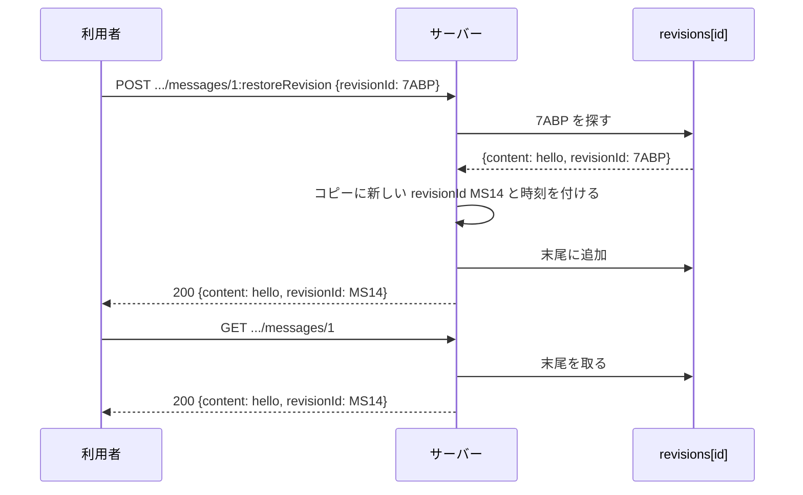

## 本記事の内容
- 『APIデザイン・パターン』(JJ Geewax 著、マイナビ出版) の第 28 章「リソースリビジョン」を、Go で書き直しながら読んだメモです
- パターンを使わない実装と使う実装を同じ手順で動かして、何が変わるかを出力で確かめます
- コードは Go 1.22 以降の `net/http` と標準ライブラリだけで動きます
- シリーズの目次は「[Go]APIデザインパターン 00: 目次と、パターンを使わないとどうなるか」にあります

## 1. 結論
リソースに `revisionId` と `revisionCreateTime` の 2 つのフィールドを足し、同じ `id` のレコードをリビジョンごとに複数保存します。
`id` だけで取得すると最新のリビジョンが返り、`id@リビジョンID` で取得すると過去の状態がそのまま返ります。
過去の内容に戻したい時は `:restoreRevision` で、そのリビジョンのコピーを新しい最新として積みます。

履歴が要らないリソースには、足さないほうがよいです。
書籍自身が「避けられるなら避けるべき」と書いているくらい、保存量と複雑さが増えます。

## 2. 困る場面
更新のたびに前の内容を上書きしていると、「先週の時点でこのリソースはどうだったか」が分かりません。
契約書、発注書、広告キャンペーンのように、いつ何が変わったかを追いたいリソースで困ります。
間違った更新を元に戻したい時も、前の内容がどこにも残っていないので手の打ちようがありません。

4-2 で、更新した瞬間に前の内容が消えるところを見ます。

## 3. 足すもの
リビジョンは別のリソースではなく、既存のリソースに 2 つのフィールドを足した「ある時点のコピー」です。
`revisionId` は 13 文字のランダムな文字列にし、`revisionCreateTime` にはコピーを取った時刻を入れます。
同じ `id` を持つレコードをリビジョンの数だけ保存しておき、`id` で取得された時は `revisionCreateTime` が最新のものを返します。

リビジョンを作るタイミングは 2 通りあります。
更新のたびにサーバーが自動で作る方法（暗黙）と、利用者が `:createRevision` を呼んだ時だけ作る方法（明示）です。
どちらでもよいのですが、API の中で混ぜると利用者が戸惑うので、揃えておきます。
どちらを選んでも、リソースを作成した瞬間に最初のリビジョンを付けておかないと「リビジョンが無いリソース」ができてしまい、後のメソッドが成り立ちません。
本記事では更新のたびに作り、`:createRevision` も用意しています。

操作ごとの HTTP の対応はこうなります。

| 操作 | HTTP |
|---|---|
| 最新を取得 | `GET /chatRooms/1/messages/2` |
| 特定のリビジョンを取得 | `GET /chatRooms/1/messages/2@{revisionId}` |
| リビジョンの一覧 | `GET /chatRooms/1/messages/2:listRevisions` |
| 明示的に作る | `POST /chatRooms/1/messages/2:createRevision` |
| 過去の内容に戻す | `POST /chatRooms/1/messages/2:restoreRevision` |
| リビジョンを消す | `DELETE /chatRooms/1/messages/2@{revisionId}:deleteRevision` |

`@` 付きで取得した時は、返す `id` にも `@` を付けます。
求めた識別子がそのまま返ってくると、欲しかったものが取れたと確認しやすいからです。
`revisionId` フィールドには、`@` の有無にかかわらず常に値が入ります。

復元は、古いリビジョンを最新の位置に動かすのではなく、コピーを新しいリビジョンとして末尾に足します。
履歴の順番を変えないので、「いつ戻したか」も後から読み取れます。
削除は物理削除だけで、最新のリビジョンは消せません（412 Precondition Failed）。
標準の delete と別のメソッドにしているのは、リソース全体を消すつもりで 1 リビジョンを消す、またはその逆、という取り違えを防ぐためです。

Go の型にするとこうなります。

```go
type Message struct {
	ID                 string    `json:"id"`
	Content            string    `json:"content"`
	RevisionID         string    `json:"revisionId"`         // ①
	RevisionCreateTime time.Time `json:"revisionCreateTime"` // ①
}

type store struct {
	mu        sync.Mutex
	seq       int
	revisions map[string][]Message // ② key は id。古い順に並び、末尾が最新
}
```

- ① 書籍の 2 つのフィールドです。`revisionId` は `0123456789ABCDEFGHJKMNPQRSTVWXYZ` から 13 文字を選んで作ります
- ② 同じ `id` のコピーを slice に積みます。削除で途中が抜けても、末尾が最新という決まりは変わりません

## 4. 前後比較
### 4-1. 使わない場合
`map[string]Message` に 1 件ずつ入れておき、更新は上書きです。

```go
type Message struct {
	ID      string `json:"id"`
	Content string `json:"content"`
}

type store struct {
	mu       sync.Mutex
	seq      int
	messages map[string]Message
}

func (s *store) update(id, content string) (Message, bool) {
	s.mu.Lock()
	defer s.mu.Unlock()
	m, ok := s.messages[id]
	if !ok {
		return Message{}, false
	}
	m.Content = content // ①
	s.messages[id] = m
	return m, true
}

func main() {
	s := &store{messages: map[string]Message{}}
	mux := http.NewServeMux()

	mux.HandleFunc("PATCH /chatRooms/{room}/messages/{msg}", func(w http.ResponseWriter, req *http.Request) {
		var in Message
		if err := json.NewDecoder(req.Body).Decode(&in); err != nil {
			http.Error(w, "invalid json: "+err.Error(), http.StatusBadRequest)
			return
		}
		m, ok := s.update(messageID(req), in.Content)
		if !ok {
			http.Error(w, "not found", http.StatusNotFound)
			return
		}
		writeJSON(w, http.StatusOK, m)
	})

	log.Fatal(http.ListenAndServe(":8028", mux))
}
```

- ① 前の `Content` はこの行で消えます。どこにも残りません

### 4-2. 動かすと前の内容が消える
メッセージを作って、2 回更新してから取得します。

```
$ curl -s -X POST localhost:8028/chatRooms/1/messages -d '{"content":"hello"}'
{"id":"chatRooms/1/messages/1","content":"hello"}

$ curl -s -X PATCH localhost:8028/chatRooms/1/messages/1 \
    -d '{"content":"hello v2"}'
{"id":"chatRooms/1/messages/1","content":"hello v2"}

$ curl -s -X PATCH localhost:8028/chatRooms/1/messages/1 \
    -d '{"content":"hello v3"}'
{"id":"chatRooms/1/messages/1","content":"hello v3"}

$ curl -s localhost:8028/chatRooms/1/messages/1
{"id":"chatRooms/1/messages/1","content":"hello v3"}
```

残っているのは `hello v3` だけです。
`hello` にも `hello v2` にも、もう戻れません。

### 4-3. 使う場合（差分）
保存の形を「1 件」から「リビジョンの列」に変え、更新は上書きではなく末尾への追加にします。

```diff go
 type Message struct {
-	ID      string `json:"id"`
-	Content string `json:"content"`
+	ID                 string    `json:"id"`
+	Content            string    `json:"content"`
+	RevisionID         string    `json:"revisionId"`
+	RevisionCreateTime time.Time `json:"revisionCreateTime"`
 }

 type store struct {
-	mu       sync.Mutex
-	seq      int
-	messages map[string]Message
+	mu        sync.Mutex
+	seq       int
+	revisions map[string][]Message
 }

+func (s *store) snapshot(m Message) Message { // ①
+	m.RevisionID = newRevisionID()
+	m.RevisionCreateTime = time.Now().UTC().Truncate(time.Second)
+	s.revisions[m.ID] = append(s.revisions[m.ID], m)
+	return m
+}
+
+func (s *store) current(id string) (Message, bool) {
+	revs := s.revisions[id]
+	if len(revs) == 0 {
+		return Message{}, false
+	}
+	return revs[len(revs)-1], true
+}
+
 func (s *store) update(id, content string) (Message, bool) {
 	s.mu.Lock()
 	defer s.mu.Unlock()
-	m, ok := s.messages[id]
+	cur, ok := s.current(id)
 	if !ok {
 		return Message{}, false
 	}
-	m.Content = content
-	s.messages[id] = m
-	return m, true
+	cur.Content = content
+	return s.snapshot(cur), true // ②
 }
```

- ① リビジョンを 1 つ積む唯一の関数です。作成、更新、`:createRevision`、`:restoreRevision` の全部がここを通ります
- ② 更新は「最新のコピーを取り、内容を変えて、末尾に足す」になります。前のリビジョンはそのまま残ります

取得、復元、削除はこう書きました。

```go
func (s *store) get(id, rev string) (Message, bool) {
	s.mu.Lock()
	defer s.mu.Unlock()
	if rev == "" {
		return s.current(id)
	}
	for _, m := range s.revisions[id] {
		if m.RevisionID == rev {
			m.ID = id + "@" + rev // ① 求められた形のまま返す
			return m, true
		}
	}
	return Message{}, false
}

func (s *store) restore(id, rev string) (Message, bool) {
	s.mu.Lock()
	defer s.mu.Unlock()
	for _, m := range s.revisions[id] {
		if m.RevisionID == rev {
			return s.snapshot(m), true // ② 古いリビジョンのコピーを新しい最新として積む
		}
	}
	return Message{}, false
}

func (s *store) deleteRevision(id, rev string) int {
	s.mu.Lock()
	defer s.mu.Unlock()
	revs := s.revisions[id]
	for i, m := range revs {
		if m.RevisionID != rev {
			continue
		}
		if i == len(revs)-1 {
			return http.StatusPreconditionFailed // ③ 最新は消せない
		}
		s.revisions[id] = append(revs[:i], revs[i+1:]...)
		return http.StatusNoContent
	}
	return http.StatusNotFound
}
```

パスの `2@ABC:deleteRevision` を `id`・`rev`・動詞に分ける `target` 関数は、全文のほうに載せています。

:::message
`for _, m := range s.revisions[id]` の `m` は slice の要素のコピーです。
`get` の中で `m.ID` を書き換えても、保存してある要素は変わりません。
Go の struct は値なので、代入や `range` のたびにコピーされます。
:::

:::message
Go 1.22 の `http.NewServeMux` では、`{msg}` はパスの 1 区切り（`/` から `/` まで）全体にしか一致しません。
`2@ABC:deleteRevision` もまとめて `{msg}` に入るので、`@` と `:` の切り分けは `target` で自分でやっています。
:::

全文は畳んでおきます。

:::details after/main.go の全文
```go
package main

import (
	"crypto/rand"
	"encoding/json"
	"log"
	"math/big"
	"net/http"
	"strconv"
	"strings"
	"sync"
	"time"
)

type Message struct {
	ID                 string    `json:"id"`
	Content            string    `json:"content"`
	RevisionID         string    `json:"revisionId"`
	RevisionCreateTime time.Time `json:"revisionCreateTime"`
}

type store struct {
	mu        sync.Mutex
	seq       int
	revisions map[string][]Message
}

const crockford = "0123456789ABCDEFGHJKMNPQRSTVWXYZ"

func newRevisionID() string {
	b := make([]byte, 13)
	for i := range b {
		n, _ := rand.Int(rand.Reader, big.NewInt(int64(len(crockford))))
		b[i] = crockford[n.Int64()]
	}
	return string(b)
}

func (s *store) snapshot(m Message) Message {
	m.RevisionID = newRevisionID()
	m.RevisionCreateTime = time.Now().UTC().Truncate(time.Second)
	s.revisions[m.ID] = append(s.revisions[m.ID], m)
	return m
}

func (s *store) create(room, content string) Message {
	s.mu.Lock()
	defer s.mu.Unlock()
	s.seq++
	return s.snapshot(Message{ID: "chatRooms/" + room + "/messages/" + strconv.Itoa(s.seq), Content: content})
}

func (s *store) current(id string) (Message, bool) {
	revs := s.revisions[id]
	if len(revs) == 0 {
		return Message{}, false
	}
	return revs[len(revs)-1], true
}

func (s *store) get(id, rev string) (Message, bool) {
	s.mu.Lock()
	defer s.mu.Unlock()
	if rev == "" {
		return s.current(id)
	}
	for _, m := range s.revisions[id] {
		if m.RevisionID == rev {
			m.ID = id + "@" + rev
			return m, true
		}
	}
	return Message{}, false
}

func (s *store) list(id string) []Message {
	s.mu.Lock()
	defer s.mu.Unlock()
	return append([]Message(nil), s.revisions[id]...)
}

func (s *store) update(id, content string) (Message, bool) {
	s.mu.Lock()
	defer s.mu.Unlock()
	cur, ok := s.current(id)
	if !ok {
		return Message{}, false
	}
	cur.Content = content
	return s.snapshot(cur), true
}

func (s *store) createRevision(id string) (Message, bool) {
	s.mu.Lock()
	defer s.mu.Unlock()
	cur, ok := s.current(id)
	if !ok {
		return Message{}, false
	}
	return s.snapshot(cur), true
}

func (s *store) restore(id, rev string) (Message, bool) {
	s.mu.Lock()
	defer s.mu.Unlock()
	for _, m := range s.revisions[id] {
		if m.RevisionID == rev {
			return s.snapshot(m), true
		}
	}
	return Message{}, false
}

func (s *store) deleteRevision(id, rev string) int {
	s.mu.Lock()
	defer s.mu.Unlock()
	revs := s.revisions[id]
	for i, m := range revs {
		if m.RevisionID != rev {
			continue
		}
		if i == len(revs)-1 {
			return http.StatusPreconditionFailed
		}
		s.revisions[id] = append(revs[:i], revs[i+1:]...)
		return http.StatusNoContent
	}
	return http.StatusNotFound
}

func writeJSON(w http.ResponseWriter, status int, v any) {
	w.Header().Set("Content-Type", "application/json")
	w.WriteHeader(status)
	json.NewEncoder(w).Encode(v)
}

// "2@ABC:deleteRevision" → id "chatRooms/1/messages/2", rev "ABC", verb "deleteRevision"
func target(req *http.Request) (id, rev, verb string) {
	seg := req.PathValue("msg")
	if i := strings.IndexByte(seg, ':'); i >= 0 {
		verb, seg = seg[i+1:], seg[:i]
	}
	if i := strings.IndexByte(seg, '@'); i >= 0 {
		rev, seg = seg[i+1:], seg[:i]
	}
	return "chatRooms/" + req.PathValue("room") + "/messages/" + seg, rev, verb
}

func main() {
	s := &store{revisions: map[string][]Message{}}
	mux := http.NewServeMux()

	mux.HandleFunc("POST /chatRooms/{room}/messages", func(w http.ResponseWriter, req *http.Request) {
		var in Message
		if err := json.NewDecoder(req.Body).Decode(&in); err != nil {
			http.Error(w, "invalid json: "+err.Error(), http.StatusBadRequest)
			return
		}
		writeJSON(w, http.StatusOK, s.create(req.PathValue("room"), in.Content))
	})

	mux.HandleFunc("GET /chatRooms/{room}/messages/{msg}", func(w http.ResponseWriter, req *http.Request) {
		id, rev, verb := target(req)
		switch verb {
		case "":
			m, ok := s.get(id, rev)
			if !ok {
				http.Error(w, "not found", http.StatusNotFound)
				return
			}
			writeJSON(w, http.StatusOK, m)
		case "listRevisions":
			writeJSON(w, http.StatusOK, map[string]any{"results": s.list(id), "nextPageToken": ""})
		default:
			http.Error(w, "unknown method", http.StatusNotFound)
		}
	})

	mux.HandleFunc("PATCH /chatRooms/{room}/messages/{msg}", func(w http.ResponseWriter, req *http.Request) {
		id, _, _ := target(req)
		var in Message
		if err := json.NewDecoder(req.Body).Decode(&in); err != nil {
			http.Error(w, "invalid json: "+err.Error(), http.StatusBadRequest)
			return
		}
		m, ok := s.update(id, in.Content)
		if !ok {
			http.Error(w, "not found", http.StatusNotFound)
			return
		}
		writeJSON(w, http.StatusOK, m)
	})

	mux.HandleFunc("POST /chatRooms/{room}/messages/{msg}", func(w http.ResponseWriter, req *http.Request) {
		id, _, verb := target(req)
		var m Message
		var ok bool
		switch verb {
		case "createRevision":
			m, ok = s.createRevision(id)
		case "restoreRevision":
			var in struct {
				RevisionID string `json:"revisionId"`
			}
			if err := json.NewDecoder(req.Body).Decode(&in); err != nil {
				http.Error(w, "invalid json: "+err.Error(), http.StatusBadRequest)
				return
			}
			m, ok = s.restore(id, in.RevisionID)
		default:
			http.Error(w, "unknown method", http.StatusNotFound)
			return
		}
		if !ok {
			http.Error(w, "not found", http.StatusNotFound)
			return
		}
		writeJSON(w, http.StatusOK, m)
	})

	mux.HandleFunc("DELETE /chatRooms/{room}/messages/{msg}", func(w http.ResponseWriter, req *http.Request) {
		id, rev, verb := target(req)
		if verb != "deleteRevision" || rev == "" {
			http.Error(w, "use DELETE .../messages/{id}@{revisionId}:deleteRevision", http.StatusNotFound)
			return
		}
		status := s.deleteRevision(id, rev)
		if status == http.StatusPreconditionFailed {
			http.Error(w, "the current revision cannot be deleted", status)
			return
		}
		w.WriteHeader(status)
	})

	log.Fatal(http.ListenAndServe(":8128", mux))
}
```
:::

### 4-4. 同じ手順で動かすと前の内容に戻せる
作成と 2 回の更新は 4-2 と同じ手順です。
レスポンスに `revisionId` が付くようになりました。

```
$ curl -s -X POST localhost:8128/chatRooms/1/messages -d '{"content":"hello"}'
{"id":"chatRooms/1/messages/1","content":"hello","revisionId":"7ABPGYF30BMTJ","revisionCreateTime":"2026-10-28T07:10:54Z"}

$ curl -s -X PATCH localhost:8128/chatRooms/1/messages/1 \
    -d '{"content":"hello v2"}'
{"id":"chatRooms/1/messages/1","content":"hello v2","revisionId":"8V9M10W7MQ06B","revisionCreateTime":"2026-10-28T07:10:54Z"}

$ curl -s -X PATCH localhost:8128/chatRooms/1/messages/1 \
    -d '{"content":"hello v3"}'
{"id":"chatRooms/1/messages/1","content":"hello v3","revisionId":"RCZB7HHMGVQVS","revisionCreateTime":"2026-10-28T07:10:54Z"}

$ curl -s localhost:8128/chatRooms/1/messages/1
{"id":"chatRooms/1/messages/1","content":"hello v3","revisionId":"RCZB7HHMGVQVS","revisionCreateTime":"2026-10-28T07:10:54Z"}
```

ここからが使った場合にだけできる操作です。
一覧を見て、最初のリビジョンを `@` 付きで取り、それを復元します。

```
$ curl -s localhost:8128/chatRooms/1/messages/1:listRevisions
{"nextPageToken":"","results":[{"id":"chatRooms/1/messages/1","content":"hello","revisionId":"7ABPGYF30BMTJ","revisionCreateTime":"2026-10-28T07:10:54Z"},{"id":"chatRooms/1/messages/1","content":"hello v2","revisionId":"8V9M10W7MQ06B","revisionCreateTime":"2026-10-28T07:10:54Z"},{"id":"chatRooms/1/messages/1","content":"hello v3","revisionId":"RCZB7HHMGVQVS","revisionCreateTime":"2026-10-28T07:10:54Z"}]}

$ curl -s localhost:8128/chatRooms/1/messages/1@7ABPGYF30BMTJ
{"id":"chatRooms/1/messages/1@7ABPGYF30BMTJ","content":"hello","revisionId":"7ABPGYF30BMTJ","revisionCreateTime":"2026-10-28T07:10:54Z"}

$ curl -s -i -X POST localhost:8128/chatRooms/1/messages/1:restoreRevision \
    -d '{"revisionId":"7ABPGYF30BMTJ"}'
HTTP/1.1 200 OK
Content-Type: application/json

{"id":"chatRooms/1/messages/1","content":"hello","revisionId":"MS14GWRTSREVS","revisionCreateTime":"2026-10-28T07:10:54Z"}

$ curl -s localhost:8128/chatRooms/1/messages/1
{"id":"chatRooms/1/messages/1","content":"hello","revisionId":"MS14GWRTSREVS","revisionCreateTime":"2026-10-28T07:10:54Z"}
```

復元後の `revisionId` は `7ABPGYF30BMTJ` ではなく、新しい `MS14GWRTSREVS` です。
古いリビジョンを動かしたのではなく、コピーを 4 つ目として積んだからです。
`@` 付きで取った時は、`id` にも `@7ABPGYF30BMTJ` が付いて返っています。

削除は、古いリビジョンなら 204 No Content、最新なら 412 Precondition Failed になります。

```
$ curl -s -i -X DELETE \
    localhost:8128/chatRooms/1/messages/1@RCZB7HHMGVQVS:deleteRevision
HTTP/1.1 204 No Content

$ curl -s -i -X DELETE \
    localhost:8128/chatRooms/1/messages/1@MS14GWRTSREVS:deleteRevision
HTTP/1.1 412 Precondition Failed
Content-Type: text/plain; charset=utf-8

the current revision cannot be deleted
```

## 5. 1 リクエストの流れ
`POST /chatRooms/1/messages/1:restoreRevision` が本番でサーバーの中をどう通るかを追います。
送る側を利用者、受ける側をサーバーと呼びます。

1. 利用者が本文 `{"revisionId":"7ABPGYF30BMTJ"}` を付けてリクエストを送る
2. サーバーは `{msg}` に入った `1:restoreRevision` を `target` で分け、`id` と動詞 `restoreRevision` を得る
3. 本文を読み、`revisionId` を取り出す。読めなければ 400
4. `id` のリビジョンの列から `revisionId` が一致するものを探す。無ければ 404
5. 見つけたリビジョンのコピーに、新しい `revisionId` と現在時刻を付けて列の末尾に足す
6. 末尾に足したものを 200 で返す
7. 以後の `GET /chatRooms/1/messages/1` は、末尾にあるこのコピーを返す



## 6. 疑問と答え
読みながら引っかかったところです。

**なぜ `revisionId` を 1、2、3 の連番にしないのか**
連番だと、途中のリビジョンを消した時に 1、2、4 のように抜けが見えて、消したことが分かってしまいます。
タイムスタンプなら抜けは目立ちませんが、同時に作られた時に衝突する可能性が残ります。
ランダムな文字列は「1 つのリビジョンを指す」以外の意味を持たないので、この 2 つの問題がどちらも起きません。

**13 文字で足りるのか**
リソースの識別子は第 6 章で 25 文字（120 ビット）にしていましたが、1 つのリソースのリビジョン数はリソースの総数よりずっと少ないです。
書籍は 64 ビット整数と同じくらいの 13 文字（60 ビット）で十分としています。
第 6 章のチェックサム文字は、本記事のコードでは省いています。

**更新のたびに自動で作るのと、利用者に `:createRevision` を呼ばせるのはどちらがよいのか**
書籍はどちらも認めていて、API 全体で揃っていることのほうを重視しています。
迷うなら多めに残す方を勧めていて、毎日の終わりに作る、特定のカスタムメソッドの実行時だけ作る、といった中間の決め方もあります。
どの方法でも、作成した瞬間に最初のリビジョンを付けることだけは外せません。

**復元した時、なぜ古いリビジョンを最新の位置に動かさないのか**
動かすと履歴の順番が変わり、後から見た人が変更の流れを追えなくなります。
コピーを末尾に足せば、「この時点で過去の内容に戻した」こと自体が履歴に残ります。

**利用者が自分で「取得して、更新して」と 3 回呼べば復元できるのでは**
できますが、3 回の往復の途中で別の利用者の更新が割り込むと、意図と違う内容になります。
サーバー側の `:restoreRevision` なら、1 回の呼び出しの中で終わります。

**論理削除（第 25 章）と組み合わせられるか**
リビジョンは論理削除の対象にせず、物理削除だけにします。
論理削除したリビジョンを復元できてしまうと、削除済みの状態から一気に未削除の最新に戻れてしまうからです。

**ChatRoom のリビジョンに、子の Message も含めるべきか**
原則は 1 つのリソースに直接入っているデータだけです。
階層ごと戻す必要が本当にあるなら、第 23 章のエクスポートで足りないかを先に確かめる、という順番を書籍は勧めています。

ここまでを自分の言葉でまとめると、同じ `id` のコピーを `revisionId` 付きで積んでいき、`id` だけなら末尾、`@` 付きなら指定のコピーを返す、戻す時もコピーを末尾に積む、です。

## 7. トレードオフ
得られるのは、過去の状態を取り出せることと、間違った更新を元に戻せることです。
引き換えに、更新のたびにコピーが増えるので保存量が膨らみ、カスタムメソッドが 4 つ増える分だけ API も実装も複雑になります。
子リソースまで含めた階層ごとのリビジョンにすると、その両方がさらに重くなります。

書籍は、避けられるなら避けること、法的文書のように履歴を残す要件がはっきりしているリソースにだけ使うことを勧めています。

## 8. 参考
- 『APIデザイン・パターン』JJ Geewax 著、マイナビ出版、第 28 章
- https://google.aip.dev/162
