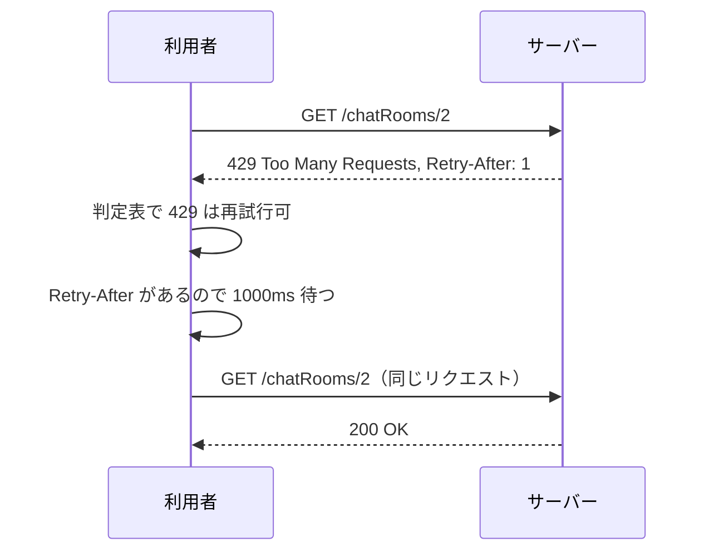

## 本記事の内容
- 『APIデザイン・パターン』(JJ Geewax 著、マイナビ出版) の第 29 章「リクエストの再試行」を、Go で書き直しながら読んだメモです
- パターンを使わない実装と使う実装を同じ手順で動かして、何が変わるかを出力で確かめます
- この章は利用者（クライアント）側のコードが主役なので、Go でも再試行ループをクライアントとして書き、サーバーは 503 / 429 / 403 を返す側として動かします
- コードは Go 1.22 以降の `net/http` と標準ライブラリだけで動きます
- シリーズの目次は「[Go]APIデザインパターン 00: 目次と、パターンを使わないとどうなるか」にあります

## 1. 結論
再試行するかどうかはステータスコードで決めます。
待ち時間は 1 秒から始めて失敗のたびに 2 倍にし、そこにランダムな数百ミリ秒を足します。
サーバーが `Retry-After` ヘッダで待つ秒数を返してきた時は、その値だけに従います。

回数と最大待ち時間には必ず上限を付けます。
サーバー側で足すものは、速度制限のように待つべき時間が分かっている時に `Retry-After` を付けることだけです。

## 2. 困る場面
一時的なエラーは避けられません。
サーバーが過負荷で 503 Service Unavailable を返す、速度制限で 429 Too Many Requests を返す、といった状況では、少し待って同じリクエストを送り直せば通ります。

素朴なクライアントは「何が返っても一定の間隔で送り直す」と書きがちで、これが 3 つの困りごとを生みます。
403 Forbidden のように何度送っても結果が変わらないエラーまで送り直して、無駄なリクエストを積み上げます。
同じ間隔で再試行するクライアントが多数いると、全員の再試行が同じ瞬間に届き、回復しかけたサーバーをまた倒します（書籍はこれを「殺到する群れ」と呼んでいます）。
サーバーが「1 秒待ってほしい」と `Retry-After` で伝えていても、読まずに叩き続けます。

4-2 で、この 3 つが実際に起きるところを見ます。

## 3. 足すもの
まず、どのエラーなら再試行してよいかを決めます。
書籍は 3 つに分けています。

| 分類 | ステータスコード | 理由 |
|---|---|---|
| 再試行してよい | 408, 421, 425, 429, 503 | サーバーが処理を始めていない |
| してはいけない | 403, 405, 412, 501 | 状況が変わらない限り同じ結果になる |
| 条件つきで可 | 500, 502, 504 | 下流が処理を始めたか分からない |

条件つきの 3 つは、GET のように何度実行しても結果が変わらないメソッドなら再試行してよく、作成のようなメソッドなら第 26 章の `requestId` を付けている時だけ再試行します。

次に、待ち時間です。
書籍の既定値は、最初の待ちが 1 秒、失敗のたびに 2 倍、最大 32 秒、最大 10 回です。
そこに 0〜1 秒のランダムな値（ジッター）を足して、クライアントごとに再試行の瞬間をずらします。
ジッターは足すだけで、2 倍にしていく対象には入れません。
本記事のデモでは出力を短くするために、200 ミリ秒から始めて最大 1,600 ミリ秒、最大 5 回、ジッター 0〜200 ミリ秒にしています。

最後に `Retry-After` です。
RFC 7231 で決まっている HTTP ヘッダで、値は秒数（`120`）か日時（`Fri, 31 Dec 1999 23:59:59 GMT`）のどちらかです。
書籍は秒数を勧めています。
日時を使うと、サーバーとクライアントの時計がずれていた時に、待つはずの時間が消えてしまうからです。
サーバー側で足すのはこの 1 行だけです。

```go
mux.HandleFunc("GET /chatRooms/2", func(w http.ResponseWriter, req *http.Request) {
	mu.Lock()
	defer mu.Unlock()
	if time.Since(lastCall) < time.Second { // 1 秒に 1 回まで
		w.Header().Set("Retry-After", "1") // ① 次に受け付けられるまでの秒数
		http.Error(w, "rate limited", http.StatusTooManyRequests)
		return
	}
	lastCall = time.Now()
	fmt.Fprintln(w, `{"id":"chatRooms/2","title":"Random"}`)
})
```

- ① `http.Error` の前に設定します。`http.Error` がヘッダを書き出してしまうと、後から足しても届きません

クライアント側の判定は、Go では `map[int]bool` を 2 つ持つだけで書けます。

```go
var retryable = map[int]bool{408: true, 421: true, 425: true, 429: true, 503: true}
var retryableIfSafe = map[int]bool{500: true, 502: true, 504: true}

func canRetry(status int, safe bool) bool {
	return retryable[status] || (safe && retryableIfSafe[status])
}
```

## 4. 前後比較
サーバーは before と after で同じものを使います。
`GET /chatRooms/1` は起動から 700 ミリ秒のあいだ 503 を返し、`GET /chatRooms/2` は 1 秒に 1 回を超えると `Retry-After: 1` 付きの 429 を返し、`GET /chatRooms/3` は常に 403 です。

### 4-1. 使わない場合
200 ミリ秒おきに最大 6 回、何が返っても送り直します。

```go
func getWithRetries(name, url string) {
	for attempt := 1; attempt <= 6; attempt++ {
		resp, err := http.Get(url)
		if err != nil {
			log.Printf("[%s] %s attempt %d -> %v", name, elapsed(), attempt, err)
		} else {
			io.Copy(io.Discard, resp.Body)
			resp.Body.Close()
			log.Printf("[%s] %s attempt %d -> %d", name, elapsed(), attempt, resp.StatusCode)
			if resp.StatusCode == http.StatusOK {
				return
			}
		}
		time.Sleep(200 * time.Millisecond) // ①
	}
	log.Printf("[%s] give up", name)
}
```

- ① ステータスコードも `Retry-After` も見ずに、同じ間隔で待ちます

### 4-2. 動かすと 403 にも 429 にも同じ間隔で送り続ける
3 つのクライアント A・B・C が同時に `/chatRooms/1` を取りに行き、続けて `/chatRooms/2` を 2 回、`/chatRooms/3` を 1 回取りに行きます。
`+859ms` は起動からの経過時間です。

```
--- 3 clients, GET /chatRooms/1 (503 for 700ms)
[B] +  54ms attempt 1 -> 503
[A] +  54ms attempt 1 -> 503
[C] +  54ms attempt 1 -> 503
[A] + 255ms attempt 2 -> 503
[B] + 255ms attempt 2 -> 503
[C] + 255ms attempt 2 -> 503
[C] + 456ms attempt 3 -> 503
[B] + 456ms attempt 3 -> 503
[A] + 456ms attempt 3 -> 503
[B] + 657ms attempt 4 -> 503
[A] + 657ms attempt 4 -> 503
[C] + 657ms attempt 4 -> 503
[C] + 859ms attempt 5 -> 200
[B] + 859ms attempt 5 -> 200
[A] + 859ms attempt 5 -> 200
--- GET /chatRooms/2 twice (429 + Retry-After: 1)
[D] + 859ms attempt 1 -> 200
[D] + 859ms attempt 1 -> 429
[D] +1060ms attempt 2 -> 429
[D] +1262ms attempt 3 -> 429
[D] +1462ms attempt 4 -> 429
[D] +1663ms attempt 5 -> 429
[D] +1865ms attempt 6 -> 200
--- GET /chatRooms/3 (403)
[E] +1865ms attempt 1 -> 403
[E] +2066ms attempt 2 -> 403
[E] +2268ms attempt 3 -> 403
[E] +2468ms attempt 4 -> 403
[E] +2670ms attempt 5 -> 403
[E] +2871ms attempt 6 -> 403
[E] give up
```

A・B・C の再試行は毎回同じミリ秒に届いています。
3 つで済むはずの成功のために 12 回の 503 を出させ、`/chatRooms/2` では 1 秒待てば済むところを 5 回叩き、`/chatRooms/3` では変わるはずのない 403 に 6 回送っています。

### 4-3. 使う場合（差分）
判定、上限、2 倍の待ち時間とジッター、`Retry-After` の 4 つを足します。

```diff go
-func getWithRetries(name, url string) {
-	for attempt := 1; attempt <= 6; attempt++ {
-		resp, err := http.Get(url)
+func getWithRetries(ctx context.Context, name, url string) error {
+	const maxRetries = 5
+	const maxDelay = 1600 * time.Millisecond
+	delay := 200 * time.Millisecond
+	for retry := 0; ; retry++ {
+		req, err := http.NewRequestWithContext(ctx, http.MethodGet, url, nil) // ①
+		if err != nil {
+			return err
+		}
+		resp, err := http.DefaultClient.Do(req)
 		if err != nil {
-			log.Printf("[%s] %s attempt %d -> %v", name, elapsed(), attempt, err)
-		} else {
-			io.Copy(io.Discard, resp.Body)
-			resp.Body.Close()
-			log.Printf("[%s] %s attempt %d -> %d", name, elapsed(), attempt, resp.StatusCode)
-			if resp.StatusCode == http.StatusOK {
-				return
-			}
+			return fmt.Errorf("attempt %d: %w", retry+1, err)
 		}
-		time.Sleep(200 * time.Millisecond)
+		io.Copy(io.Discard, resp.Body)
+		resp.Body.Close()
+		log.Printf("[%s] %s attempt %d -> %d", name, elapsed(), retry+1, resp.StatusCode)
+		if resp.StatusCode == http.StatusOK {
+			return nil
+		}
+		if !canRetry(resp.StatusCode, true) { // ② GET なので 500 系も再試行してよい
+			return fmt.Errorf("not retryable: %s", resp.Status)
+		}
+		if retry >= maxRetries {
+			return fmt.Errorf("gave up after %d retries: %s", retry, resp.Status)
+		}
+		wait := delay + time.Duration(rand.Int64N(int64(200*time.Millisecond))) // ③
+		if secs, err := strconv.Atoi(resp.Header.Get("Retry-After")); err == nil {
+			wait = time.Duration(secs) * time.Second // ④
+		}
+		log.Printf("[%s] %s wait %dms", name, elapsed(), wait.Milliseconds())
+		time.Sleep(wait)
+		delay = min(delay*2, maxDelay) // ⑤
 	}
-	log.Printf("[%s] give up", name)
 }
```

- ① 呼び出し元の `context` を付けます。全体の締め切りを過ぎると `Do` がエラーを返し、ループが止まります
- ② 判定表に無いコードはここで諦めて、エラーとして返します
- ③ 2 倍にしていく `delay` に、0〜200 ミリ秒のランダムな値を足した時間だけ待ちます
- ④ `Retry-After` があれば、③ で計算した値を捨ててサーバーの指示に従います
- ⑤ 次の待ち時間を 2 倍にし、上限で止めます

:::message
`resp.Body` は使わなくても読み切って `Close` します。
これをしないと、その接続が再利用されずに増え続けます。
:::

:::message
`fmt.Errorf("...: %w", err)` の `%w` で元のエラーを包んでおくと、呼び出し元が `errors.Is(err, context.DeadlineExceeded)` で「締め切り切れだった」と判定できます。
`%v` で文字列にしてしまうと、この判定ができなくなります。
:::

全文は畳んでおきます。

:::details after/main.go の全文
```go
package main

import (
	"context"
	"fmt"
	"io"
	"log"
	"math/rand/v2"
	"net/http"
	"os"
	"strconv"
	"sync"
	"time"
)

const addr = "localhost:8129"

var start = time.Now()

func elapsed() string { return fmt.Sprintf("+%4dms", time.Since(start).Milliseconds()) }

// 一時的な過負荷 (503) / 速度制限 (429) / 権限なし (403) を返すサーバー
func newServer() http.Handler {
	var mu sync.Mutex
	var lastCall time.Time
	mux := http.NewServeMux()
	mux.HandleFunc("GET /chatRooms/1", func(w http.ResponseWriter, req *http.Request) {
		if time.Since(start) < 700*time.Millisecond { // 起動から 700ms は過負荷
			http.Error(w, "overloaded", http.StatusServiceUnavailable)
			return
		}
		fmt.Fprintln(w, `{"id":"chatRooms/1","title":"General"}`)
	})
	mux.HandleFunc("GET /chatRooms/2", func(w http.ResponseWriter, req *http.Request) {
		mu.Lock()
		defer mu.Unlock()
		if time.Since(lastCall) < time.Second { // 1 秒に 1 回まで
			w.Header().Set("Retry-After", "1")
			http.Error(w, "rate limited", http.StatusTooManyRequests)
			return
		}
		lastCall = time.Now()
		fmt.Fprintln(w, `{"id":"chatRooms/2","title":"Random"}`)
	})
	mux.HandleFunc("GET /chatRooms/3", func(w http.ResponseWriter, req *http.Request) {
		http.Error(w, "forbidden", http.StatusForbidden)
	})
	return mux
}

var retryable = map[int]bool{408: true, 421: true, 425: true, 429: true, 503: true}
var retryableIfSafe = map[int]bool{500: true, 502: true, 504: true}

func canRetry(status int, safe bool) bool {
	return retryable[status] || (safe && retryableIfSafe[status])
}

func getWithRetries(ctx context.Context, name, url string) error {
	const maxRetries = 5
	const maxDelay = 1600 * time.Millisecond
	delay := 200 * time.Millisecond
	for retry := 0; ; retry++ {
		req, err := http.NewRequestWithContext(ctx, http.MethodGet, url, nil)
		if err != nil {
			return err
		}
		resp, err := http.DefaultClient.Do(req)
		if err != nil {
			return fmt.Errorf("attempt %d: %w", retry+1, err)
		}
		io.Copy(io.Discard, resp.Body)
		resp.Body.Close()
		log.Printf("[%s] %s attempt %d -> %d", name, elapsed(), retry+1, resp.StatusCode)
		if resp.StatusCode == http.StatusOK {
			return nil
		}
		if !canRetry(resp.StatusCode, true) {
			return fmt.Errorf("not retryable: %s", resp.Status)
		}
		if retry >= maxRetries {
			return fmt.Errorf("gave up after %d retries: %s", retry, resp.Status)
		}
		wait := delay + time.Duration(rand.Int64N(int64(200*time.Millisecond)))
		if secs, err := strconv.Atoi(resp.Header.Get("Retry-After")); err == nil {
			wait = time.Duration(secs) * time.Second
		}
		log.Printf("[%s] %s wait %dms", name, elapsed(), wait.Milliseconds())
		time.Sleep(wait)
		delay = min(delay*2, maxDelay)
	}
}

func main() {
	log.SetFlags(0)
	go func() { log.Fatal(http.ListenAndServe(addr, newServer())) }()
	time.Sleep(50 * time.Millisecond)
	if len(os.Args) > 1 && os.Args[1] == "serve" {
		select {}
	}
	ctx, cancel := context.WithTimeout(context.Background(), 10*time.Second)
	defer cancel()
	report := func(name string, err error) {
		if err != nil {
			log.Printf("[%s] %s error: %v", name, elapsed(), err)
		}
	}

	log.Println("--- 3 clients, GET /chatRooms/1 (503 for 700ms)")
	var wg sync.WaitGroup
	for _, name := range []string{"A", "B", "C"} {
		wg.Add(1)
		go func() {
			defer wg.Done()
			report(name, getWithRetries(ctx, name, "http://"+addr+"/chatRooms/1"))
		}()
	}
	wg.Wait()

	log.Println("--- GET /chatRooms/2 twice (429 + Retry-After: 1)")
	report("D", getWithRetries(ctx, "D", "http://"+addr+"/chatRooms/2"))
	report("D", getWithRetries(ctx, "D", "http://"+addr+"/chatRooms/2"))

	log.Println("--- GET /chatRooms/3 (403)")
	report("E", getWithRetries(ctx, "E", "http://"+addr+"/chatRooms/3"))
}
```
:::

### 4-4. 同じ手順で動かすと再試行が減り、届く時刻がばらける
サーバーもクライアントの手順も 4-2 と同じです。

```
--- 3 clients, GET /chatRooms/1 (503 for 700ms)
[C] +  54ms attempt 1 -> 503
[C] +  54ms wait 215ms
[B] +  54ms attempt 1 -> 503
[B] +  54ms wait 335ms
[A] +  54ms attempt 1 -> 503
[A] +  55ms wait 265ms
[C] + 272ms attempt 2 -> 503
[C] + 272ms wait 525ms
[A] + 322ms attempt 2 -> 503
[A] + 322ms wait 413ms
[B] + 391ms attempt 2 -> 503
[B] + 391ms wait 551ms
[A] + 737ms attempt 3 -> 200
[C] + 798ms attempt 3 -> 200
[B] + 943ms attempt 3 -> 200
--- GET /chatRooms/2 twice (429 + Retry-After: 1)
[D] + 943ms attempt 1 -> 200
[D] + 943ms attempt 1 -> 429
[D] + 944ms wait 1000ms
[D] +1944ms attempt 2 -> 200
--- GET /chatRooms/3 (403)
[E] +1944ms attempt 1 -> 403
[E] +1944ms error: not retryable: 403 Forbidden
```

503 を出させた回数は 12 回から 6 回に減り、A・B・C の 2 回目以降はジッターの分だけ別々の時刻に届いています。
`/chatRooms/2` は `Retry-After: 1` を読んで 1,000 ミリ秒待ち、1 回で通りました。
`/chatRooms/3` は 403 を見た時点で再試行をやめています。

サーバーが返している 429 を curl で見ると、ヘッダはこうなっています。

```
$ curl -s -i localhost:8129/chatRooms/2
HTTP/1.1 200 OK
Content-Type: text/plain; charset=utf-8

{"id":"chatRooms/2","title":"Random"}

$ curl -s -i localhost:8129/chatRooms/2
HTTP/1.1 429 Too Many Requests
Content-Type: text/plain; charset=utf-8
Retry-After: 1

rate limited
```

## 5. 1 リクエストの流れ
`GET /chatRooms/2` が速度制限に当たった時の、利用者側の 1 回のループを追います。
送る側を利用者、受ける側をサーバーと呼びます。

1. 利用者が `context` 付きのリクエストを作り、`GET /chatRooms/2` を送る
2. サーバーは前回の受付から 1 秒経っていないので、`Retry-After: 1` を付けて 429 を返す
3. 利用者は本文を読み捨てて接続を返し、ステータスコードを判定表で引く。429 は再試行してよい
4. 再試行回数が上限（5 回）に達していないことを確かめる
5. 指数バックオフとジッターで待ち時間を計算するが、`Retry-After` があるので捨てて、1 秒を採用する
6. 1 秒待つ
7. 次回のために `delay` を 2 倍にして、同じリクエストをもう一度送る
8. サーバーは前回の受付から 1 秒以上経っているので 200 を返し、ループを抜ける



## 6. 疑問と答え
読みながら引っかかったところです。

**「500 系は再試行、400 系はしない」の単純なルールではなぜ足りないのか**
429 や 408 は 400 系ですが、サーバーが処理を始めていないので再試行してよいコードです。
逆に 500、502、504 は、下流のサーバーが処理を始めていたかもしれず、作成のようなメソッドだと二重実行になります。
コードの番台ではなく「サーバーが処理を始めたか」「結果が変わりうるか」で分けると、書籍の 3 分類になります。

**なぜ待ち時間を 2 倍ずつ伸ばすのか**
相手の状態が分からない時に、負荷をかけすぎずに回復を待つ方法として、TCP の頃から使われてきた実績があるからです。
サーバーについて何も知らないなら、これより良い待ち方はないと書籍は言っています。

**ジッターは何のためにあるのか**
同じアルゴリズムで動く多数のクライアントが、同じ瞬間に失敗して同じ時間だけ待つと、再試行も同じ瞬間に届きます。
4-2 の A・B・C がまさにそれで、ランダムな値を足してこの同期を崩します。
2 倍にする対象に入れないのは、ジッターまで倍々になると待ち時間の上限が読めなくなるからです。

**`Retry-After` に日時ではなく秒数を使うのはなぜか**
サーバーとクライアントの時計が 1 時間ずれていたら、「13 時まで待て」という指示は、クライアントによってはすぐ再試行することになります。
秒数なら、レスポンスが届くまでの遅延の分だけ長く待つだけで済みます。

**第 26 章の `requestId` とはどう関係するのか**
この章は「いつ」送り直すかを決め、第 26 章は送り直しを「安全に」します。
POST の作成を 504 で再試行するなら、`requestId` を付けていないと同じリソースが 2 つできます。

**接続そのものが失敗した時はどうするのか**
本記事のコードは、`Do` がエラーを返したらそのまま呼び出し元に返しています。
`context` の締め切り切れもここに含まれます。
GET のように安全なメソッドなら、ここも再試行の対象にして構いません。

ここまでを自分の言葉でまとめると、再試行の可否はステータスコードの表で決め、待ち時間は 2 倍ずつにランダムを足し、サーバーが `Retry-After` で秒数を言ってきたらそれだけ待つ、です。

## 7. トレードオフ
得られるのは、一時的なエラーのほとんどを利用者が自力で乗り越えられることと、再試行の集中でサーバーを倒さなくなることです。
引き換えに失うものはほとんどありません。
指数バックオフは長年使われてきた方法で、`Retry-After` もサーバーが確かな情報を持つ時にだけ付けるものだからです。

書籍が挙げる唯一の難点は、従うかどうかがクライアント次第で、サーバーからは強制できないことです。

## 8. 参考
- 『APIデザイン・パターン』JJ Geewax 著、マイナビ出版、第 29 章
- https://google.aip.dev/194
- RFC 7231 7.1.3 Retry-After: https://www.rfc-editor.org/rfc/rfc7231#section-7.1.3
