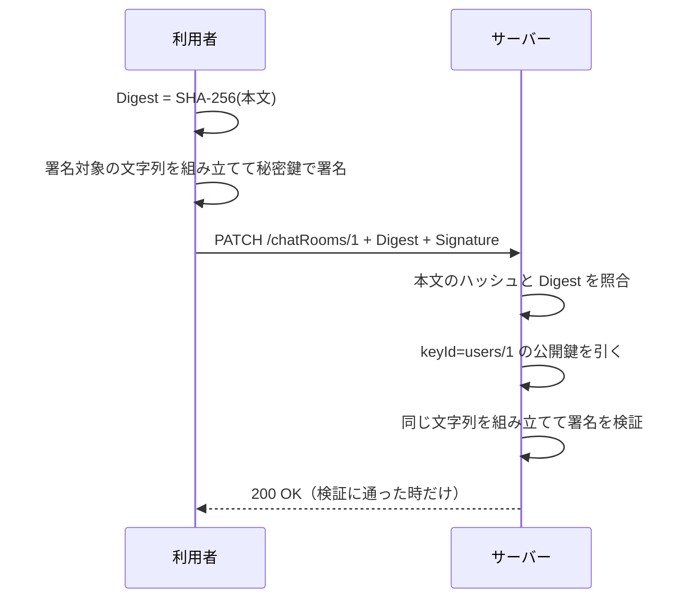

## 本記事の内容
- 『APIデザイン・パターン』(JJ Geewax 著、マイナビ出版) の第 30 章「リクエストの認証」を、Go で書き直しながら読んだメモです
- パターンを使わない実装と使う実装を同じ手順で動かして、何が変わるかを出力で確かめます
- 署名には書籍の RSA-SHA256 ではなく、Go の標準ライブラリにある `crypto/ed25519` を使っています。署名方式はヘッダの `algorithm` で伝えるので、仕組みは変わりません
- コードは Go 1.22 以降の `net/http` と標準ライブラリだけで動きます
- シリーズの目次は「[Go]APIデザインパターン 00: 目次と、パターンを使わないとどうなるか」にあります

## 1. 結論
利用者が鍵ペアを作り、公開鍵だけをサーバーに登録します。
リクエストを送るたびに、メソッド・パス・ホスト・日時・本文のハッシュを 1 つの文字列に並べ、それを秘密鍵で署名して `Signature` ヘッダに載せます。
サーバーは `keyId` で公開鍵を引いて署名を検証するので、誰が送ったか、途中で変えられていないか、後から「送っていない」と言えないか、の 3 つを 1 つの仕組みで確かめられます。

後から否認されないことまで要らないなら、共有鍵の HMAC や OAuth 2.0 のアクセストークンで足ります。
書籍自身が「多くの場面では過剰」と書いているパターンです。

## 2. 困る場面
利用者とサーバーが同じトークンを持ち、それをヘッダに載せるだけの認証を考えます。
困ることが 2 つあります。

トークンは本文と結びついていないので、途中で本文だけ差し替えられても、サーバーには分かりません。
もう 1 つは、サーバーもトークンを知っているので、「このリクエストは確かに利用者が送った」とサーバー以外の第三者に示せないことです。
サーバー自身が同じトークンで偽のリクエストを作れるからです。
健康情報や財務記録のように、後で監査される更新ではこれが問題になります。

4-2 で、差し替えた本文がそのまま通るところを見ます。

## 3. 足すもの
書籍はリクエスト認証の要件を 3 つに分けています。
発信元（誰が送ったか）、整合性（送った時のままか）、否認防止（後から「送っていない」と言えないか）です。
3 つ目を満たすには、利用者だけが持つ鍵で作れる証拠が要るので、利用者とサーバーで別の鍵を持つデジタル署名を使います。

利用者は最初に鍵ペアを作ります。
秘密鍵は手元に置いたまま、公開鍵だけを `POST /users` でサーバーに送って `users/1` のような識別子をもらいます。
サーバーに鍵を作らせない理由は、サーバーがコピーを持っていないことを証明できないからです。

リクエストには 2 つのヘッダを足します。

`Digest` には本文の SHA-256 を Base64 にして `SHA-256=...` の形で入れます。
本文そのものではなくハッシュを署名の対象にするのは、本文が大きくなりうるからです。

`Signature` には署名と、サーバーが同じ手順で検証するための情報を入れます。

| フィールド | 中身 |
|---|---|
| `keyId` | 公開鍵を引くための識別子。登録時の `users/1` |
| `algorithm` | 署名方式。本記事は `ed25519` |
| `headers` | 署名の対象にした項目と、その順番 |
| `signature` | 署名を Base64 にしたもの |

署名の対象は、リクエストを一意に表す文字列です。
メソッドとパスをまとめた `(request-target)`、`host`、`date`、`digest` を、ヘッダと同じ「名前: 値」の形で改行区切りに並べます。

```
(request-target): patch /chatRooms/1
host: localhost:8130
date: Wed, 28 Oct 2026 07:11:25 GMT
digest: SHA-256=HV9PltG0QPRNsl1FB7ebQA8XPasvPyRg6hhU0QF2l4M=
```

メソッド・パス・ホストまで入れるのは、本文が空の DELETE では「何をするか」がそこにしか無いからです。
`date` を入れておくと、古すぎるリクエストを捨てられます。

サーバー側の検証は、`Digest` と本文の照合、`Signature` の分解、`keyId` で公開鍵を引く、同じ文字列を組み立てて署名を検証する、の順です。
どこかで引っかかれば 401 Unauthorized を返します。

Go の型にするとこうなります。

```go
type User struct {
	ID        string `json:"id"`
	PublicKey string `json:"publicKey"` // ① base64 の ed25519 公開鍵
}

type SignatureMetadata struct { // ② Signature ヘッダの中身
	KeyID     string
	Algorithm string
	Headers   []string
	Signature string
}

var signedHeaders = []string{"(request-target)", "host", "date", "digest"}
```

- ① 書籍の `User` と同じです。秘密鍵のフィールドはどこにもありません
- ② `keyId="users/1",algorithm="ed25519",headers="(request-target) host date digest",signature="..."` を分解したものです

## 4. 前後比較
### 4-1. 使わない場合
`Authorization: Bearer <共有トークン>` が合っていれば通します。

```go
const sharedToken = "s3cr3t-shared-token" // ① 利用者とサーバーが同じ値を持つ

func main() {
	var mu sync.Mutex
	room := ChatRoom{ID: "chatRooms/1", Title: "General"}
	mux := http.NewServeMux()

	mux.HandleFunc("PATCH /chatRooms/1", func(w http.ResponseWriter, req *http.Request) {
		if req.Header.Get("Authorization") != "Bearer "+sharedToken { // ②
			http.Error(w, "unauthorized", http.StatusUnauthorized)
			return
		}
		var in ChatRoom
		if err := json.NewDecoder(req.Body).Decode(&in); err != nil {
			http.Error(w, "invalid json: "+err.Error(), http.StatusBadRequest)
			return
		}
		mu.Lock()
		room.Title = in.Title
		out := room
		mu.Unlock()
		writeJSON(w, http.StatusOK, out)
	})

	log.Fatal(http.ListenAndServe(":8030", mux))
}
```

- ① この値を知っていれば誰でも利用者になれます。サーバーも知っています
- ② ヘッダの値だけを見ます。本文が何であっても関係ありません

### 4-2. 動かすと差し替えた本文がそのまま通る
正しいリクエストを送った後、同じヘッダのまま本文だけを変えて送ります。

```
$ curl -s -i -X PATCH localhost:8030/chatRooms/1 \
    -H 'Authorization: Bearer s3cr3t-shared-token' -d '{"title":"New title"}'
HTTP/1.1 200 OK
Content-Type: application/json

{"id":"chatRooms/1","title":"New title"}

$ curl -s -i -X PATCH localhost:8030/chatRooms/1 \
    -H 'Authorization: Bearer s3cr3t-shared-token' -d '{"title":"tampered"}'
HTTP/1.1 200 OK
Content-Type: application/json

{"id":"chatRooms/1","title":"tampered"}

$ curl -s -i -X PATCH localhost:8030/chatRooms/1 -d '{"title":"no token"}'
HTTP/1.1 401 Unauthorized
Content-Type: text/plain; charset=utf-8

unauthorized
```

トークンが無ければ 401 になりますが、トークン付きで本文を `tampered` に変えたリクエストは 200 で通りました。
サーバーには、これが利用者の送った本文かどうかを確かめる手段がありません。

### 4-3. 使う場合（差分）
ハンドラの登録は、共有トークンの比較を外して `authenticate` で包むだけです。

```diff go
-const sharedToken = "s3cr3t-shared-token"
-
 func main() {
+	users := &userStore{users: map[string]User{}}
 	var mu sync.Mutex
 	room := ChatRoom{ID: "chatRooms/1", Title: "General"}
 	mux := http.NewServeMux()

-	mux.HandleFunc("PATCH /chatRooms/1", func(w http.ResponseWriter, req *http.Request) {
-		if req.Header.Get("Authorization") != "Bearer "+sharedToken {
-			http.Error(w, "unauthorized", http.StatusUnauthorized)
-			return
-		}
+	mux.HandleFunc("POST /users", func(w http.ResponseWriter, req *http.Request) { // ① 公開鍵の登録
+		var in User
+		if err := json.NewDecoder(req.Body).Decode(&in); err != nil {
+			http.Error(w, "invalid json: "+err.Error(), http.StatusBadRequest)
+			return
+		}
+		if pub, err := base64.StdEncoding.DecodeString(in.PublicKey); err != nil || len(pub) != ed25519.PublicKeySize {
+			http.Error(w, "publicKey must be a base64 ed25519 public key", http.StatusBadRequest)
+			return
+		}
+		writeJSON(w, http.StatusOK, users.create(in.PublicKey))
+	})
+
+	mux.HandleFunc("PATCH /chatRooms/1", authenticate(users, func(w http.ResponseWriter, req *http.Request) { // ②
 		var in ChatRoom
 		if err := json.NewDecoder(req.Body).Decode(&in); err != nil {
 			http.Error(w, "invalid json: "+err.Error(), http.StatusBadRequest)
 			return
 		}
+		log.Printf("server: PATCH /chatRooms/1 authenticated as %s", req.Context().Value(userKey{}))
 		mu.Lock()
 		room.Title = in.Title
 		out := room
 		mu.Unlock()
 		writeJSON(w, http.StatusOK, out)
-	})
+	}))
```

- ① 公開鍵が ed25519 の長さ（32 バイト）でなければ 400 で断ります
- ② 検証に通ったリクエストだけが中のハンドラに届きます

利用者側の署名と、サーバー側の `authenticate` はこう書きました。

```go
func signRequest(req *http.Request, body []byte, userID string, priv ed25519.PrivateKey) {
	req.Header.Set("Date", time.Now().UTC().Format(http.TimeFormat))
	req.Header.Set("Digest", digestHeader(body)) // ① 本文のハッシュ
	fp := fingerprint(req, signedHeaders)        // ② 署名の対象の文字列
	sig := ed25519.Sign(priv, []byte(fp))        // ③ 秘密鍵で署名
	req.Header.Set("Signature", buildSignatureHeader(SignatureMetadata{
		KeyID:     userID,
		Algorithm: "ed25519",
		Headers:   signedHeaders,
		Signature: base64.StdEncoding.EncodeToString(sig),
	}))
}

func authenticate(users *userStore, next http.HandlerFunc) http.HandlerFunc {
	return func(w http.ResponseWriter, req *http.Request) {
		body, err := io.ReadAll(req.Body)
		if err != nil {
			http.Error(w, "read body: "+err.Error(), http.StatusBadRequest)
			return
		}
		req.Body = io.NopCloser(bytes.NewReader(body))
		if req.Header.Get("Digest") != digestHeader(body) { // ④ 本文が変わっていれば不一致
			http.Error(w, "digest mismatch", http.StatusUnauthorized)
			return
		}
		meta, err := parseSignatureHeader(req.Header.Get("Signature"))
		if err != nil || meta.Algorithm != "ed25519" || strings.Join(meta.Headers, " ") != strings.Join(signedHeaders, " ") {
			http.Error(w, "bad signature header", http.StatusUnauthorized)
			return
		}
		if d, err := http.ParseTime(req.Header.Get("Date")); err != nil || time.Since(d).Abs() > 5*time.Minute { // ⑤
			http.Error(w, "stale date", http.StatusUnauthorized)
			return
		}
		user, ok := users.get(meta.KeyID)
		if !ok {
			http.Error(w, "unknown keyId", http.StatusUnauthorized)
			return
		}
		pub, _ := base64.StdEncoding.DecodeString(user.PublicKey)
		sig, _ := base64.StdEncoding.DecodeString(meta.Signature)
		if len(pub) != ed25519.PublicKeySize || !ed25519.Verify(pub, []byte(fingerprint(req, meta.Headers)), sig) { // ⑥
			http.Error(w, "signature invalid", http.StatusUnauthorized)
			return
		}
		next(w, req.WithContext(context.WithValue(req.Context(), userKey{}, user.ID)))
	}
}
```

- ①〜③ が利用者側です。`fingerprint` は 3 章の改行区切りの文字列を組み立てます
- ④ `Digest` の照合です。4-2 で通ってしまった「本文だけ差し替え」はここで止まります
- ⑤ 5 分より古い `Date` は捨てます。書籍の練習問題にあるリプレイ攻撃への、最低限の備えです
- ⑥ 公開鍵で署名を検証します。本文に合わせて `Digest` を付け直しても、署名は秘密鍵が無いと作り直せません

:::message
`req.Body` は 1 回しか読めないので、`io.ReadAll` で読んだ後に `io.NopCloser(bytes.NewReader(body))` を入れ直しています。
これを忘れると、中のハンドラの `json.NewDecoder(req.Body)` が空の本文を読みます。
:::

:::message
検証に通った利用者の ID は、`context.WithValue` で `req` に載せて中のハンドラに渡しています。
key に `userKey{}` という自分だけの型を使うのは、他のパッケージが同じ文字列の key を使っても衝突しないようにするためです。
:::

全文は畳んでおきます。
`main` は引数なしでサーバーとして動き、`client` を付けると同じプロセスでサーバーを起動したうえで、鍵の生成から改ざんの試行までを順に実行します。

:::details after/main.go の全文
```go
package main

import (
	"bytes"
	"context"
	"crypto/ed25519"
	"crypto/rand"
	"crypto/sha256"
	"encoding/base64"
	"encoding/json"
	"fmt"
	"io"
	"log"
	"net/http"
	"os"
	"strconv"
	"strings"
	"sync"
	"time"
)

const addr = "localhost:8130"

type User struct {
	ID        string `json:"id"`
	PublicKey string `json:"publicKey"`
}

type ChatRoom struct {
	ID    string `json:"id"`
	Title string `json:"title"`
}

type SignatureMetadata struct {
	KeyID     string
	Algorithm string
	Headers   []string
	Signature string
}

var signedHeaders = []string{"(request-target)", "host", "date", "digest"}

func digestHeader(body []byte) string {
	sum := sha256.Sum256(body)
	return "SHA-256=" + base64.StdEncoding.EncodeToString(sum[:])
}

// 署名の対象になる文字列
func fingerprint(req *http.Request, headers []string) string {
	host := req.Host
	if host == "" {
		host = req.URL.Host
	}
	lines := make([]string, 0, len(headers))
	for _, h := range headers {
		var v string
		switch h {
		case "(request-target)":
			v = strings.ToLower(req.Method) + " " + req.URL.Path
		case "host":
			v = host
		default:
			v = req.Header.Get(h)
		}
		lines = append(lines, h+": "+v)
	}
	return strings.Join(lines, "\n")
}

func buildSignatureHeader(m SignatureMetadata) string {
	return fmt.Sprintf(`keyId="%s",algorithm="%s",headers="%s",signature="%s"`,
		m.KeyID, m.Algorithm, strings.Join(m.Headers, " "), m.Signature)
}

func parseSignatureHeader(s string) (SignatureMetadata, error) {
	var m SignatureMetadata
	for _, pair := range strings.Split(s, ",") {
		k, v, ok := strings.Cut(pair, "=")
		if !ok {
			return m, fmt.Errorf("bad pair %q", pair)
		}
		v = strings.Trim(v, `"`)
		switch k {
		case "keyId":
			m.KeyID = v
		case "algorithm":
			m.Algorithm = v
		case "headers":
			m.Headers = strings.Fields(v)
		case "signature":
			m.Signature = v
		}
	}
	return m, nil
}

// ---- 利用者側 ----

func signRequest(req *http.Request, body []byte, userID string, priv ed25519.PrivateKey) {
	req.Header.Set("Date", time.Now().UTC().Format(http.TimeFormat))
	req.Header.Set("Digest", digestHeader(body))
	fp := fingerprint(req, signedHeaders)
	sig := ed25519.Sign(priv, []byte(fp))
	req.Header.Set("Signature", buildSignatureHeader(SignatureMetadata{
		KeyID:     userID,
		Algorithm: "ed25519",
		Headers:   signedHeaders,
		Signature: base64.StdEncoding.EncodeToString(sig),
	}))
}

// ---- サーバー側 ----

type userStore struct {
	mu    sync.Mutex
	seq   int
	users map[string]User
}

func (s *userStore) create(publicKey string) User {
	s.mu.Lock()
	defer s.mu.Unlock()
	s.seq++
	u := User{ID: "users/" + strconv.Itoa(s.seq), PublicKey: publicKey}
	s.users[u.ID] = u
	return u
}

func (s *userStore) get(id string) (User, bool) {
	s.mu.Lock()
	defer s.mu.Unlock()
	u, ok := s.users[id]
	return u, ok
}

type userKey struct{}

func authenticate(users *userStore, next http.HandlerFunc) http.HandlerFunc {
	return func(w http.ResponseWriter, req *http.Request) {
		body, err := io.ReadAll(req.Body)
		if err != nil {
			http.Error(w, "read body: "+err.Error(), http.StatusBadRequest)
			return
		}
		req.Body = io.NopCloser(bytes.NewReader(body))
		if req.Header.Get("Digest") != digestHeader(body) {
			http.Error(w, "digest mismatch", http.StatusUnauthorized)
			return
		}
		meta, err := parseSignatureHeader(req.Header.Get("Signature"))
		if err != nil || meta.Algorithm != "ed25519" || strings.Join(meta.Headers, " ") != strings.Join(signedHeaders, " ") {
			http.Error(w, "bad signature header", http.StatusUnauthorized)
			return
		}
		if d, err := http.ParseTime(req.Header.Get("Date")); err != nil || time.Since(d).Abs() > 5*time.Minute {
			http.Error(w, "stale date", http.StatusUnauthorized)
			return
		}
		user, ok := users.get(meta.KeyID)
		if !ok {
			http.Error(w, "unknown keyId", http.StatusUnauthorized)
			return
		}
		pub, _ := base64.StdEncoding.DecodeString(user.PublicKey)
		sig, _ := base64.StdEncoding.DecodeString(meta.Signature)
		if len(pub) != ed25519.PublicKeySize || !ed25519.Verify(pub, []byte(fingerprint(req, meta.Headers)), sig) {
			http.Error(w, "signature invalid", http.StatusUnauthorized)
			return
		}
		next(w, req.WithContext(context.WithValue(req.Context(), userKey{}, user.ID)))
	}
}

func writeJSON(w http.ResponseWriter, status int, v any) {
	w.Header().Set("Content-Type", "application/json")
	w.WriteHeader(status)
	json.NewEncoder(w).Encode(v)
}

func newServer() http.Handler {
	users := &userStore{users: map[string]User{}}
	var mu sync.Mutex
	room := ChatRoom{ID: "chatRooms/1", Title: "General"}
	mux := http.NewServeMux()

	mux.HandleFunc("POST /users", func(w http.ResponseWriter, req *http.Request) {
		var in User
		if err := json.NewDecoder(req.Body).Decode(&in); err != nil {
			http.Error(w, "invalid json: "+err.Error(), http.StatusBadRequest)
			return
		}
		if pub, err := base64.StdEncoding.DecodeString(in.PublicKey); err != nil || len(pub) != ed25519.PublicKeySize {
			http.Error(w, "publicKey must be a base64 ed25519 public key", http.StatusBadRequest)
			return
		}
		writeJSON(w, http.StatusOK, users.create(in.PublicKey))
	})

	mux.HandleFunc("PATCH /chatRooms/1", authenticate(users, func(w http.ResponseWriter, req *http.Request) {
		var in ChatRoom
		if err := json.NewDecoder(req.Body).Decode(&in); err != nil {
			http.Error(w, "invalid json: "+err.Error(), http.StatusBadRequest)
			return
		}
		log.Printf("server: PATCH /chatRooms/1 authenticated as %s", req.Context().Value(userKey{}))
		mu.Lock()
		room.Title = in.Title
		out := room
		mu.Unlock()
		writeJSON(w, http.StatusOK, out)
	}))
	return mux
}

// ---- デモ用の利用者 ----

func do(label string, req *http.Request) {
	resp, err := http.DefaultClient.Do(req)
	if err != nil {
		log.Fatal(err)
	}
	defer resp.Body.Close()
	b, _ := io.ReadAll(resp.Body)
	log.Printf("client: %s -> %s %s", label, resp.Status, strings.TrimSpace(string(b)))
}

func runClient() {
	base := "http://" + addr
	pub, priv, err := ed25519.GenerateKey(rand.Reader) // 秘密鍵 priv はこのプロセスの外に出ない
	if err != nil {
		log.Fatal(err)
	}
	reg, _ := json.Marshal(User{PublicKey: base64.StdEncoding.EncodeToString(pub)})
	resp, err := http.Post(base+"/users", "application/json", bytes.NewReader(reg))
	if err != nil {
		log.Fatal(err)
	}
	var user User
	json.NewDecoder(resp.Body).Decode(&user)
	resp.Body.Close()
	log.Printf("client: registered as %s (publicKey=%s)", user.ID, user.PublicKey)

	body := []byte(`{"title":"New title"}`)
	req, _ := http.NewRequest(http.MethodPatch, base+"/chatRooms/1", bytes.NewReader(body))
	signRequest(req, body, user.ID, priv)
	log.Printf("client: Digest: %s", req.Header.Get("Digest"))
	log.Printf("client: Signature: %s", req.Header.Get("Signature"))
	do("signed request", req)

	tampered := []byte(`{"title":"tampered"}`)
	req2, _ := http.NewRequest(http.MethodPatch, base+"/chatRooms/1", bytes.NewReader(tampered))
	req2.Header = req.Header.Clone() // 途中で本文だけ書き換えられた
	do("body tampered, headers copied", req2)

	req3, _ := http.NewRequest(http.MethodPatch, base+"/chatRooms/1", bytes.NewReader(tampered))
	req3.Header = req.Header.Clone()
	req3.Header.Set("Digest", digestHeader(tampered)) // Digest も付け直したが、秘密鍵が無いので署名は古いまま
	do("body tampered, digest recomputed", req3)
}

func main() {
	log.SetFlags(0)
	if len(os.Args) > 1 && os.Args[1] == "client" {
		go func() { log.Fatal(http.ListenAndServe(addr, newServer())) }()
		time.Sleep(50 * time.Millisecond)
		runClient()
		return
	}
	log.Fatal(http.ListenAndServe(addr, newServer()))
}
```
:::

### 4-4. 同じ手順で動かすと差し替えた本文は 401 になる
`client` モードで実行した出力です。
鍵を作って登録し、署名付きで送り、そのあと 4-2 と同じように本文だけを差し替えて送っています。

```
$ go run ./ch30/after client
client: registered as users/1 (publicKey=vDHDVwUFcVYo9A8uk+Hw66Crl8mbGMInigsc0uFcqlY=)
client: Digest: SHA-256=HV9PltG0QPRNsl1FB7ebQA8XPasvPyRg6hhU0QF2l4M=
client: Signature: keyId="users/1",algorithm="ed25519",headers="(request-target) host date digest",signature="JL7JR+JRu29/mfjBhgNDZCGMUsdOl6DRiLdJf0Ftu18WxZStD8FoP6DQsVml8cFmjsl/hTXsCqhMnLWrFYSyDw=="
server: PATCH /chatRooms/1 authenticated as users/1
client: signed request -> 200 OK {"id":"chatRooms/1","title":"New title"}
client: body tampered, headers copied -> 401 Unauthorized digest mismatch
client: body tampered, digest recomputed -> 401 Unauthorized signature invalid
```

署名付きの正しいリクエストは 200 で通り、サーバー側のログに `users/1` として記録されました。
同じヘッダのまま本文を変えたものは `Digest` の照合で、`Digest` を付け直したものは署名の検証で、どちらも 401 になっています。

`Digest` の値 `HV9PltG0QPRNsl1FB7ebQA8XPasvPyRg6hhU0QF2l4M=` は、書籍のリスト 30.6 に載っている例と同じです。
本文が同じ `{"title":"New title"}` なので、SHA-256 も同じになります。

署名を付けずに curl で送ると、最初の照合で止まります。

```
$ curl -s -i -X PATCH localhost:8130/chatRooms/1 -d '{"title":"no signature"}'
HTTP/1.1 401 Unauthorized
Content-Type: text/plain; charset=utf-8

digest mismatch
```

## 5. 1 リクエストの流れ
署名付きの `PATCH /chatRooms/1` が、利用者の手元を出てからハンドラに届くまでを追います。
送る側を利用者、受ける側をサーバーと呼びます。

1. 利用者は本文の SHA-256 を Base64 にして `Digest` ヘッダに入れる
2. `(request-target)`、`host`、`date`、`digest` を改行区切りに並べた文字列を作る
3. その文字列を秘密鍵で署名し、`keyId`・`algorithm`・`headers` と一緒に `Signature` ヘッダに入れて送る
4. サーバーは本文を読み切り、SHA-256 を計算して `Digest` と比べる。違えば 401
5. `Signature` を分解し、`algorithm` と `headers` が想定どおりか、`Date` が 5 分以内かを確かめる。違えば 401
6. `keyId` の `users/1` で登録済みの公開鍵を引く。無ければ 401
7. 受け取ったリクエストから 2 と同じ文字列を組み立て、公開鍵で署名を検証する。合わなければ 401
8. 通ったら `context` に `users/1` を載せて、本来のハンドラに渡す



## 6. 疑問と答え
読みながら引っかかったところです。

**発信元を確かめられれば、否認防止も自動的に満たされるのでは**
共有トークンや HMAC では、サーバーも同じ鍵を持っているので、サーバー自身が利用者になりすました署名を作れます。
第三者から見ると「利用者が送った」と「サーバーが偽造した」を区別できません。
秘密鍵を利用者しか持たない非対称の鍵にして初めて、否認防止になります。

**TLS を使っていれば整合性は要らないのでは**
TLS が守るのは通信経路で、リクエストそのものの検証ではありません。
TLS を終端したプロキシの先で変えられたものや、後からログを見て検証したい場合には役に立ちません。
書籍は、ネットワーク層に頼るのは「正しく送られてきたと仮定して額面どおり受け取ること」だと書いています。

**なぜメソッドやパスまで署名に入れるのか**
`DELETE /chatRooms/1` の本文は空なので、何をするかはメソッドとパスにしかありません。
本文だけを署名していると、同じ署名を別のパスに使い回されても気付けません。

**JSON のキーの順番が変わっただけで検証に失敗しないか**
失敗します。
署名はバイト列に対して計算するので、意味が同じでもバイト列が違えば別物です。
だからサーバーは受け取った本文をそのまま使い、自分で JSON を組み直してから検証してはいけません。

**同じリクエストをそっくり再送されたら通ってしまうのでは**
通ります。
本記事のコードは `Date` を署名に含めて 5 分より古いものを捨てていますが、5 分以内の再送は防げません。
完全に防ぐなら、第 26 章の `requestId` のような 1 回限りの値を署名の対象に加えて、サーバーで使用済みを記録します。

**鍵はサーバーで作って利用者に配ってもよいのでは**
サーバーがコピーを持っていないことを、サーバー自身が約束する以外に証明できなくなります。
秘密鍵がネットワークを通る時点で傍受の可能性も生まれるので、利用者の手元で作って公開鍵だけを送ります。

ここまでを自分の言葉でまとめると、利用者だけが持つ秘密鍵で「メソッド・パス・ホスト・日時・本文のハッシュ」を署名し、サーバーは登録済みの公開鍵で同じものを検証する、です。

## 7. トレードオフ
得られるのは、送信元の確認と改ざんの検知に加えて、後から利用者が「送っていない」と主張できなくなることです。
引き換えに、リクエストごとに非対称鍵の署名と検証が走るので計算コストが高く、利用者側にも鍵の管理と署名の実装が求められます。
TLS でさえ最初の鍵交換にだけ非対称鍵を使い、その後は対称鍵に切り替えているくらいです。

書籍は、否認防止が本当に必要なのは第三者が後から検証する場面や、健康情報・財務記録のような更新に限られる、と書いています。
それ以外では HMAC や OAuth 2.0 のアクセストークンのほうが妥当なことが多い、というのが書籍の立場です。

## 8. 参考
- 『APIデザイン・パターン』JJ Geewax 著、マイナビ出版、第 30 章
