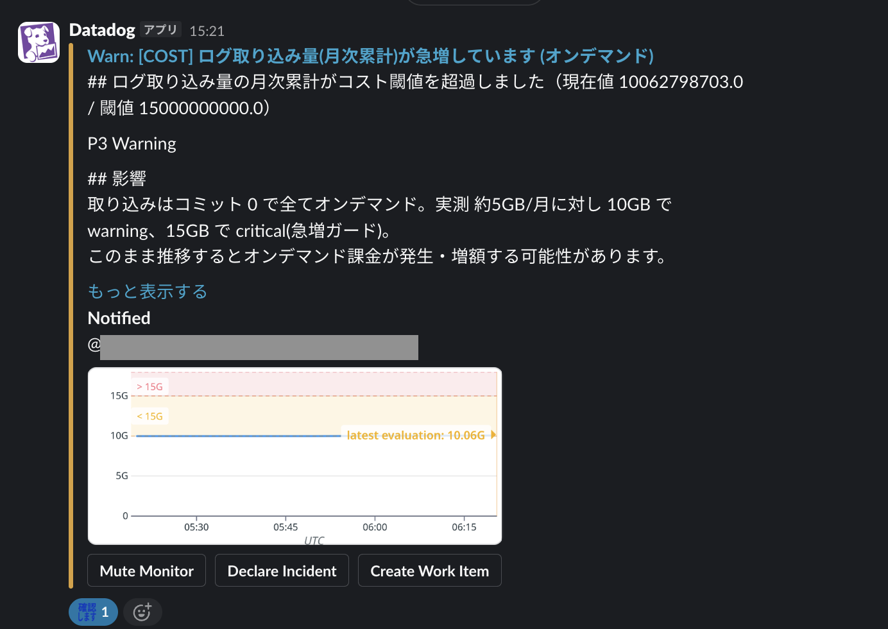
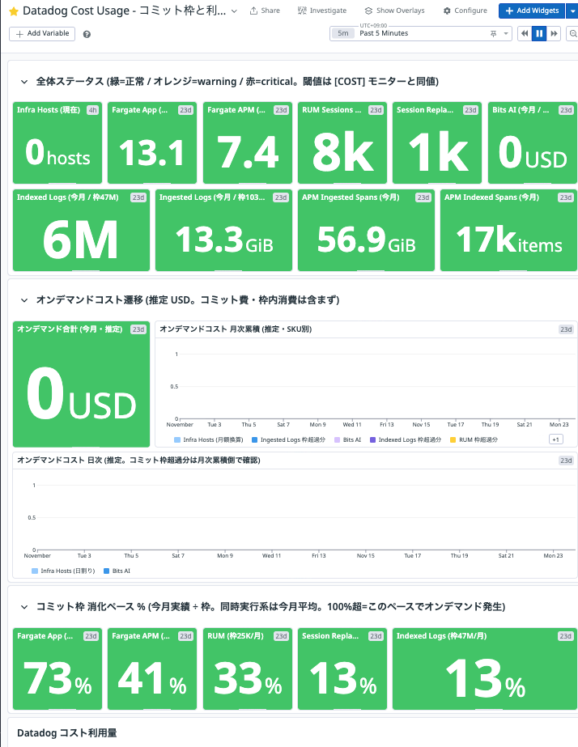

SREとして働いているtakehiro1111です！  
弊社ではオブザーバビリティツールとしてDatadogを運用しています。

今回はDatadogの導入前後で考えたことや判断したことを振り返って記録として残します。
特にツールは何を選ぶかトレードオフであり正解がない中での選択になるため、事例として少しでも参考になれば嬉しいです！

## この記事で書くこと

- 導入前に抱えていた主な課題
- Datadogを選定するまでに考えたこと、判断基準
- 設計段階で判断したこと
- 実装でハマった点
- 運用でやったこと

## 前提

弊社の運用体制とメインプロダクトで採用している技術スタックです。

- FE: TypeScript, React
- BE: Go
- DB: MySQL(Aurora)
- Infra: AWS(ECS Fargate)
- IaC: AWS CDK
- CI/CD: GitHub Actions
- 役割: 開発者がインフラも含めて技術横断的に対応しています。
- AI: Claude Codeを中心にAIをフル活用してスピード感を持って開発に取り組んでいます。

## 導入前に抱えていた主な課題
- 少人数体制のため、専任のSREがおらず横断的にプロダクトの基盤を整備する工数が作れない。
- ユーザー目線での可観測性を得られていない。
  - CloudWatchでエラーログを見たり、メトリクスのアラートを通知するだけに留まっている。

## 1. Datadogを選定するまでに考えたこと、判断基準

私がTRIPLE THREEに参画した2026/5に調査から始めました。  
まずは弊社にとってどんな状態が望ましいかを考えながら整理し、その課題を解決するための手段となり得るツールを調査し、最終的な方向性をCTOと決めていきました。

### 1-1. 調査段階

導入前の時点での状況を整理し、開発組織やプロダクトにとってどんな状態であるべきかを考えました。

どう在りたいかという点はCTOと壁打ちしながら擦り合わせしましたが、元から一定の共通認識は持つことができていたため、擦り合わせにはさほど時間がかかりませんでした。

そのため、オブザーバビリティを獲得するための手段になるツール選定に時間をかけました。  
各ツールの特徴を調査、整理し、比較しながら消去法で絞っていく進め方で対応しました。

:::details 調べたツールの一覧（2026年5月の調査時点）

| 区分 | カテゴリ                 | ツール                                 | 構成・特徴                                                      | 気になった点                                                                                                   |
| ---- | ------------------------ | -------------------------------------- | --------------------------------------------------------------- | -------------------------------------------------------------------------------------------------------------- |
| AWS  | ログ                     | S3 + Athena + Redash                   | ログをS3に置いてクエリする                                      | 容量の上限、ライフサイクルポリシー、ストレージクラスの設計を自分たちで持つ必要がある。即時検索には向いていない。 |
| AWS  | ログ                     | Data Firehose + OpenSearch + Kibana    | Fluent Bitで送ったログをOpenSearchに集約して検索する            | OpenSearchの固定費が高い。Kibanaのテンプレート管理の工数も必要になる。                                         |
| AWS  | ログ / 監視              | CloudWatch Logs + Lambda               | ERRORなどのログを検知してSlackに通知する                        | Lambdaのコード保守や、リトライ・冪等性の設計が必要。                                                           |
| AWS  | ログ                     | CloudWatch Logs + Insights / Dashboard | CloudWatchのコンソールで検索・可視化する                        | ログ・メトリクス・トレースを横断して辿るのが難しい。  |
| SaaS | ログ / 監視 / メトリクス | Datadog                                | ログ・APM・インフラ・RUMを1つにまとめる                         | ツールとして魅力的だが、課金項目が多く、試算で約9〜13万円/月と他手段と比較するとコストが高くなる想定。         |
| SaaS | ログ / 監視 / メトリクス | New Relic                              | 取り込みデータ量とユーザー数で課金                              | ユーザー数に応じた課金形態が合わなさそう。                                                                                   |
| SaaS | ログ / 監視 / メトリクス | Mackerel                               | 国産の監視サービスで、日本語サポートがある                      | 調査時点では、APM・分散トレースはDatadog / New Relicほど充実していない印象。                                                     |
| SaaS | 監視                     | Sentry                                 | アプリのエラー監視                                              | インフラメトリクスは対象外。                                                                                   |
| SaaS | ログ / 監視 / メトリクス | Dynatrace                              | エンタープライズ向けの統合プラットフォーム                      | 年間コミットの契約が前提。                                                 |
| OSS  | 監視 / メトリクス        | Prometheus + Alertmanager + Grafana    | ECS Fargateでセルフホストしてメトリクス監視・通知・可視化をする | 3つとも自分たちで構築・運用する必要があり、運用コストが高い。                                                  |
| OSS  | 監視                     | Uptime Kuma                            | ECS FargateでセルフホストしてURL監視をする                      | Uptime Kuma自体の監視も必要。                                                                                  |

:::

この中から、費用や機能のカバー範囲、運用工数のバランスでNew Relic / Sentry / Datadogを比較しました。
この時点で各ツールに対する所感は以下です。

#### New Relic
  - 今の規模なら月100GBの無料枠に収まる可能性が高く、費用面ではDatadogより有力。
  - アカウント数や権限レベルでの課金が組織設計と合うか、組織がスケールした時に足かせにならないかがリスクになり得る。

#### Sentry + AWS
  - アプリ内部のエラー監視が本職で、CPUやメモリなどのインフラメトリクスは守備範囲外。  
  - 単一のプラットフォームで運用が完結しない点は欠点。  
  - 比較的コストが低いため、妥協案として選択肢に残す。

#### Datadog
  - 機能が豊富でAIネイティブな開発との相性が良い。  
  - トレース・メトリクス・ログを結びつけてユーザーの行動を辿ることができ、ビジネス的にスケールするための狙いとしても魅力的。  
  - 課金項目が多数あり、監視対象や機能を増やすほど費用が想定より上がる可能性が高い点が懸念でした。

### 1-2. 判断基準

#### 1. 運用時の工数を抑えられるか

- 中長期的にもオブザーバビリティツールの保守に割く時間を減らしたいため、用途によってプラットフォームを分けず、開発者の負担を最小限に運用できるか。

#### 2. 情報を取得する際のUI/UXが良いか

- ログ・トレース・メトリクスを紐付けて辿れるか
  - 従来のインフラ周りの監視だけでなく、可観測性の文脈で必要な情報を把握しユーザー目線で改善に向けた取り組みに繋げられるか。
- 開発者がある程度直感的に操作できるUI

#### 3. コストとリターンが見合いそうか

- 開発組織と課金体系の相性
  - 基本的なスタンスとして、アカウント数での課金は避けたい。
- 事業をスケールするための投資になり得るか。

#### 4. AIネイティブな開発組織での相性

- 公式のMCPサーバーが提供されているか
  - 当時、Datadog MCPがリリースされて間もないタイミングでした。
  - Claude Codeからログ・トレース・メトリクスを直接取得し、障害調査や原因の切り分けをAIと進めたい。

### 1-3. 選定結果

最終候補は次の2案に絞られました。  
可観測性をしっかり実現してより成長を見据えた投資をするか、目先の費用とプロダクトのフェーズを優先した妥協案にするかです。

```md
A. Sentry + AWS(CloudWatch, Athena + S3)
→ 約3〜5万円/月

B. Datadogで統合
→ 約9〜13万円/月
```

前提として、Datadogは契約上、最低でも500ドルのコミットが必要です。

ブログタイトルからネタバレしていますが、結論としてDatadogを選定しました。 
最終的には目先のコストを抑える方向ではなく、より事業成長を加速させるためのツールという考え方を優先しました。
具体の理由は以下です。
- AIネイティブな開発スタイルとの相性
- 開発者がプロダクトの信頼性向上にコミットする組織体制の方針に合う
- 単一プラットフォームに集約できる点が運用時の負担が低い。
- GUIの画面が直感的で他ツールより操作しやすそう。
- ログ・トレース・メトリクスを紐付けて、最終的に特定ユーザーの行動まで辿れるためビジネス面での施策に活かせそう。
  - プリセールスの方のRUMのデモが良かったです(笑)

この時点でCTOが予算取りの調整も並行して進めていただき、スピード感を持って判断できたため、凄く感謝しています！

## 2. 設計段階で判断したこと

スモールスタートで小さく早く運用開始することを優先とし、大枠として以下内容で実装、設定しました。

### 2-1. 計装と設定の責務を分ける

- 計装（Agent・ログ転送・APM・RUM）は各プロダクトのアプリとCDKで行う
  - アプリの実装やECSのタスク定義に依存するため、各プロダクトのリポジトリ内で実装する。
- 収集したデータに対するmonitor / dashboard / SLOなどの設定は、DatadogのTerraform専用リポジトリで管理する
  - monitorやdashboardはプロダクト横断的にテンプレート化したいため。

### 2-2. ECSにはAgentとFluent Bitをサイドカーで入れる

ログだけでなくメトリクスとAPMも取り込みたいため、Datadogが提供するCDKのConstruct（`datadog-cdk-constructs-v2`の`DatadogECSFargate`）を使いました。  
タスク定義を直接書き換えるより記述量が少なく、各プロダクトへ横展開しやすいことも理由です。

AgentとFluent Bit（ログルーター）では、止まった時の扱いを逆にしています。

- Datadog Agent
  - トレースとメトリクスをDatadogへ送る。
  - Agentが止まってもアプリのコンテナは動き続ける。
  - トレースとメトリクスの収集のためにサービスを止めないよう、可用性を重視。
- Fluent Bit
  - アプリのログを、Agentを通さずにDatadogへ直接送る。
  - Fluent Bitが止まったらタスクごと止め、ECSのサービスに新しいタスクを起動させる。
  - ログの取りこぼしを避けたい。
  - AWSの[ドキュメント](https://docs.aws.amazon.com/ja_jp/AmazonECS/latest/developerguide/firelens-taskdef.html)でも、ログルーターのコンテナは必須コンテナ（止まるとタスクごと止まるコンテナ）にすることが推奨されている。

サイドカーが増える分、CPU / メモリが逼迫して起動できない、OOMになる、性能が落ちる等の可能性もあります。  
その場合はタスク定義のスペックを増やす前提で各プロダクトへ展開しました。

### 2-3. APMは自動計装にする

GoアプリのAPMは、Orchestrionによるコンパイル時の自動計装にしました。  
`orchestrion go build`がビルド時に`net/http`・`go-chi`・`database/sql`などへスパンを作るコードを挿入するため、アプリのコードを変更せずにトレースを送れます。

手動計装に切り替える時にベンダーロックインをどこまで避けるかも検討しましたが、導入段階では気にせずDatadogのライブラリの実装に寄せる方針にしました。  
運用中の段階で自動計装では満たせない課題が出てから、部分計装やOpenTelemetryでの計装への移行を検討しようと考えていました。
とにかくまずはスピード感を持って運用まで持っていき、必要なタイミングで改善すれば良いという方針で対応しました。

### 2-4. タグを揃える

`service`と`env`のタグがAgent・ログ・トレースでずれると、同じサービスとして紐付かず、横断検索もできなくなります。
そのためCDKの中でservice名を1つの変数にし、Agentとログドライバの両方に同じ値を渡すことにしました。

### 2-5. アラートの優先度をP1〜P5で定義する

優先度はCTOや各プロダクトの開発者と一緒に決めました。
事前に全てを厳密に定義するよりも、まずはP1〜P3から設定し、走りながら改善する方針で対応しました。

| Priority | 基準                                           |
| -------- | ---------------------------------------------- |
| P1       | ユーザーがサービスを利用できない               |
| P2       | 一部機能に影響がある、または放置するとP1になる |
| P3       | 品質劣化はあるが機能は使える                   |
| P4       | 将来的にリスクになる兆候がある                       |
| P5       | 情報収集・改善提案                             |

#### 通知先の判断

- P1
  - 事業影響にクリティカルな事象を想定しているため、プロダクト横断で特定のSlackチャンネルに通知させています。
- P2/P3
  - 各プロダクトの専用のSlackチャンネルに通知しています。
- P4/P5
  - 該当する事象はmonitorの設定をせず通知していません。
    - 重要な内容ではない事象まで通知しても、アラート疲れやオオカミ少年化に繋がりやすいためです。

### 2-6. Terraformでの構成管理は運用開始後にimportで対応する

2週間のトライアル期間に色々検証したいため、運用までのリードタイムを短くする観点で、Terraformでの構成管理は運用開始後にimportで対応することにしました。

## 3. 実装でハマった点

### 3-1. ECSのサイドカー設定

#### 3-1-1. ログがJSONとして解釈されない

アプリはJSONでログを出しているのに、Datadog上ではテキストとして入ってしまい、`@http.status_code`のような属性で検索できませんでした。
原因はFluent Bitの`isParseJson`で、デフォルトのfalseのままだとJSONを解釈せずに送ります。
そのため、trueにしてDatadog上でJSONとして扱うようにしました。

```ts
firelensOptions: {
  isParseJson: true,
},
```

#### 3-1-2. ログがトレースと紐付かない

アプリのコンテナのログが、serviceが空、sourceが`undefined`の状態で取り込まれていました。
serviceは、ログとトレースを同じサービスのものとして紐付けるための値で、空のままでは紐付きません。
Fluent Bitの設定で、`serviceName`にトレースと同じservice名を、`sourceName`に`go`を指定しました。

```ts
logDriverConfig: {
  serviceName: ddService,
  sourceName: "go",
},
```

トレースのservice名には、同じ変数を`service`に渡しています。

```ts
service: ddService,
```

#### 3-1-3. CDKのsynthが落ちる

`isLogRouterEssential: true`にしたところ、CDKのsynthがエラーになりました。
CDKは、タスク定義へ最初に追加された必須コンテナを、ALBがトラフィックを送るコンテナとして扱います。
ログルーターがアプリより先に追加されるため、ポートマッピングの無いログルーターが選ばれていました。
ターゲットにアプリのコンテナとポートを明示的に指定して解消しました。

```ts
targets: [
  fargateService.loadBalancerTarget({
    containerName: "server",
    containerPort: 80,
  }),
],
```

### 3-2. ログの標準化

アプリのアクセスログとアプリケーションログの課題を洗い出し、まずはアクセスログ中心に整備しました。
ロギングは色々と課題が多くまだ対応しきれていないですが、最低限のところは改善するよう努めました。

- アクセスログを出力していないプロダクトへの実装
- 属性をDatadogの標準属性（`http.method` / `http.status_code` / `duration`など）に揃える
- ステータスコードに応じてログレベルを分ける
- `http.route`にchiのルートパターンを入れ、エンドポイント単位で集計できるようにする
- ログにトレースIDを付け、ログとトレースを双方向に辿れるようにする
- `duration`をナノ秒で出す
- ユーザーIDを`usr.id`に文字列で出す
  - 現在対応中ですが、ID基盤を整備しプロダクト横断で同じユーザーを同じIDで辿れるようにする予定です。
- chiのテキスト形式のログを削除し、JSONの構造化ログに寄せる
- `X-Forwarded-For`ヘッダが複数あっても送信元のIPアドレスを取れるようにし、IPアドレスの形式も検証する
- WebSocketやストリーミングのレスポンスでもアクセスログのミドルウェアが動くようにする
- 個人情報や資格情報をログに出さないようにする
- Datadogのパイプラインでも個人情報をマスクする

## 4. 運用でやったこと

### 4-1. ダッシュボード作成のプレゼン大会
ダッシュボードは開発組織内でプレゼン大会を開催して、ワイワイしながら作りました！

作ったのは「システムヘルスチェック」、「ユーザ行動分析」、「SRE用ダッシュボード」、「CTO専用ボード」の4種類です。
主に開発者同士でプレゼンし合ったのは、システムヘルスチェック、ユーザ行動分析の2種類です。

- システムヘルスチェック
  - プロダクト開発者がリリース前後にサービスの健全性を確認するためのダッシュボードです。
- ユーザ行動分析
  - 機能開発のアイデア出しや施策の効果測定、リリースした機能の利用状況の確認に使います。
  - ユーザーの傾向も把握できるため、ビジネス面での施策に活かせそうと感じました。

同じテーマでも、前日比で変化を検出する人、プロダクトを横断して比較する人、機能の利用ランキングを出す人がいて、作る人によって見たい視点が違うため興味深く楽しく作ることができました。
最後に、各メンバーのダッシュボードから良い視点を集めて、統合版のダッシュボードにまとめました！

### 4-2. Terraform化

設計時点で決めていたとおり、Terraformでの構成管理は運用開始後に対応しました。
既にDatadog上に作っていたmonitorやダッシュボードを`import`ブロックで取り込みました。

#### 4-2-1. ディレクトリ設計

ディレクトリはプロダクトごと・環境ごとに分け、1ディレクトリを1つのstateにしました。
stateの`key`はリポジトリのルートからの相対パスと必ず同じにして、ディレクトリとstateを1対1で対応させています。
現在は最低限のプロダクトと環境にしかDatadogを利用していませんが、今後プロダクトがスケールしてより信頼性の優先度が上がる場合を想定して拡張性のあるディレクトリ設計を意識しました。

```zsh
datadog-terraform/
├── <product_name>/
│   └── prod/            # プロダクト固有のmonitorやRUM
├── shared/              # プロダクトを横断する設定
│   ├── dashboard/
│   ├── logs/
│   ├── monitor/
│   ├── cost/
│   └── aws_integration/
├── modules/
│   ├── alert_message/   # monitorの通知メッセージのテンプレート
│   └── variable/        # 複数のstateから参照する定数
```

#### 4-2-2. GitOpsでのCI/CD

Datadogの設定は、PRのマージで反映するGitOpsの形で変更しています。
mainブランチ向けのPRを作ると、変更したディレクトリだけ`terraform plan`が走り、結果がPRのコメントに出ます。
レビューを受けてマージすると、そのディレクトリに`terraform apply`が走ります。
この部分にはDiggerとGitHub Actionsを使っています。

一方で、applyをCI/CDだけに厳しく縛ってはおらず、手元でのplanとapplyも許しています。
管理しているのは監視の設定だけで、問題があっても修正してapplyし直せば済むためです。

#### 4-2-3. Claude Codeでの運用

Datadogの設定を変える作業は、Claude Codeで進められるようにしています。
リポジトリには、アラートの通知メッセージやダッシュボードの書き方をClaude Code向けのルールとして置き、DatadogのMCPサーバーにも繋がるようにしました。
Issueの内容を実装してPRを作るところまでも、スキルとして用意しています。
問題発見〜課題の立案と対策の提示はAIが自律的に対応してPRを作成し、人間が承認するだけの状態にしています。

定期的な点検もClaude Codeに任せています。
毎週月曜にGitHub ActionsからClaude Codeを起動し、次の3つを確認しています。

- Datadogの画面上で変更されたダッシュボードを検出し、Terraformのコードを追従させるPRを作る
- Terraformで管理していないmonitorなどを検出し、importするPRを作る
- DatadogのMCPで実際のデータを見て、監視の過不足やしきい値をレビューし、Issueを起票する
  - 指摘を無理に作らせないよう、課題が無ければ何も起票しないルールにしています。

PRがマージされた後のドキュメントの更新も、Claude CodeがPRを作る形にしました。

### 4-3. Datadog自体のコスト監視
Datadogで予めコミットしている設定以外のものを使用していないか、または容量を超過していないかを検知できるようにダッシュボードとアラート通知で監視しています。  
コストの超過は障害ではないため、アラートは便宜上P3に分類しています。





### 4-4. アラートの一次調査の自動化

弊社には`TRIPLE ASK`という、Slackでメンションすると裏でClaude Codeが動く社内Botがあります。
DatadogのアラートがSlackに通知されると、ASKがログ・トレース・コードを調べて、スレッドに調査結果を返してくれます。
気になる方はこちらの記事をご覧ください！

@[card](https://zenn.dev/triplethree/articles/d6a9a9d6935256)

## 最後に

現状では最低限の部分しか整備できておらず、課題はまだ沢山あります。
ただ、ツールを使うこと自体を目的にはしません。
事業やプロダクトのフェーズにとって今何が必要なのかを都度判断し、コストも考慮しながらより使いこなしていきたいです！

## We're Hiring!

TRIPLE THREEでは、少人数 × AI前提で開発も業務も回す仲間を募集しています！
カジュアル面談もやっているので、話だけでも聞いてみたい！という方も大歓迎です。
興味のある方は是非のぞいてみてください！

@[card](https://www.333-inc-intra.com/?v=18ad08d1a1f581ae9317000cc9071a00)
